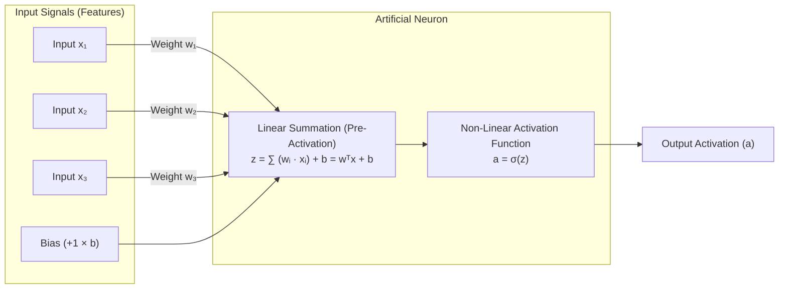
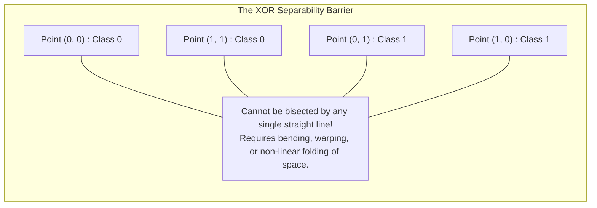
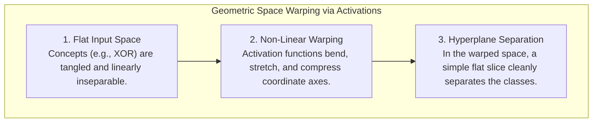
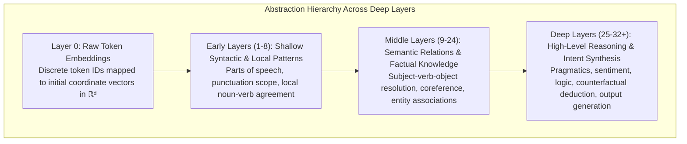
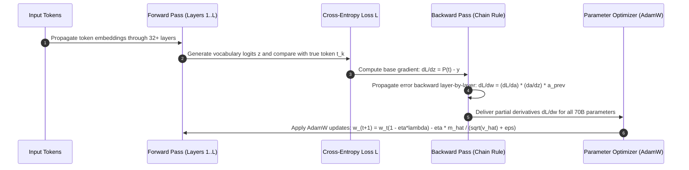
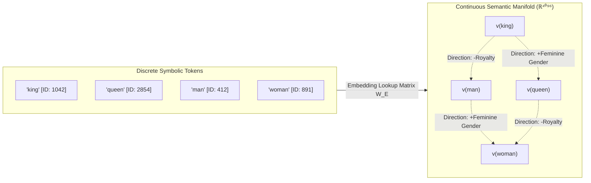

# Chapter 1: Foundations of Neural Computation

## 1. Executive Summary & Narrative Arc

At its most fundamental level, modern Artificial Intelligence represents a profound paradigm shift in how humanity instructs machines. For seventy years, the dominant paradigm in computer science was **symbolic AI** (often called *Good Old-Fashioned AI* or *GOFAI*). In symbolic AI, human programmers conceive explicit rules, encode them in deterministic conditional logic (`if-then-else`), and compile them into CPU instructions. This paradigm excelled at arithmetic, relational databases, formal logic, and deterministic algorithms. However, it hit an insurmountable brick wall when confronted with tasks that biological brains solve effortlessly: recognizing a handwritten digit, understanding poetic irony, detecting sarcasm, or synthesizing an argument across thousands of technical documents. Real-world phenomena are simply too fuzzy, ambiguous, and context-dependent to capture in handwritten `if` statements.

Large Language Models (LLMs) belong to an alternative lineage: the **connectionist** paradigm. Instead of handcrafting rules, connectionism builds networks of elementary computational units—artificial neurons—wired together in layered topologies. Knowledge in a connectionist system is not stored in explicit lines of executable code or symbolic database rows; it is distributed across millions or billions of continuous **floating-point parameters** (weights and biases). A floating-point parameter is simply a fractional decimal number (such as `0.4281` or `-1.054`, typically stored in GPU memory as a 16-bit or 32-bit float) that acts as an adjustable tuning knob. Rather than being programmed, these parameters are discovered through exposure to vast amounts of data via mathematical optimization.

To understand why a 70-billion-parameter Transformer can write code, pass medical licensing exams, or engage in nuanced philosophical debate, we must strip away the anthropomorphic marketing terminology and inspect the elementary physics of neural computation:
1. **The Artificial Neuron**: How individual units aggregate inputs through linear projections.
2. **Non-Linear Activations**: Why non-linear functions allow networks to "bend" and classify complex realities.
3. **Hierarchical Abstraction**: How deep multilayer architectures construct increasingly sophisticated representations.
4. **Optimization & Backpropagation**: How gradient descent and the multivariate chain rule navigate astronomical high-dimensional loss landscapes.
5. **Continuous Representation**: How discrete words become geometric coordinates in continuous semantic manifolds.

---

## 2. The Artificial Neuron: Linear Aggregation

The foundational building block of any artificial neural network is the **artificial neuron**, originally conceptualized by neurophysiologist Warren McCulloch and logician Walter Pitts (1943) and later refined by Frank Rosenblatt (1958) as the **Perceptron**.

An artificial neuron performs two sequential operations:
1. **Weighted Summation (Linear Projection)**: It receives an input vector $\mathbf{x}$, multiplies each component by a corresponding learnable **weight** $w_i$, sums these products together, and adds an adjustable offset called a **bias** $b$.
2. **Non-Linear Gating (Activation)**: It feeds this raw scalar sum $z$ through a non-linear **activation function** $\sigma(z)$ to produce the neuron's final output activation $a$.

### Mathematical Formulation & Symbol Breakdown

The linear aggregation step is expressed as:

$$z = \sum_{i=1}^{n} w_i x_i + b = \mathbf{w}^T \mathbf{x} + b$$

$$a = \sigma(z)$$

Let us deconstruct every symbol, variable, and operation in this equation:

- $\mathbf{x} = [x_1, x_2, \dots, x_n]^T \in \mathbb{R}^n$: **The Input Vector**.
  - *What it means*: This is the incoming data fed into the neuron. In an early layer of an LLM, these numbers might represent the numerical coordinates of an embedded token. In an image model, they might be normalized pixel brightness values. In a credit scoring system, they could be applicant income, credit score, and debt ratio.
  - *Software intuition*: Think of $\mathbf{x}$ as a read-only array of floats `float[] inputs` passed as arguments into a function.
- $\mathbf{w} = [w_1, w_2, \dots, w_n]^T \in \mathbb{R}^n$: **The Weight Vector**.
  - *What it means*: These are the learnable connection strengths (synaptic sensitivities). Each weight $w_i$ determines how much influence the corresponding input $x_i$ exerts on the neuron's decision.
  - **Positive Weight** ($w_i > 0$): Excitatory. If $x_i$ increases, the neuron becomes more eager to fire.
  - **Negative Weight** ($w_i < 0$): Inhibitory. If $x_i$ increases, it suppresses the neuron's activity.
  - **Near-Zero Weight** ($w_i \approx 0$): Irrelevant. The neuron essentially ignores this input feature.
- $\mathbf{w}^T \mathbf{x}$: **The Vector Dot Product (Weighted Sum)**.
  - *What it means*: Transposing the column vector $\mathbf{w}$ into a row vector of shape $1 \times n$ and multiplying it by the column vector $\mathbf{x}$ of shape $n \times 1$ yields a single scalar number: $\sum_{i=1}^n w_i x_i = w_1 x_1 + w_2 x_2 + \dots + w_n x_n$.
  - *Physical & geometric intuition*: The dot product measures *directional alignment*. If the pattern of inputs $\mathbf{x}$ matches the pattern of weights $\mathbf{w}$ perfectly, the dot product reaches its maximum positive value. If the input is completely orthogonal (unrelated) to the weights, the dot product is zero.
- $b \in \mathbb{R}$: **The Bias**.
  - *What it means*: A single learnable scalar offset added to the weighted sum, completely independent of the inputs.
  - *Software intuition*: Think of the bias as the default threshold or baseline skepticism of the neuron. If $b$ is a large negative number (e.g., $-10.0$), the neuron is an "ultra-skeptic": it demands overwhelming positive evidence from $\mathbf{w}^T \mathbf{x}$ before $z$ can cross zero. If $b$ is a large positive number (e.g., $+10.0$), the neuron is an "optimist": it defaults to firing even when inputs are weak or absent. Geometrically, the bias shifts the decision boundary away from the coordinate origin $(0, 0, \dots, 0)$.
- $z \in \mathbb{R}$: **The Pre-Activation (Logit)**.
  - *What it means*: The raw, unconstrained scalar score resulting from the linear combination. It can take any value from $-\infty$ to $+\infty$.
- $\sigma(\cdot)$: **The Activation Function**.
  - *What it means*: The non-linear gating function (such as GELU, SwiGLU, or ReLU) that maps the raw scalar score $z$ into a bounded or modulated output signal $a$.
- $a \in \mathbb{R}$: **The Final Activation (Output)**.
  - *What it means*: The resulting output value transmitted down the computational graph to serve as input for subsequent neurons in the next layer.

### Real-World Engineering Example: Candidate Screening Filter
Imagine writing a single artificial neuron to predict whether a software engineer should receive an interview callback:
- $x_1$: Years of professional experience ($4.0$).
- $x_2$: Number of public GitHub open-source contributions ($15.0$).
- $x_3$: Number of glaring typos detected in the resume ($3.0$).
- Weights: $w_1 = +1.5$ (experience is valued), $w_2 = +0.4$ (contributions help moderately), $w_3 = -2.5$ (typos are heavily penalized).
- Bias: $b = -5.0$ (the company has high standards; the baseline default is rejection).

The neuron calculates:
$$z = (1.5 \times 4.0) + (0.4 \times 15.0) + (-2.5 \times 3.0) + (-5.0) = 6.0 + 6.0 - 7.5 - 5.0 = -0.5$$

Because $z = -0.5$ is negative, the candidate falls below the baseline threshold. If passed through a Sigmoid activation, $\sigma(-0.5) = \frac{1}{1 + e^{0.5}} \approx 0.377$ (a 37.7% callback probability). If the candidate had zero typos ($x_3 = 0$), $z$ would become $+7.0$, yielding $\sigma(7.0) \approx 0.999$ (a near-certain callback).

---

### The Inherent Limitation of Pure Linearity: Hyperplanes and XOR

If an artificial neuron only performed the weighted sum $z = \mathbf{w}^T \mathbf{x} + b$, it would be geometrically restricted to drawing a flat **linear hyperplane** to bisect the input space.
- In a 2D input space, a hyperplane is a flat 1D straight line ($w_1 x_1 + w_2 x_2 + b = 0$).
- In a 3D input space, a hyperplane is a flat 2D plane ($w_1 x_1 + w_2 x_2 + w_3 x_3 + b = 0$).
- In an $n$-dimensional space, a hyperplane is a flat $(n-1)$-dimensional affine subspace.

Points on one side of the hyperplane evaluate to $z > 0$, while points on the other side evaluate to $z < 0$.

#### The XOR Limitation
In 1969, Marvin Minsky and Seymour Papert published their landmark book *Perceptrons*, exposing a fatal limitation of single-layer linear units: they cannot solve problems that are not **linearly separable**. The archetypal example is the **Exclusive-OR (XOR)** logic gate:

| Input $x_1$ | Input $x_2$ | Target Output $y = x_1 \oplus x_2$ |
| :---: | :---: | :---: |
| $0$ | $0$ | $0$ |
| $0$ | $1$ | $1$ |
| $1$ | $0$ | $1$ |
| $1$ | $1$ | $0$ |

If you plot these four points on a 2D Cartesian plane:
- Points $(0, 1)$ and $(1, 0)$ belong to Class 1.
- Points $(0, 0)$ and $(1, 1)$ belong to Class 0.

No single straight line can ever separate the Class 1 points from the Class 0 points. A straight line separating $(0, 1)$ from $(0, 0)$ will inevitably misclassify either $(1, 0)$ or $(1, 1)$. This limitation caused the first "AI Winter," as researchers mistakenly assumed that stacking more layers would not solve the underlying problem.

#### Why Simply Stacking Linear Layers Fails: Matrix Composition Collapse
A common misconception among beginner software engineers is that stacking multiple linear layers together will add expressive power. Linear algebra demonstrates that this is mathematically impossible due to the associativity of matrix multiplication:

$$\mathbf{W}_3 (\mathbf{W}_2 (\mathbf{W}_1 \mathbf{x})) = (\mathbf{W}_3 \mathbf{W}_2 \mathbf{W}_1) \mathbf{x} = \mathbf{W}_{\text{comp}} \mathbf{x}$$

Let us break down this formula step-by-step:
- $`\mathbf{x} \in \mathbb{R}^{d_{\text{in}}}`$: The initial input vector.
- $`\mathbf{W}_1 \in \mathbb{R}^{d_1 \times d_{\text{in}}}`$: The weight matrix of Layer 1.
- $`\mathbf{W}_2 \in \mathbb{R}^{d_2 \times d_1}`$: The weight matrix of Layer 2.
- $`\mathbf{W}_3 \in \mathbb{R}^{d_{\text{out}} \times d_2}`$: The weight matrix of Layer 3.
- $`\mathbf{W}_{\text{comp}} = \mathbf{W}_3 \mathbf{W}_2 \mathbf{W}_1 \in \mathbb{R}^{d_{\text{out}} \times d_{\text{in}}}`$: **The Composite Weight Matrix**.
  - *Mathematical reality*: The product of any number of matrices is simply another single matrix. 
  - *Engineering consequence*: If you construct a 100-layer neural network with billions of parameters, but omit the non-linear activation functions between layers, that 100-layer network collapses into an ordinary, single-layer linear regression model. It has zero additional expressive capacity compared to a 1-layer model. It can never solve XOR, and it can never parse the non-linear syntax of human language.

---

## 3. The Miracle of Non-Linear Activation Functions

Non-linear activation functions are the mathematical engine that breaks the linear composition collapse. By inserting a non-linear operation $\sigma(\cdot)$ after every linear transformation, the network gains the ability to twist, stretch, fold, and carve high-dimensional space into arbitrary geometric shapes.

### Evolution of Activation Functions: From Biology to Frontier LLMs

The deep learning community has spent decades iterating on activation functions to solve two fundamental optimization obstacles:
1. **Vanishing Gradients**: When the slope (derivative) of an activation function approaches zero at extreme values, backpropagated gradients shrink exponentially as they travel backward through layers, causing early layers to stop learning completely.
2. **Dying Neurons**: When an activation function outputs a flat zero with zero derivative for a wide range of inputs, a neuron can get pushed into a state where it never fires and can never receive gradient updates, permanently disabling that parameter.

The following table summarizes the five generations of activation functions:

| Generation | Function Name | Mathematical Formula | Mechanics & Characteristics | Primary Limitations |
| :--- | :--- | :--- | :--- | :--- |
| **Gen 1** | **Sigmoid / Logistic** | $\sigma(z) = \frac{1}{1 + e^{-z}}$ | Squeezes $(-\infty, +\infty)$ into bounded range $(0, 1)$. Mimics biological firing probability. | **Vanishing Gradients**: Derivative $\sigma'(z) \le 0.25$. Saturates for $\vert z \vert > 4$, killing gradients in deep networks. Not zero-centered. |
| **Gen 2** | **Hyperbolic Tangent (Tanh)** | $\tanh(z) = \frac{e^z - e^{-z}}{e^z + e^{-z}}$ | Zero-centered variant of Sigmoid mapping to $(-1, 1)$. Derivative $\tanh'(z) \le 1.0$. | Still saturates for large $\vert z \vert$, causing vanishing gradients in networks deeper than ~5 layers. |
| **Gen 3** | **Rectified Linear Unit (ReLU)** | $\text{ReLU}(z) = \max(0, z)$ | Identity for positive inputs, zero for negative. Derivative is exactly $1.0$ for all $z > 0$. Extremely fast to compute. | **Dying ReLU**: If large gradient updates knock weights such that $z < 0$ across all training inputs, the neuron dies permanently ($\frac{\partial a}{\partial z} = 0$). |
| **Gen 4 (Modern LLMs)** | **Gaussian Error Linear Unit (GELU)** | $\text{GELU}(z) = z \cdot \Phi(z)$ | Probabilistic gating: scales input by the CDF of a standard normal distribution. Used in GPT-2, GPT-3, BERT. | Slightly more compute-intensive than ReLU, but maintains smooth, continuous derivatives everywhere with no dead zones. |
| **Gen 5 (SOTA LLMs)** | **SwiGLU** | $\text{SwiGLU}(x) = \text{Swish}_\beta(x \mathbf{W}) \odot (x \mathbf{V})$ | Bilinear gated activation: multiplies two parallel linear projections, one modulated by Swish ($`u \cdot \sigma(\beta u)`$). Standard in LLaMA 1/2/3, Mistral, DeepSeek-V3. | Requires three weight matrices per FFN block instead of two, but provides dramatically superior training stability, gradient flow, and parameter efficiency. |

---

### Step-by-Step Deconstruction of Activation Formulas

Let us inspect the exact mathematical formulations of each activation function, their derivatives, and their real-world intuitions.

#### 1. The Sigmoid Function
$$\sigma(z) = \frac{1}{1 + e^{-z}}$$

- **Symbol Breakdown**:
  - $z$: The pre-activation scalar.
  - $e$: Euler's number ($\approx 2.71828$), the base of natural logarithms.
  - $e^{-z}$: Exponential decay term. As $z \to +\infty$, $e^{-z} \to 0$, so $\sigma(z) \to \frac{1}{1 + 0} = 1$. As $z \to -\infty$, $e^{-z} \to +\infty$, so $\sigma(z) \to \frac{1}{\infty} = 0$. When $z = 0$, $e^0 = 1$, so $\sigma(0) = \frac{1}{1 + 1} = 0.5$.
- **Derivative Breakdown**:
  $$\frac{d\sigma}{dz} = \sigma(z) \cdot (1 - \sigma(z))$$
  Because $\sigma(z) \in (0, 1)$, the maximum possible value of the derivative occurs at $z = 0$: $\sigma'(0) = 0.5 \times (1 - 0.5) = 0.25$.
- **The Vanishing Gradient Trap**:
  When you backpropagate through 10 consecutive Sigmoid layers, the gradient is multiplied by at most $0.25$ at each layer: $0.25^{10} \approx 9.5 \times 10^{-7}$. The error signal evaporates into numerical noise before reaching the earliest layers.
#### 2. The Hyperbolic Tangent (Tanh) Function
$$\tanh(z) = \frac{e^z - e^{-z}}{e^z + e^{-z}} = 2\sigma(2z) - 1$$

- **Symbol Breakdown**:
  - $e^z - e^{-z}$: The difference between forward and backward exponential growth.
  - Squeezes inputs symmetrically into the interval $(-1, 1)$.
  - Zero-centered property: When $z = 0$, $\tanh(0) = 0$. This ensures that mean activations do not drift systematically positive, improving convergence speed over Sigmoid, though saturation still kills gradients for $|z| > 3$.

#### 3. The Rectified Linear Unit (ReLU)
$$
\text{ReLU}(z) = \max(0, z) = \begin{cases}
z & \text{if } z > 0 \\
0 & \text{if } z \le 0
\end{cases}
$$
- **Symbol Breakdown**:
  - $\max(0, z)$: A simple conditional gate. If $z$ is positive, it passes through unaltered. If negative, it is hard-clamped to zero.
- **Derivative Breakdown**:
  The derivative of ReLU is an active step function:

$$
\frac{d\text{ReLU}}{dz} = \begin{cases}
1 & \text{if } z > 0 \\
0 & \text{if } z < 0
\end{cases}
$$

While the derivative of $1.0$ completely cures vanishing gradients for positive activations, the derivative of $0.0$ for negative values creates a trap. If a large gradient step shifts a neuron's bias so far negative that $z < 0$ for all samples in the training dataset, its gradient becomes $0$ forever. The neuron becomes a "zombie" that never learns again.
#### 4. The Gaussian Error Linear Unit (GELU)
$$\text{GELU}(z) = z \cdot \Phi(z) = z \cdot P(X \le z), \quad X \sim \mathcal{N}(0, 1)$$

$$\Phi(z) = \frac{1}{\sqrt{2\pi}} \int_{-\infty}^{z} e^{-\frac{t^2}{2}} dt$$

- **Symbol Breakdown**:
  - $z$: The incoming scalar pre-activation value.
  - $\Phi(z)$: The Cumulative Distribution Function (CDF) of the standard normal distribution $\mathcal{N}(0, 1)$.
  - $P(X \le z)$: The probability that a random draw from a standard bell curve is less than or equal to $z$.
  - $t$: The dummy integration variable tracing the standard normal curve from $-\infty$ to the upper limit $z$.
  - $\pi$: Archimedes' mathematical constant ($\pi \approx 3.14159265\dots$), representing the ratio of a circle's circumference to its diameter, appearing as the normalization factor of the Gaussian distribution ($\frac{1}{\sqrt{2\pi}}$).
- **Software & Physical Intuition**:
  Instead of hard-gating inputs at zero like ReLU, GELU gates inputs *probabilistically*. 
  - If $z = +3.0$, $\Phi(3.0) \approx 0.9987$, so $\text{GELU}(3.0) \approx 3.0 \times 0.9987 = 2.996$ (almost completely preserved).
  - If $z = 0.0$, $\Phi(0.0) = 0.5$, so $\text{GELU}(0.0) = 0.0 \times 0.5 = 0.0$.
  - If $z = -2.0$, $\Phi(-2.0) \approx 0.0228$, so $\text{GELU}(-2.0) \approx -2.0 \times 0.0228 = -0.0456$ (small negative leakage, preserving gradient flow).
- **Fast Analytic Approximation (used in GPT-2 / BERT)**:
  Because computing the Gaussian integral $\Phi(z)$ on GPUs is computationally expensive, implementations use a fast polynomial approximation:
  $$\text{GELU}(z) \approx 0.5 z \left( 1 + \tanh\left( \sqrt{\frac{2}{\pi}} \left( z + 0.044715 z^3 \right) \right) \right)$$
  where $0.044715$ is an empirically fitted polynomial coefficient (Hendrycks & Gimpel, 2016) that minimizes approximation error to the exact Gaussian cumulative distribution function.
#### 5. SwiGLU: The SOTA Frontier Standard
Modern open-weights models (such as Meta's LLaMA-1/2/3, Mistral, and DeepSeek-V3) have replaced standard activations with **SwiGLU** (Shazeer, 2020), a Gated Linear Unit variant based on the Swish function:

$$\text{Swish}_\beta(u) = u \cdot \sigma(\beta u) = \frac{u}{1 + e^{-\beta u}}$$

$$\text{SwiGLU}(x) = \text{Swish}_1(x \mathbf{W}) \odot (x \mathbf{V})$$

In a complete Transformer Feed-Forward Network (FFN) block, SwiGLU projects the result back to the hidden dimension with a third matrix $\mathbf{W}_2$:

$$\text{FFN}_{\text{SwiGLU}}(x) = \left( \text{Swish}(x \mathbf{W}) \odot (x \mathbf{V}) \right) \mathbf{W}_2$$

Let us deconstruct every component of this architecture:
- $x \in \mathbb{R}^{d_{\text{model}}}$: The input token representation vector arriving from the multi-head self-attention sub-layer (e.g., $d_{\text{model}} = 4,096$ in LLaMA-3-8B).
- $\mathbf{W} \in \mathbb{R}^{d_{\text{model}} \times d_{\text{ffn}}}$: The **Gate Projection Weight Matrix**. It transforms the input into an intermediate hidden space. In parameter-matched baseline designs (such as LLaMA-1 and LLaMA-2 7B), $d_{\text{ffn}} = \frac{8}{3} d_{\text{model}} \approx 10,923$ (rounded to the nearest multiple of 256, which is $11,008$). In expanded frontier architectures such as LLaMA-3-8B, this sizing is deliberately enlarged to $3.5 \times d_{\text{model}} = 14,336$ ($3.5 \times 8,192 = 28,672$ in LLaMA-3-70B) to substantially increase the model's factual parameter storage.
- $\mathbf{V} \in \mathbb{R}^{d_{\text{model}} \times d_{\text{ffn}}}$: The **Value (Up) Projection Weight Matrix**. It computes a parallel linear transformation of the input of identical dimension.
- $`\mathbf{W}_2 \in \mathbb{R}^{d_{\text{ffn}} \times d_{\text{model}}}`$: The **Down-Projection Weight Matrix**. It projects the combined gated representation from the high-dimensional intermediate space ($d_{\text{ffn}}$) back into the model's residual hidden dimension ($d_{\text{model}}$).
- In the Swish gating formula $\text{Swish}_\beta(u) = u \cdot \sigma(\beta u) = \frac{u}{1 + e^{-\beta u}}$:
  - $u \in \mathbb{R}$: The incoming scalar or vector feature input.
  - $\beta \ge 0$: A scaling parameter controlling gating sharpness. When $\beta = 1.0$ (standard in Transformer SwiGLU implementations), it is the standard Swish / SiLU function. As $\beta \to \infty$, it smoothly approaches standard ReLU; when $\beta = 0$, it becomes a linear function $u / 2$.
  - $\sigma(\cdot)$: The standard Sigmoid activation function $\sigma(z) = \frac{1}{1 + e^{-z}}$.
- $\odot$: **The Hadamard Product (Elementwise Multiplication)**.
  - *Definition*: Given two vectors $\mathbf{a} = [a_1, a_2, \dots, a_k]$ and $\mathbf{b} = [b_1, b_2, \dots, b_k]$, their Hadamard product is:
    $$\mathbf{a} \odot \mathbf{b} = [a_1 b_1, a_2 b_2, \dots, a_k b_k]$$
  - *Crucial difference from dot product*: A dot product $\mathbf{a}^T \mathbf{b}$ collapses two vectors into a single scalar number. A Hadamard product $\mathbf{a} \odot \mathbf{b}$ keeps the full vector dimension, multiplying matching elements individually.
- **Why SwiGLU Outperforms Earlier Activations**:
  In a traditional ReLU or GELU layer, a single projection $x\mathbf{W}$ is passed through an elementwise function: the activation can only decide to pass or suppress the exact feature it just computed. SwiGLU decouples this into two specialized streams:
  1. The **Value stream** ($`x\mathbf{V}`$) computes *what candidate concepts* could be extracted from the token.
  2. The **Gate stream** ($`\text{Swish}(x\mathbf{W})`$) acts as a dynamic continuous filter deciding *how much* of each candidate concept should be transmitted.
  This multiplicative interaction allows tokens to dynamically suppress irrelevant context or amplify salient features with unprecedented expressiveness.

---

## 4. Multi-Layer Networks: Building Hierarchies of Abstraction

A single layer of neurons can only draw flat linear boundaries. When we assemble neurons into consecutive layers—where the output activations of layer $l$ become the input features to layer $l+1$—the network gains the ability to construct **hierarchical abstractions**.

### The Universal Approximation Theorem vs. The Power of Depth

In 1989, George Cybenko proved a remarkable result, later generalized by Kurt Hornik (1991):
> **The Universal Approximation Theorem**: A feed-forward artificial neural network with a single hidden layer, a finite number of neurons, and arbitrary continuous non-linear activation functions can approximate any continuous function on a compact subset of $\mathbb{R}^n$ to any arbitrary degree of precision $\epsilon > 0$.

If a shallow, single-hidden-layer network can theoretically approximate any function, why do modern LLMs use 32, 64, or 128 layers?

The answer lies in **representational efficiency**:
- **The Exponential Width Trap**: While a single hidden layer can *theoretically* approximate any function, doing so for complex real-world distributions requires an astronomical, exponentially wide hidden layer ($O(2^n)$ neurons). To memorize and partition a complex high-dimensional dataset, a shallow network must create a separate localized "bump" or template for every possible input combination.
- **The Combinatorial Power of Depth**: Deep networks factorize complex functions into nested computational graphs: $f(x) = f_L(f_{L-1}(\dots f_2(f_1(x))))$. Each layer reuses the features composed by earlier layers. 
  - Layer 1 learns 100 basic syntactic primitives.
  - Layer 2 combines those 100 primitives into $100^2 = 10,000$ compound phrases.
  - Layer 3 combines those into $10,000^2 = 100,000,000$ high-level structures.
Depth provides an **exponential parameter efficiency advantage** over shallow networks, enabling models to generalize across unseen combinations rather than merely memorizing training examples.

---

## 5. The Loss Surface, Optimization, and Backpropagation

How do hundreds of billions of random floating-point weights self-organize into an engine capable of mathematical reasoning, translation, and code synthesis?

### The Objective Function: Autoregressive Next-Token Cross-Entropy

Modern generative Large Language Models are **autoregressive**. The term *autoregressive* comes from time-series statistics:
- *Auto* (self) + *regressive* (predicting a future variable from its own past values).
- An autoregressive language model generates text token by token, continually appending its own generated tokens back into its input prompt to predict the subsequent token.

Given an input context sequence of $k-1$ tokens $(t_1, t_2, \dots, t_{k-1})$, the model processes the tokens through its layers and outputs an unnormalized vector of scores called **logits** $\mathbf{z} \in \mathbb{R}^{|V|}$, where $|V|$ is the size of the vocabulary (typically 32,000 to 128,000 unique token IDs).

These logits are converted into a normalized probability distribution over the vocabulary using the **Softmax function**:

$$P(w \mid t_1, \dots, t_{k-1}) = \frac{e^{z_w}}{\sum_{j \in V} e^{z_j}}$$

The training objective is to minimize the **Cross-Entropy Loss** for the ground-truth target token $t_k$, which is equivalent to minimizing the **Negative Log-Likelihood (NLL)**:

$$\mathcal{L} = -\log P(t_k \mid t_1, t_2, \dots, t_{k-1})$$

Let us unpack the mathematical and software intuition behind this equation:
- $w$: The specific candidate word or token from the vocabulary whose probability is being calculated.
- $j$: The summation dummy index iterating sequentially over all candidate tokens in the vocabulary ($j \in V$).
- $V$: The complete vocabulary set containing all known discrete tokens ($|V|$ typically ranges from 32,000 to 128,000 tokens).
- $z_w$: The raw pre-activation scalar logit score assigned by the model's final unembedding projection to candidate token $w$.
- $z_j$: The raw logit score assigned to candidate token $j$.
- $e$: Euler's number ($e \approx 2.71828$), the base of the natural exponential function $e^x$, used here to ensure all resulting values are strictly positive ($e^z > 0$) prior to normalization.
- $t_k$: The actual true token that appeared next in the human text corpus (e.g., `"sat"` in the phrase `"the cat ... on the mat"`).
- $P(t_k \mid \dots) \in (0, 1]$: The probability that the model's Softmax assigned to that correct token.
- $\log$: The natural logarithm ($\ln$). Because probabilities are fractions between $0$ and $1$, their natural logs are always negative numbers:
  - $\log(0.5) \approx -0.693$
  - $\log(0.01) \approx -4.605$
  - $\log(0.0001) \approx -9.210$
- $-\log$: The negative sign flips these negative values into a positive scalar loss $\mathcal{L} \ge 0$.
  - *If the model is confident and correct*: $P(t_k) = 0.99 \implies \mathcal{L} = -\log(0.99) \approx 0.010$ (near zero error).
  - *If the model is uncertain*: $P(t_k) = 0.10 \implies \mathcal{L} = -\log(0.10) \approx 2.302$.
  - *If the model is confidently wrong*: $P(t_k) = 0.0001 \implies \mathcal{L} = -\log(0.0001) \approx 9.210$.
- **Why Cross-Entropy over Mean Squared Error (MSE)?**:
  If we used MSE on logits, an extremely confident wrong prediction would saturate the Softmax, producing near-zero gradients that prevent the model from learning. Cross-entropy cancels out the exponential in the Softmax derivative, yielding an error gradient that is directly proportional to the prediction error: $(P(t) - y_t)$. This delivers massive gradient pushes whenever the model makes severe errors.

---

### The Geometry of High-Dimensional Loss Surfaces

We often conceptualize the loss function as an undulating 3D landscape with rolling hills, valleys, and local minima where a ball rolling downhill might become permanently stuck.

In an LLM with 70 billion parameters, the **loss surface (or loss landscape)** does not exist in 3 dimensions; it exists in an astronomical coordinate space of $\mathbb{R}^{70,000,000,000}$. Groundbreaking mathematical physics research into high-dimensional non-convex optimization (Dauphin et al., 2014; Choromanska et al., 2015) has revealed that our 3D geometric intuition completely breaks down in extreme dimensions:

1. **Saddle Points Dominate High-Loss Regimes**:
   - A **saddle point** is a stationary point (where the gradient $\nabla \mathcal{L} = \mathbf{0}$) where some directional slopes curve upwards while other directional slopes curve downwards—resembling a horse's saddle or a mountain pass.
   - The curvature of the landscape is formally captured by the **Hessian matrix** $\mathbf{H} \in \mathbb{R}^{D \times D}$, which contains all second-order partial derivatives:
     $$\mathbf{H}_{ij} = \frac{\partial^2 \mathcal{L}}{\partial w_i \partial w_j}$$
   - The **eigenvalues** ($\lambda_1, \lambda_2, \dots, \lambda_D$) of the Hessian indicate the curvature along the principal axes. A positive eigenvalue means the terrain curves upward (like a valley); a negative eigenvalue means the terrain curves downward (like a ridge).
   - For a point to be a true local minimum (a trap), **all 70 billion eigenvalues must be simultaneously positive**. If we assume roughly equal probability of positive and negative curvature in unconstrained non-convex landscapes, the probability of encountering a true local minimum at high loss is:
     $$P(\text{local minimum}) \approx \left(\frac{1}{2}\right)^{70 \times 10^9} \approx 0$$
   - Critical points in high dimensions are overwhelmingly saddle points. An optimizer equipped with momentum can almost always find escape trajectories along negative curvature directions.
2. **Local Minima Cluster Near Global Performance**:
   - As the loss drops and the optimizer approaches the bottom of the landscape, the proportion of positive eigenvalues increases. However, empirical studies of Hessian spectra (Sagun et al., 2017) demonstrate that deep network loss basins are characterized by numerous near-zero eigenvalues. Rather than sharp, isolated potholes, they form expansive, interconnected flat valleys. Parameters can drift along these flat zero-curvature manifolds with negligible loss penalties, explaining why models with different random initializations generalize equally well.

---

### Backpropagation: The Multivariate Chain Rule as Credit Assignment

To update each weight $w_i$ in a network, we must compute how sensitive the final scalar loss $\mathcal{L}$ is to that specific parameter: the partial derivative $\frac{\partial \mathcal{L}}{\partial w_i}$.

In a 32-layer model, a weight in Layer 1 affects the activations of Layer 2, which affect Layer 3, cascading through billions of operations before reaching the loss. **Backpropagation** calculates this sensitivity systematically by working backward from the output loss to the input layer using the **multivariate chain rule** of differential calculus:

$$\frac{\partial \mathcal{L}}{\partial w^{(l)}} = \frac{\partial \mathcal{L}}{\partial a^{(L)}} \cdot \frac{\partial a^{(L)}}{\partial z^{(L)}} \cdot \frac{\partial z^{(L)}}{\partial a^{(L-1)}} \cdots \frac{\partial z^{(l+1)}}{\partial a^{(l)}} \cdot \frac{\partial a^{(l)}}{\partial z^{(l)}} \cdot \frac{\partial z^{(l)}}{\partial w^{(l)}}$$

Let us deconstruct every link in this multiplicative chain:
- $\frac{\partial \mathcal{L}}{\partial a^{(L)}}$: The sensitivity of the final loss to the output logits of the top layer $L$.
- $\frac{\partial a^{(L)}}{\partial z^{(L)}}$: The derivative of the top layer's activation function.
- $\frac{\partial z^{(l+1)}}{\partial a^{(l)}} = \mathbf{W}^{(l+1)}$: The forward weight matrix connecting layer $l$ to layer $l+1$. The backpropagation algorithm multiplies incoming gradients by the transpose of this weight matrix ($(\mathbf{W}^{(l+1)})^T$).
- $\frac{\partial a^{(l)}}{\partial z^{(l)}}$: The local derivative of the activation function at layer $l$.
- $\frac{\partial z^{(l)}}{\partial w^{(l)}} = a^{(l-1)}$: The input activation feeding into weight $w^{(l)}$ from the layer below.

---

### Modern Parameter Optimization: The AdamW Algorithm

Modern LLMs are not trained using naive Stochastic Gradient Descent (SGD). Simple SGD uses a fixed learning rate across all parameters and struggles terribly with saddle points, noisy mini-batches, and disparate gradient scales across layers.

Instead, state-of-the-art models are trained with **AdamW** (Loshchilov & Hutter, 2017). AdamW maintains two running statistical **moments** for every individual parameter in the network:
1. The **First Moment ($\mathbf{m}_t$)**: The exponential moving average of past gradients (momentum).
2. The **Second Moment ($\mathbf{v}_t$)**: The exponential moving average of past *squared* gradients (uncentered variance).

Furthermore, AdamW resolves a subtle bug in classical Adam by **decoupling weight decay** from the adaptive gradient moment scaling.

#### The Complete AdamW Mathematical Equations

$$\mathbf{m}_t = \beta_1 \mathbf{m}_{t-1} + (1 - \beta_1) \mathbf{g}_t$$

$$\mathbf{v}_t = \beta_2 \mathbf{v}_{t-1} + (1 - \beta_2) \mathbf{g}_t^2$$

$$\hat{\mathbf{m}}_t = \frac{\mathbf{m}_t}{1 - \beta_1^t}$$

$$\hat{\mathbf{v}}_t = \frac{\mathbf{v}_t}{1 - \beta_2^t}$$

$$\mathbf{w}_{t+1} = \mathbf{w}_t (1 - \eta \lambda) - \eta \frac{\hat{\mathbf{m}}_t}{\sqrt{\hat{\mathbf{v}}_t} + \epsilon}$$

Let us break down each symbol, time index, and mechanism step-by-step:

- $t$: **The Current Optimization Step (Time Index)**. A discrete positive integer ($t = 1, 2, 3, \dots$) tracking the number of mini-batch gradient updates completed.
- $t-1$: **The Prior Step Index**. References the momentum and variance states stored in memory from the previous step.
- $`\mathbf{g}_t = \nabla_{\mathbf{w}} \mathcal{L}_t`$: **The Current Mini-Batch Gradient**.
  - *What it means*: The raw vector of partial derivatives $\frac{\partial \mathcal{L}}{\partial \mathbf{w}}$ computed on the current batch of training text at step $t$.
- $\mathbf{m}_t \in \mathbb{R}^D$: **The First Moment (Momentum Vector)**.
  - *What it means*: A running exponential moving average of past gradient vectors, combining current gradient $`\mathbf{g}_t`$ with the prior momentum state $`\mathbf{m}_{t-1}`$.
  - $\beta_1$: The momentum decay hyperparameter (typically set to $0.9$).
  - *Physical intuition*: Think of this as a heavy iron ball rolling down the loss terrain. Even if individual mini-batches have noisy, conflicting gradients, the momentum term preserves the consistent downhill direction, smoothing out oscillations and blasting through small saddle points.
- $\mathbf{v}_t \in \mathbb{R}^D$: **The Second Moment (Variance Vector)**.
  - *What it means*: A running exponential moving average of past squared gradients ($`\mathbf{g}_t^2 = \mathbf{g}_t \odot \mathbf{g}_t`$), combining current variance with the prior variance state $`\mathbf{v}_{t-1}`$.
  - $\beta_2$: The second-moment decay hyperparameter (typically set to $0.95$ for LLMs, or $0.999$ for smaller models).
  - *Software intuition*: $\mathbf{v}_t$ tracks how violently each specific parameter's gradient fluctuates over time.
- $\hat{\mathbf{m}}_t, \hat{\mathbf{v}}_t$: **Bias-Corrected Moments**.
  - *Why they exist*: Because $\mathbf{m}_0$ and $\mathbf{v}_0$ are initialized to zero vectors at step $t=0$, the moving averages are heavily biased toward zero during the earliest training steps ($t = 1, 2, 3$).
  - *The correction*: Dividing by $(1 - \beta_1^t)$ and $(1 - \beta_2^t)$ (where $\beta_1^t$ and $\beta_2^t$ denote the decay hyperparameters raised to the arithmetic power of step $t$) rescales the estimates back to their true unbiased magnitudes. As $t \to \infty$, $\beta^t \to 0$, so the denominator approaches $1.0$ and the correction naturally fades away.
- $\eta$: **The Learning Rate**.
  - *What it means*: The master step size (e.g., $1.5 \times 10^{-4}$), typically regulated by a cosine annealing learning rate scheduler with a linear warmup phase.
- $\epsilon$: **Numerical Stability Epsilon**.
  - *What it means*: A tiny constant (e.g., $10^{-8}$) added inside the denominator to prevent a catastrophic divide-by-zero error if $\hat{\mathbf{v}}_t$ approaches zero.
    - If a parameter has historically massive, chaotic gradients ($\hat{\mathbf{v}}_t$ is huge), dividing by $\sqrt{\hat{\mathbf{v}}_t}$ dials down its update step to prevent unstable parameter explosions.
    - If a parameter receives tiny or infrequent gradients ($\hat{\mathbf{v}}_t$ is small), dividing by $\sqrt{\hat{\mathbf{v}}_t}$ boosts its update step so it doesn't get left behind.
- $\mathbf{w}_t (1 - \eta \lambda)$: **Decoupled Weight Decay**.
  - *What it means*: $\lambda$ is the weight decay coefficient (typically $0.1$). At every step, the weight is gently shrunk by multiplying it by a fraction slightly less than one ($(1 - \eta \lambda) \approx 0.999985$).
  - *Why AdamW was a breakthrough*: In original Adam (Kingma & Ba, 2014), weight decay was implemented as an $L_2$ penalty added directly into the gradient: $\mathbf{g}_t \leftarrow \mathbf{g}_t + \lambda \mathbf{w}_t$. But when that modified gradient was divided by $\sqrt{\mathbf{v}_t}$, parameters with large historical gradients had their regularization penalization suppressed! AdamW decouples weight decay entirely from the gradient scaling, applying pure, uncorrupted weight shrinkage directly to $\mathbf{w}_t$.

---

## 6. Representation Learning: The Continuous Geometry of Meaning

One of the most profound realizations of modern deep learning is that **meaning can be represented as geometry**.

In classical software, words are treated as discrete, arbitrary symbols. In an application database, the word `"dog"` might be integer ID `4512`, while `"puppy"` is integer ID `9821`. Mathematically, if you represent these words as one-hot vectors:

$$\mathbf{v}_{\text{dog}} = [0, \dots, 0, 1, 0, \dots, 0]^T$$

$$\mathbf{v}_{\text{puppy}} = [0, \dots, 0, 0, 1, \dots, 0]^T$$

The dot product between them is identically zero: $`\mathbf{v}_{\text{dog}}^T \mathbf{v}_{\text{puppy}} = 0`$. In symbolic space, `"dog"` is just as distant from `"puppy"` as it is from `"refrigerator"` or `"quantum"`. The software has no intrinsic awareness of semantic relatedness.

### The Embedding Matrix: From Discrete Tokens to Continuous Coordinates

To overcome this, neural networks map every discrete token ID into a continuous, high-dimensional vector space $\mathbb{R}^D$ via a learned **Embedding Matrix** $\mathbf{W}_E \in \mathbb{R}^{|V| \times D}$ (where $D$ is the model's hidden dimension, e.g., $4,096$ in an 8B model and $8,192$ in a 70B model).

When token ID $k$ enters the model, looking up its embedding is mathematically equivalent to multiplying its one-hot vector by $\mathbf{W}_E$:

$$\mathbf{e}_k = \mathbf{x}_{\text{one-hot}}^T \mathbf{W}_E = \mathbf{W}_E[k, :]$$

### The Semantic Manifold and Cosine Similarity

Real-world language does not populate the 4,096-dimensional embedding space uniformly. Random coordinates in $\mathbb{R}^{4096}$ represent complete semantic gibberish. Instead, meaningful words and coherent concepts inhabit a lower-dimensional, non-linear **semantic manifold** curved through that ambient space.

On this manifold, semantic similarity is measured geometrically by the angle between vectors, formalized as **Cosine Similarity**:

$$\text{CosineSimilarity}(\mathbf{u}, \mathbf{v}) = \frac{\mathbf{u} \cdot \mathbf{v}}{\lVert \mathbf{u} \rVert \lVert \mathbf{v} \rVert} = \frac{\sum_{i=1}^D u_i v_i}{\sqrt{\sum_{i=1}^D u_i^2} \sqrt{\sum_{i=1}^D v_i^2}}$$

- **Value Interpretation**:
  - $+1.0$: The vectors point in the exact same direction ($\theta = 0^\circ$). The concepts are synonymous.
  - $0.0$: The vectors are orthogonal ($\theta = 90^\circ$). The concepts are independent or completely unrelated.
  - $-1.0$: The vectors point in diametrically opposed directions ($\theta = 180^\circ$). The concepts are diametrically opposed antonyms.

---

### Vector Arithmetic and Linear Substructures of Meaning

Because neural networks represent features as directional vectors, conceptual transformations emerge as linear spatial translations. The classic finding discovered by Mikolov et al. (Word2Vec, 2013) and expanded in deep Transformers is that semantic relationships correspond to parallel vector offsets:

$$\vec{v}(\text{"king"}) - \vec{v}(\text{"man"}) + \vec{v}(\text{"woman"}) \approx \vec{v}(\text{"queen"})$$

Let us break down the physical, geometric, and software intuition behind this equation:

1. $\vec{v}(\text{"king"}) \in \mathbb{R}^D$: The coordinate vector representing the concept of a male monarch. This vector encodes multiple composite features: [+Human, +Royalty, +Adult, +Male, +Historical Leader].
2. $-\vec{v}(\text{"man"})$: Subtracting the coordinate vector of "man" removes the directional components associated with masculinity and common adulthood: [-Human, -Adult, -Male]. What remains is an isolated, abstract directional vector representing pure **monarchical authority/royalty**:
   $$\vec{v}_{\text{royalty}} \approx \vec{v}(\text{"king"}) - \vec{v}(\text{"man"})$$
3. $+ \vec{v}(\text{"woman"})$: Adding the coordinate vector of "woman" injects the directional components [+Human, +Adult, +Female] onto that monarchical vector.
4. $\approx \vec{v}(\text{"queen"})$: The resulting coordinate lands in the immediate geometric neighborhood of the embedding vector for "queen".

This spatial regularity holds across diverse linguistic and factual domains:
- **Capital Cities**: $\vec{v}(\text{"Paris"}) - \vec{v}(\text{"France"}) + \vec{v}(\text{"Japan"}) \approx \vec{v}(\text{"Tokyo"})$
- **Grammatical Tense**: $\vec{v}(\text{"swimming"}) - \vec{v}(\text{"swim"}) + \vec{v}(\text{"walk"}) \approx \vec{v}(\text{"walking"})$
- **Comparative Adjectives**: $\vec{v}(\text{"bigger"}) - \vec{v}(\text{"big"}) + \vec{v}(\text{"cold"}) \approx \vec{v}(\text{"colder"})$

#### Visualizing the Transformer as a Vector Coordinate Transformer
With this geometric foundation, the entire operation of a deep Transformer becomes intuitive:
- A token enters the network as a static point on the semantic manifold.
- Each of the 32 or 80 successive layers reads the token's current coordinates, calculates contextual influences from other tokens in the sequence, and applies a vector offset ($\Delta \mathbf{x}$ via residual connections).
- The network translates, rotates, and refines the token vector along the manifold until it points directly at the coordinates representing the most probable next token in the English language.

---

## 7. Key Engineering Takeaways

1. **Connectionism over Symbolism**: Rather than handcrafting brittle rules in code, connectionist models distribute knowledge across billions of floating-point parameters (weights and biases) optimized directly from data.
2. **Neurons are Linear Classifiers with Non-Linear Valves**: A single neuron computes a weighted dot product plus a bias ($z = \mathbf{w}^T \mathbf{x} + b$) and gates it through an activation function. Without non-linearities, any deep stack of linear layers collapses into an ordinary 1-layer matrix multiplication.
3. **SwiGLU is the Frontier LLM Standard**: Modern LLMs have discarded Sigmoid, Tanh, and basic ReLU in favor of SwiGLU. SwiGLU uses a Hadamard product ($\odot$) to multiply a Swish-gated projection by a value projection, providing dynamic feature selection and superior gradient flow.
4. **Depth Provides Exponential Efficiency**: While the Universal Approximation Theorem proves that a single wide hidden layer can theoretically fit any function, deep networks factorize functions into hierarchical abstractions, achieving exponential parameter efficiency over shallow networks.
5. **High-Dimensional Loss Landscapes are Tamed by Saddle Points**: In a 70-billion-parameter space, true local minima traps virtually do not exist. Saddle points dominate high-loss regions, and adaptive momentum optimizers like AdamW reliably identify negative-curvature escape paths.
6. **AdamW Decouples Weight Decay**: AdamW separates weight shrinkage from adaptive moment normalization ($\frac{\hat{\mathbf{m}}}{\sqrt{\hat{\mathbf{v}}}}$), preventing parameters with large historical gradients from evading regularizing decay.
7. **Meaning is Geometric**: Tokens inhabit continuous high-dimensional manifolds where spatial proximity signifies semantic relatedness (measured via Cosine Similarity) and spatial vectors encode conceptual operations. The Transformer's job is to steer these vector coordinates across layers until the correct next token emerges.