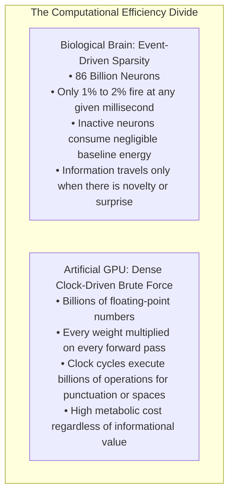
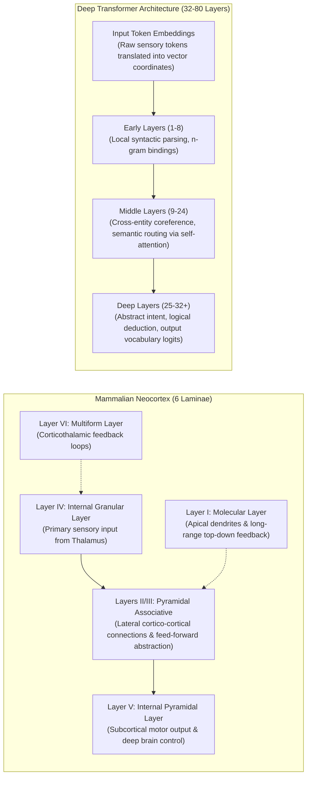
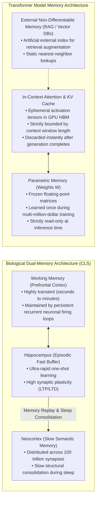
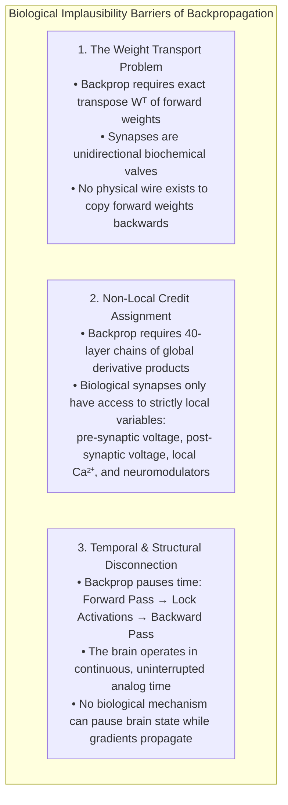
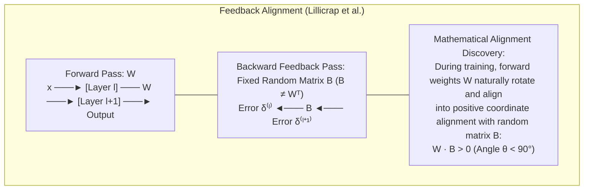
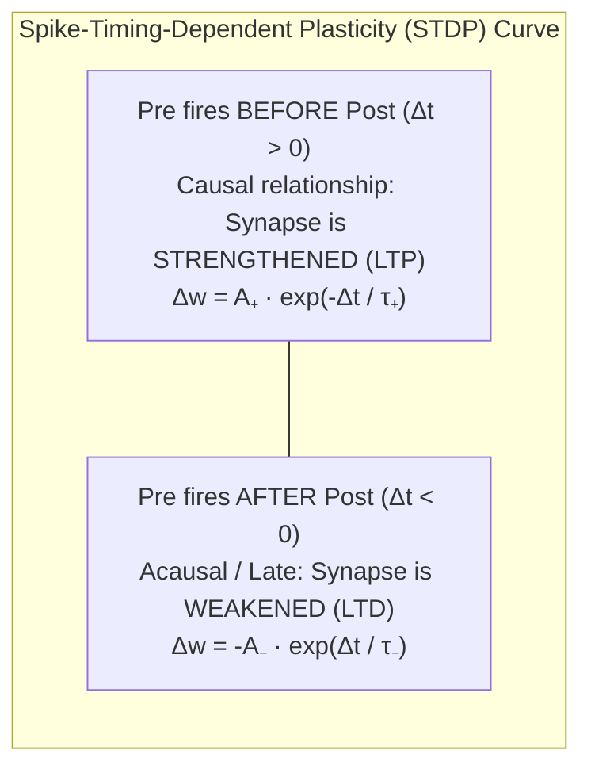

# Chapter 2: The Biological Brain vs. Artificial Neural Networks

## 1. Executive Summary & Narrative Arc

Since the dawn of cognitive science, humanity has attempted to understand the biological mind by comparing it to the most advanced technology of the contemporary era. The brain has been conceptualized as a hydraulic pump (René Descartes in the 17th century), a clockwork automaton (the Enlightenment), a telephone switchboard (the early 20th century), and a digital Von Neumann computer with distinct CPU and memory buses (the mid-20th century). Today, as Large Language Models (LLMs) demonstrate astonishing capabilities in conversational nuance, complex reasoning, computer programming, and creative generation, the temptation to equate biological **wetware** with artificial neural networks is stronger than ever.

The term **wetware** refers to living, organic biological neural tissue—composed of lipid cell membranes, water, protein ion channels, and biochemical electrolytes—as opposed to silicon computer hardware.

When examining the relationship between biological brains and artificial intelligence, computer science practitioners often oscillate between two intellectual traps:
1. **The Romantic Fallacy**: Believing that because deep neural networks borrow terminology from neuroscience ("neurons", "synapses", "layers", "learning"), they operate as digital clones of the human brain.
2. **The Cynical Fallacy**: Dismissing LLMs as mere "stochastic parrots" or cold matrix multiplications that possess zero scientific or cognitive relevance to biological intelligence.

The reality uncovered by modern computational neuroscience is far more profound. While artificial Transformers are **biologically implausible** in their microscopic implementation (such as 16-bit floating-point precision, global clock synchrony, and backward-propagated derivatives), they exhibit striking **computational and functional convergence** with mammalian neocortical architecture at higher organizational levels. 

Both systems are deep hierarchies. Both map continuous signals into high-dimensional geometric coordinate spaces. And most importantly, both systems appear to be driven by the exact same master computational objective: **minimizing prediction error about the future state of their environment**.

---

## 2. The Micro-Level: Biological Neurons vs. Artificial Units

To understand why the brain and an artificial neural network can converge on similar abstract capabilities despite being built from completely different substrates, we must inspect the micro-architecture of a biological neuron alongside its mathematical abstraction in an artificial neural network.

```mermaid
flowchart TD
    subgraph Biological ["Biological Neuron (Electrochemical Wetware Substrate)"]
        Dendrites["Dendritic Arbor<br/>(Thousands of tree-like branches performing local, non-linear computations)"]
        Soma["Soma & Axon Hillock<br/>(Analog integration of membrane voltage potential across time)"]
        Axon["Axon & Myelin Sheath<br/>(All-or-none discrete action potentials / spikes propagating at 100 m/s)"]
        Synapse["Synaptic Cleft<br/>(Biochemical diffusion of neurotransmitters across a 20-nanometer gap)"]
        Dendrites --> Soma --> Axon --> Synapse
    end

    subgraph Artificial ["Artificial Unit (Linear Algebraic Silicon Substrate)"]
        Inputs["Vector Input x = [x₁, x₂, ..., xₙ]<br/>(Synchronous array of static floating-point numbers)"]
        Weights["Weight Parameters W<br/>(Learnable scalar floats stored in GPU High-Bandwidth Memory)"]
        Act["Activation Function (GELU/SwiGLU)<br/>(Stateless elementwise mathematical transformation)"]
        Outputs["Continuous Output Activation a<br/>(Instantly transmitted to downstream tensor operations)"]
        Inputs --> Weights --> Act --> Outputs
    end
```

### Anatomical & Functional Deconstruction of the Biological Neuron

A biological neuron is not a simple arithmetic multiplier; it is an intricate, single-celled metabolic and computational organism composed of specialized anatomical structures:

1. **Dendrites (The Receiving Arbor)**:
   - *Anatomy*: A tree-like branching structure extending outward from the cell body, densely covered in microscopic protrusions called dendritic spines. A single pyramidal neuron in the human neocortex may receive inputs from up to 30,000 separate synapses across its dendritic arbor.
   - *Computation*: For decades, artificial intelligence assumed dendrites were passive copper wires that simply funneled electrical current into the cell body. Modern neurophysiology has revealed that dendrites are active, non-linear computational sub-units. Dendritic branches possess voltage-gated ion channels capable of generating localized "dendritic spikes." A single biological neuron's dendritic tree acts more like a multi-layered artificial neural network than a single perceptron.
2. **Soma (The Cell Body & Analog Integrator)**:
   - *Anatomy*: The central core of the cell containing the nucleus, DNA, mitochondria, and protein synthesis machinery.
   - *Computation*: The soma acts as a continuous analog integrator. Ion currents entering through thousands of synapses alter the electrical charge across the cell's lipid bilayer membrane. The resting membrane potential sits at approximately $-70\text{ mV}$. As excitatory ions enter, this voltage rises toward zero (depolarization).
3. **Axon Hillock & Axon (The All-or-None Pulse Generator & Cable)**:
   - *Anatomy*: The axon is a long, slender projection (ranging from a fraction of a millimeter to over a meter in length) originating at a specialized junction on the soma called the axon hillock.
   - *Computation*: If the integrated somatic membrane potential crosses an electrical threshold (approximately $-55\text{ mV}$), voltage-gated sodium channels open rapidly. This generates an **action potential** (or **spike**)—a rapid, discrete, all-or-none electrical voltage spike of approximately $+40\text{ mV}$ lasting roughly 1 millisecond.
   - *Key takeaway*: Unlike artificial neurons that output continuous decimal numbers, the axon operates digitally in amplitude: an action potential either fires completely or does not fire at all. Information in biological brains is encoded in the temporal timing, frequency, and rhythmic synchrony of these discrete spikes.
4. **Myelin Sheath (Biological Signal Acceleration)**:
   - *Anatomy*: A thick, fatty insulating layer wrapped around the axon at regular intervals, produced by specialized glial cells (oligodendrocytes in the brain, Schwann cells in the peripheral nervous system).
   - *Engineering mechanism*: In an unmyelinated axon, electrical impulses crawl at a sluggish $0.5$ to $2\text{ meters per second}$ because ions must leak across the entire membrane. Myelin prevents charge leakage, allowing the electrical signal to passively hop between uninsulated gaps called the *Nodes of Ranvier*. This process—known as **saltatory conduction**—boosts signal propagation speeds up to $120\text{ meters per second}$ ($\sim 430\text{ km/h}$) with minimal energy consumption.
5. **Synaptic Cleft & Neurotransmitters (Biochemical Inter-Cellular Gates)**:
   - *Anatomy*: The physical gap separating the axon terminal of the transmitting (pre-synaptic) neuron from the dendrite of the receiving (post-synaptic) neuron. This gap is microscopic: approximately $20\text{ nanometers}$ wide.
   - *Biochemical mechanism*: When an electrical action potential reaches the axon terminal, it triggers an influx of calcium ions ($\text{Ca}^{2+}$). This causes membrane-bound packets called synaptic vesicles to fuse with the outer wall and dump chemical messengers called **neurotransmitters** into the synaptic cleft.
   - *Types of neurotransmitters*:
     - **Glutamate**: The brain's primary *excitatory* neurotransmitter. When it binds to post-synaptic receptors (such as AMPA and NMDA receptors), it admits positive sodium and calcium ions, driving the post-synaptic voltage closer to firing threshold (acting like a positive weight $+w$).
     - **GABA ($\gamma$-aminobutyric acid)**: The brain's primary *inhibitory* neurotransmitter. It opens chloride channels, admitting negative ions and suppressing the post-synaptic neuron from firing (acting like a negative weight $-w$).
     - **Neuromodulators (Dopamine, Serotonin, Acetylcholine, Noradrenaline)**: Diffuse chemical signals that bathe large populations of neurons, altering their plasticity, attention, and learning rates on a global scale.
6. **Synaptic Plasticity: LTP and LTD**:
   - The connection strength of a biological synapse is not a static float; it dynamically increases or decreases through biochemical restructuring:
     - **Long-Term Potentiation (LTP)**: A persistent, long-lasting strengthening of a synapse following high-frequency coordinated activity between pre- and post-synaptic cells. Physical receptors (AMPA) are recruited to the membrane, making the synapse more sensitive to future signals.
     - **Long-Term Depression (LTD)**: A persistent weakening of synaptic efficacy when pre-synaptic firing fails to correlate with post-synaptic activation, or occurs at low frequencies. Receptors are internalized and removed from the membrane.

---

### Comprehensive Structural Comparison Table

| Architectural Dimension | Biological Brain (Neocortex) | Artificial Neural Network (Transformer LLM) |
| :--- | :--- | :--- |
| **Physical Substrate** | **Wetware**: Lipid bilayers, aqueous electrolyte solutions, ion channels ($\text{Na}^+, \text{K}^+, \text{Ca}^{2+}, \text{Cl}^-$), and complex proteins. | **Silicon**: Complementary Metal-Oxide Semiconductor (CMOS) transistors, GPU High-Bandwidth Memory (HBM), and register files. |
| **Information Representation** | **Spike Trains (Action Potentials)**: Discrete, asynchronous, all-or-none binary events in time ($1\text{ ms}$ pulses, $1\text{ to }100\text{ Hz}$). Signal is encoded in spike timing and firing rates. | **Continuous Floating-Point Numbers**: Dense 16-bit or 8-bit decimal tensors (FP32, BF16, FP8, INT4). No temporal duration; static values. |
| **Synaptic / Weight Complexity** | **Molecular Computer**: A single biological synapse contains thousands of interacting proteins, dynamic vesicle pools, retrograde feedback messengers, and receptor phosphorylation states. | **Scalar Number**: A single weight is an isolated, static floating-point scalar value ($w \in \mathbb{R}$) stored at a memory address. |
| **Spatial Computation** | **Dendritic Tree Computation**: High-dimensional, non-linear spatio-temporal filtering occurs across thousands of dendritic branches before reaching the soma. | **Flat Vector Dot Product**: All inputs are flattened and multiplied simultaneously in a single linear step ($\mathbf{w}^T \mathbf{x} + b$). |
| **Temporal Dynamics** | **Intrinsic Time Memory**: Dynamical state space with membrane integration time constants ($\tau_m \approx 20\text{ ms}$), refractory periods, and synaptic fatigue. | **Stateless Feed-Forward**: Given the identical input vector, an artificial neuron outputs the exact same scalar value regardless of real-world elapsed time. |
| **System Synchrony** | **Asynchronous & Decentralized**: No global master clock. Neurons fire whenever their local physical threshold is reached. | **Clock-Driven & Synchronous**: Billions of transistors locked to a rigid GPU core clock cycle ($\sim 1.5\text{ to }2.0\text{ GHz}$). |
| **Total Power Consumption** | **$\approx 20\text{ Watts}$** of metabolic glucose power (equivalent to a dim household LED bulb) to run 86 billion neurons and 100 trillion synapses. | **Megawatts** of industrial electrical power and massive chilled-water cooling loops to train or serve 70B+ parameter clusters. |

---

### The Energy Paradox: Event-Driven Sparsity vs. Dense Matrix Compute

The human brain runs on $20\text{ Watts}$ of power while delivering multimodal perception, fluid motor control, abstract linguistic reasoning, and lifetime continuous learning. Meanwhile, an AI data center training an ultra-large frontier LLM consumes enough electricity to power a medium-sized city.

What explains this million-fold efficiency disparity?

The difference stems from two fundamentally opposing computational philosophies:

1. **Biological Brain: Event-Driven Sparsity**:
   - The brain is **radially sparse in both space and time**. Out of the roughly 86 billion neurons in the human brain (with 16 billion in the cerebral cortex), only an estimated **1% to 2%** are firing action potentials at any given millisecond.
   - Ion pumping and vesicle recycling consume significant metabolic energy *only when an action potential is generated*. When a cortical circuit has nothing new to report, its neurons remain completely quiescent, consuming minimal resting energy. Information is transmitted strictly on an **event-driven** basis: signals travel only when there is sensory change, cognitive conflict, or unexpected novelty.
2. **Artificial GPU: Dense Clock-Driven Matrix Multiplication**:
   - Standard artificial neural networks are **dense and clock-driven**. In a standard Transformer forward pass, every single floating-point number across every weight matrix is read from High-Bandwidth Memory (HBM), loaded into SRAM register files, and multiplied via Tensor Core Matrix Multiply-Accumulate (MMA) instructions.
   - The GPU expends the exact same computational energy processing a trivial whitespace or comma token as it does deciphering a complex mathematical theorem. 
   - While modern architectures like **Sparse Mixture-of-Experts (MoE)** (e.g., DeepSeek-V3, Mixtral) move closer to biological sparsity by routing tokens to a subset of parameters (e.g., activating 8 out of 256 expert networks per token), the underlying hardware still executes dense, synchronous floating-point linear algebra within every selected expert.

---

## 3. Cortical Hierarchies and the Neocortex

While biological neurons and artificial units differ radically in their physical construction, the macro-level organizational structure of the mammalian **neocortex** reveals remarkable architectural convergence with deep Transformer networks.

The neocortex is the evolutionary crowning jewel of mammalian intelligence, responsible for perception, conscious thought, spatial reasoning, and human language. Anatomically, it is a $2\text{ to }4\text{ millimeter}$ thick sheet of gray matter folded into convolutions (gyri and sulci) to maximize surface area.

### Mountcastle’s Uniform Neocortex Hypothesis

In 1978, the visionary Johns Hopkins neuroscientist **Vernon Mountcastle** proposed a revolutionary hypothesis that reshaped modern neuroscience:
> Across the entire cerebral cortex—whether processing high-frequency visual inputs in the occipital lobe, auditory speech in the temporal lobe, somatic touch in the parietal lobe, or abstract planning in the frontal lobe—the microscopic circuit architecture is remarkably, astonishingly **uniform**.

Mountcastle observed that the neocortex is organized into repeating vertical modular cylinders called **cortical minicolumns**. 
- A cortical minicolumn is roughly $20\text{ to }50\text{ micrometers}$ in diameter and spans vertically across all six horizontal cellular layers (laminae).
- Each minicolumn contains approximately $80\text{ to }120\text{ neurons}$, intricately interconnected with stereotyped vertical and horizontal wiring.
- Millions of these identical minicolumns are tiled side-by-side across the entire cortical sheet.

Mountcastle's profound deduction was that the neocortex does not invent specialized, bespoke algorithms for different sensory and cognitive modalities. Instead, **evolution discovered a single, universal, general-purpose canonical computational algorithm**, and replicated it millions of times across the brain. 
- Connect that algorithm to the optic nerve, and it computes visual edge detection, shape completion, and facial recognition.
- Connect it to the cochlear nerve, and it computes frequency decomposition, phoneme parsing, and spoken language comprehension.
- Connect it to the associative areas, and it computes abstract logic, grammar, and planning.

### The Homogeneous Transformer as Mountcastle's Machine

Modern deep Transformer models are the direct software manifestation of Mountcastle’s hypothesis:
1. **No Handcrafted Heuristic Pipelines**: In traditional software and classical computer vision, engineers built bespoke pipelines: an edge-detection filter feeding a corner detector, feeding a contour linker, feeding a custom rule parser.
2. **Identical Stacked Layers**: A modern 70B Transformer is composed of 80 virtually identical, homogeneous computational blocks stacked on top of one another.
   - Each block contains the exact same two sub-layers: a **Multi-Head Self-Attention** module and a **SwiGLU Feed-Forward Network**, separated by **RMSNorm** and **Residual Connections**.
   - Layer 1 has the exact same code, the exact same tensor shapes, and the exact same mathematical operations as Layer 79.
   - The only difference between the early layers (which resolve shallow grammar) and the late layers (which synthesize philosophical arguments) is the numerical configuration of the learned floating-point weights inside those identical blocks.

---

## 4. Predictive Coding: The Grand Unifying Principle

If biological wetware and artificial silicon are fundamentally different substrates, why do they converge on identical hierarchical modular architectures?

The answer lies in their shared computational objective. In contemporary cognitive science and computational neuroscience, the leading theoretical framework for biological brain function is **Predictive Coding** (formalized by Rajesh Rao & Dana Ballard, 1999) and Karl Friston’s overarching **Free Energy Principle** (2006, 2010).

```mermaid
flowchart TD
    subgraph BrainPrediction ["Biological Predictive Coding Hierarchy"]
        Top["Higher Cortical Centers<br/>Internal Generative World Model"]
        Pred["Top-Down Prediction P⁽ˡ⁾<br/>('What sensory states do I expect to experience next?')"]
        Compare["Error Comparator (Cortical Column)"]
        Sensory["Sensory Receptors (Retina, Cochlea)<br/>Actual Incoming Environmental Data r⁽ˡ⁾"]
        Res["Ascending Prediction Error Residual: ε⁽ˡ⁾ = r⁽ˡ⁾ - P⁽ˡ⁾<br/>('Transmit ONLY the unpredicted surprise upward!')"]

        Top -->|"Top-Down Generative Flow"| Pred --> Compare
        Sensory -->|"Bottom-Up Environmental Flow"| Compare
        Compare -->|"Ascending Residual Flow"| Res --> Top
    end

    subgraph TransformerPrediction ["Transformer Autoregressive Modeling"]
        TInternal["Hidden State Representation (Residual Stream)<br/>Internal token & world representations across layers"]
        TPred["Logit Projection & Softmax<br/>P(tₖ | t₁...tₖ₋₁) : Predictive vocabulary distribution"]
        TLoss["Cross-Entropy Comparator"]
        TTarget["Ground-Truth Target Token<br/>Actual next token from human text dataset"]
        TGrad["Backpropagation Error Gradient ∇L<br/>Surprise signal updates internal model weights"]

        TInternal --> TPred --> TLoss
        TTarget --> TLoss
        TLoss --> TGrad --> TInternal
    end
```

### The Free Energy Principle: The Physics of Living Systems

Karl Friston's **Free Energy Principle** is a foundational theory rooted in non-equilibrium thermodynamics and Bayesian statistics:
- Any self-organizing biological system that resists thermal decay and maintains its internal structural integrity (homeostasis) must avoid surprising, high-entropy states.
- Mathematically, biological systems achieve this by minimizing a quantity called **Variational Free Energy**, which acts as an upper bound on sensory surprise ($`-\log P(\text{sensory data})`$).
- To minimize surprise, the brain must construct an internal **generative model** that continuously predicts incoming sensory inputs.

### The Brain as an Active Generative Simulation Engine

Classical 20th-century neuroscience taught that the brain was a passive, bottom-up feature detector: light struck the photoreceptors of the retina, signals traveled up the optic nerve into the primary visual cortex (V1), propagated to V2 and V4 to extract shapes, and finally reached the inferotemporal cortex (IT) where a conscious picture of the world was assembled.

Predictive coding turns this paradigm completely on its head:
1. **The Brain is an Active Simulator**: Higher cortical areas are continuously projecting massive, top-down predictions downwards through the cortical hierarchy. You do not passively perceive the world; your brain is actively generating an internal hallucination of reality, using sensory data merely to calibrate and anchor the simulation.
2. **Top-Down Predictions vs. Bottom-Up Prediction Errors**:
   - Higher layers send **top-down predictions** ($\hat{\mathbf{r}}^{(l)}$) to lower layers, specifying what neural firing patterns are expected:
     $$\hat{\mathbf{r}}^{(l)} = f\left(\mathbf{U}^{(l)} \mathbf{r}^{(l+1)}\right)$$
     where:
     - $`l \in \{1, 2, \dots, L\}`$: The hierarchical cortical layer index, where layer $1$ is closest to raw sensory input and layer $L$ represents abstract association cortex.
     - $\mathbf{r}^{(l+1)}$: The neural activation state vector of the higher cortical layer $l+1$.
     - $\mathbf{U}^{(l)}$: The top-down generative projection matrix (synaptic weights) transforming higher-level abstract states into expected lower-level neural firing patterns.
     - $f(\cdot)$: The non-linear neuronal activation transfer function (such as a sigmoidal or thresholded firing rate curve).
     - $\hat{\mathbf{r}}^{(l)}$: The predicted neural firing rate vector generated for layer $l$.
   - The lower layer compares this top-down prediction with its actual measured state $\mathbf{r}^{(l)}$ (where $\mathbf{r}^{(l)}$ is the measured firing pattern driven by bottom-up inputs).
   - It computes the **prediction error (or residual)**:
     $$\mathbf{\epsilon}^{(l)} = \mathbf{r}^{(l)} - \hat{\mathbf{r}}^{(l)}$$
     where $\mathbf{\epsilon}^{(l)}$ is the difference vector measuring the mismatch between expectation and observation.
   - What travels *up* the biological hierarchy is not the raw sensory signal, but exclusively the **prediction error residual** $\mathbf{\epsilon}^{(l)}$.
   - If the brain’s top-down prediction matches reality perfectly (e.g., staring at a blank, static wall), the prediction error is zero ($\mathbf{\epsilon} \approx \mathbf{0}$). No error signals travel up the hierarchy, and the brain expends almost zero metabolic energy.
   - Only when your environment deviates from expectations (e.g., a snake darts across your path) does a surge of prediction error travel upward to force higher cortical layers to update their internal world representations.

---

### The Mirror in Large Language Models: Autoregressive Next-Token Prediction

The training objective of modern generative Large Language Models is the exact mathematical reflection of biological predictive coding:

$$\mathcal{L}_{\text{NLL}} = -\log P\left(t_k \mid t_1, t_2, \dots, t_{k-1}\right)$$

Consider what happens during LLM pre-training:
- An LLM is never explicitly programmed with English grammar, Python syntax rules, legal precedents, or mathematical theorems.
- It is given a single, relentlessly simple task: **predict the next token**.
- In order to minimize prediction error across trillions of tokens of human writing, the model is mathematically compelled to discover the underlying generative factors of reality that produced that text:
  - To predict the next word in a Python script, it must internally simulate variable scoping and logic flow.
  - To predict the next word in a murder mystery novel, it must internally model the characters, their hidden motives, the physical murder weapon, and who was in the room.
  - To predict the next word in a medical journal article, it must internally represent biochemical pathways and clinical disease progressions.

**Compression and prediction are mathematically equivalent to understanding.** Both the biological brain and the deep Transformer arrive at general intelligence not by hand-coded heuristics, but as an emergent mathematical necessity of minimizing future prediction errors.

---

## 5. Memory Systems: Static Weights vs. Synaptic Plasticity

One of the most consequential divergences between biological brains and artificial intelligence lies in their respective memory architectures.

### Parametric Memory vs. Working Memory / In-Context Cache

In an artificial Transformer, memory is strictly partitioned into two disconnected domains:

1. **Parametric Memory (The Weight Matrices)**:
   - *What it is*: The billions of static floating-point numbers stored in the projection matrices ($`\mathbf{W}_Q, \mathbf{W}_K, \mathbf{W}_V, \mathbf{W}_O, \mathbf{W}_{\text{gate}}, \mathbf{W}_{\text{up}}, \mathbf{W}_{\text{down}}`$).
   - *Characteristics*: This represents the model's **crystallized semantic knowledge**—facts, linguistic syntax, coding idioms, and conceptual relationships learned during pre-training.
   - *The Critical Limitation*: During inference (when generating text for a user), **the weights are completely frozen and read-only**. No matter how profound, novel, or urgent a piece of information you provide the model in your prompt, it cannot permanently modify its weights. The model has zero autonomous online learning capability.
2. **Working Memory & In-Context Storage (The KV Cache)**:
   - *What it is*: The dynamically accumulated **Key-Value (KV) cache** tensors stored in GPU High-Bandwidth Memory during a prompt generation session.
   - *Analogy*: This functions identically to **human working memory** (active neuronal firing patterns in the prefrontal cortex). It allows the model to keep track of entities, follow a conversation, maintain code context, and execute in-context learning.
   - *The Ephemeral Fate*: The instant the API call completes or the session is reset, the KV cache tensors are deallocated from GPU memory. The model immediately reverts to its baseline pre-trained state, suffering total amnesia regarding the interaction.

---

### The Plasticity-Stability Dilemma & Catastrophic Forgetting

Why can't we simply leave gradient descent and backpropagation switched "on" during inference so the LLM continuously updates its weights from every user conversation?

This exposes a fundamental obstacle in machine learning known as the **Plasticity-Stability Dilemma**:
- **Plasticity**: The ability of a system to rapidly absorb new information and adapt to environmental shifts.
- **Stability**: The ability of a system to retain established, foundational knowledge without interference.

When an artificial neural network is trained sequentially on new data distributions without strict regularization, it suffers from **Catastrophic Forgetting** (French, 1999).
- If you take a fully trained LLM that understands medicine, law, history, and Python programming, and fine-tune it exclusively on Python code for several thousand steps, the weight updates designed to minimize coding errors will overwrite the delicate interference patterns representing medical knowledge and legal reasoning.
- Within hours, the model’s performance on non-coding tasks collapses catastrophically.

#### The Biological Solution: Complementary Learning Systems (CLS)
Mammalian biology solved the plasticity-stability dilemma hundreds of millions of years ago through the evolution of **Complementary Learning Systems (CLS)** (McClelland, McNaughton, & O'Reilly, 1995):

1. **The Fast Learner: The Hippocampus**:
   - The hippocampus is a specialized subcortical structure characterized by sparse representations and ultra-high synaptic plasticity.
   - It acts as a rapid episodic buffer, capable of encoding a novel experience in a single shot (e.g., remembering where you parked your car today or what you ate for lunch) without disrupting existing memories.
2. **The Slow Consolidator: The Neocortex**:
   - The neocortex learns at an extremely low, deliberate pace, slowly integrating statistical regularities across vast amounts of experience.
3. **Memory Replay During Sleep**:
   - During slow-wave sleep and quiet rest, the hippocampus spontaneously "replays" compressed, accelerated sequences of the day's experiences, transmitting them to the neocortex.
   - The neocortex weaves these new experiences into its existing semantic network, interleaving new memories with old memories to completely avoid catastrophic interference.

*Engineering Takeaway*: Current AI systems lack an autonomous hippocampal-neocortical consolidation loop. To approximate biological stability, AI engineers must rely on cumbersome external engineering scaffolds: retrieval-augmented generation (RAG), vector databases, parameter-efficient fine-tuning (LoRA), or continuous pre-training on balanced replay datasets.

---

## 6. Biological Plausibility: Why the Brain Cannot Execute Algorithmic Backpropagation

In deep learning, backpropagation is the universal engine of progress. However, contemporary neuroscientists widely agree that **the biological brain cannot physically execute algorithmic backpropagation** (Crick, 1989; Lillicrap et al., 2020).

Biological wetware faces severe physical, anatomical, and mathematical barriers that render standard backpropagation physically impossible in living tissue:

### 1. The Weight Transport Problem

In artificial backpropagation, the gradient of the loss with respect to the activations of layer $l$ is calculated by multiplying the error vector from layer $l+1$ by the **exact transpose of the forward weight matrix**:

$$\mathbf{\delta}^{(l)} = \left(\mathbf{W}^{(l+1)}\right)^T \mathbf{\delta}^{(l+1)} \odot \sigma'\left(\mathbf{z}^{(l)}\right)$$

- In an artificial neural network, this is trivial: the matrix $\mathbf{W}^{(l+1)}$ sits in GPU memory, and the backpropagation CUDA kernel simply indexes it across rows instead of columns ($(\mathbf{W})^T$).
- In the biological brain, this represents the **Weight Transport Problem**:
  - A biological synapse is an asymmetric, unidirectional chemical valve. Neurotransmitters are released from the pre-synaptic terminal and diffuse across the synaptic cleft to post-synaptic receptors.
  - While retrograde messengers (such as nitric oxide gas and endocannabinoids) exist, there is no biological mechanism for a backward feedback axon to read the exact physical conductance, receptor density, or biochemical efficacy of an upstream forward synapse and synchronize its own backward weight to match it.

---

### 2. The Non-Local Credit Assignment Problem

In algorithmic backpropagation, computing the weight update for a single weight in Layer 2 requires calculating an unbroken chain of partial derivatives through all 32 subsequent layers up to the global loss:

$$\frac{\partial \mathcal{L}}{\partial w^{(2)}} = \frac{\partial \mathcal{L}}{\partial a^{(32)}} \cdot \frac{\partial a^{(32)}}{\partial z^{(32)}} \cdots \frac{\partial z^{(3)}}{\partial a^{(2)}} \cdot \frac{\partial a^{(2)}}{\partial z^{(2)}} \cdot \frac{\partial z^{(2)}}{\partial w^{(2)}}$$

Biological synapses operate under **strictly local constraints**:
- A physical synapse between Neuron A and Neuron B has zero knowledge of what is happening 10 synapses away in the visual cortex, let alone what the global objective loss is.
- A biological synapse has physical access to only three things:
  1. The pre-synaptic electrical membrane potential and spike timing.
  2. The post-synaptic electrical membrane potential and local dendritic calcium influx ($\text{Ca}^{2+}$).
  3. Diffuse, non-specific neuromodulatory broadcasts (e.g., a burst of dopamine signaling reward prediction error).

---

### 3. Biological Approximations: Feedback Alignment

If the brain cannot transmit gradients through the exact transpose matrix $\mathbf{W}^T$, how can deep biological cortical hierarchies learn complex multi-layer abstractions at all?

In a breakthrough discovery, **Timothy Lillicrap et al. (2016, Nature Communications; 2020, Nature Neuroscience)** demonstrated that exact weight transport is **not mathematically required** for deep credit assignment. They introduced **Feedback Alignment**:

In Feedback Alignment, the backpropagated error is transmitted through a **completely fixed, random matrix $\mathbf{B}$** that has no connection to $\mathbf{W}^T$:

$$\mathbf{\delta}_{\text{FA}}^{(l)} = \mathbf{B}^{(l+1)} \mathbf{\delta}^{(l+1)} \odot \sigma'\left(\mathbf{z}^{(l)}\right)$$

- *The Mathematical Wonder*: You might assume that multiplying errors by random numbers would inject pure chaos and destroy learning.
- *What Actually Happens*: Over repeated training steps, the forward weights $\mathbf{W}$ undergo updates that cause them to **rotate in high-dimensional space until they align with the random matrix $\mathbf{B}$**. 
- Specifically, the matrix product $\mathbf{W}\mathbf{B}$ develops positive eigenvalues, meaning the angle between the true gradient direction and the random feedback direction becomes less than $90^\circ$ ($\mathbf{W} \cdot \mathbf{B} > 0$).
- As long as the error vector points roughly in the correct downhill half-space, gradient descent successfully drives the task error down! This proved that deep networks can achieve gradient-based credit assignment using completely separate, asymmetric forward and backward feedback pathways.

---

### 4. Local Biological Learning Rules: Hebbian Plasticity and STDP

In the absence of global backpropagation, biological synapses update their weights using local learning rules governed by physical spike timing.

#### Classical Hebbian Learning
Proposed by Donald Hebb in 1949, the foundational rule of neuroplasticity is colloquially summarized as:
> *"Neurons that fire together, wire together."*

Mathematically, the classical Hebbian learning rule strengthens a synaptic connection in proportion to the correlated activity between the pre-synaptic neuron $a_i$ and the post-synaptic neuron $a_j$:

$$\Delta w_{ij} = \eta \cdot a_i \cdot a_j$$

- $w_{ij}$: The synaptic connection strength between pre-synaptic neuron $i$ and post-synaptic neuron $j$.
- $\eta$: The biological learning rate (governed by intracellular biochemical enzyme cascades).
- $a_i, a_j$: The simultaneous activation rates of the two neurons.
- *Limitation*: Classical Hebbian learning has an inherent runaway instability: because positive correlations increase $w_{ij}$, future firing becomes even more correlated, causing weights to grow unbounded toward $+\infty$ unless capped by homeostatic synaptic scaling.

#### Spike-Timing-Dependent Plasticity (STDP)
In the late 1990s, neurophysiologists Bi & Poo (1998) and Markram et al. (1997) discovered that biological plasticity depends critically on the **sub-millisecond relative timing** between pre- and post-synaptic action potentials:

$$
\Delta w = \begin{cases}
A_+ \exp\left(-\frac{\Delta t}{\tau_+}\right) & \text{if } \Delta t > 0 \quad (\text{Pre fires BEFORE Post} \implies \text{LTP}) \\
0 & \text{if } \Delta t = 0 \quad (\text{Exact synchrony} \implies \text{No net directional plasticity}) \\
-A_- \exp\left(\frac{\Delta t}{\tau_-}\right) & \text{if } \Delta t < 0 \quad (\text{Pre fires AFTER Post} \implies \text{LTD})
\end{cases}
$$

Let us deconstruct every symbol, variable, and temporal condition in this equation:

- $\Delta w$: **Change in Synaptic Connection Efficacy (Weight)**. A positive value ($\Delta w > 0$) signifies Long-Term Potentiation (strengthening the connection), while a negative value ($\Delta w < 0$) signifies Long-Term Depression (weakening the connection). At $\Delta t = 0$, $\Delta w = 0$.
- $\exp(\cdot)$: The natural exponential function ($e^x$), governing the exponential decay of synaptic plasticity as the time interval between spikes widens.
- $\Delta t = t_{\text{post}} - t_{\text{pre}}$: **The Spike-Timing Difference**.
  - $t_{\text{pre}}$: The exact millisecond timestamp when an action potential arrived at the pre-synaptic axon terminal.
  - $t_{\text{post}}$: The exact millisecond timestamp when the post-synaptic neuron fired its own action potential.
- **Condition 1: Causal Timing ($\Delta t > 0$) $\implies$ Long-Term Potentiation (LTP)**:
  - *Physical meaning*: The pre-synaptic neuron fired *before* the post-synaptic neuron ($t_{\text{post}} > t_{\text{pre}}$).
  - *Intuition*: Because Neuron A fired just before Neuron B, Neuron A's signal likely contributed causally to pushing Neuron B over its firing threshold. The brain recognizes this causal efficacy and **strengthens the synapse** ($\Delta w > 0$).
  - $A_+$: The maximum amplitude of synaptic potentiation.
  - $\tau_+$: The positive temporal decay constant (typically $\approx 20\text{ milliseconds}$). If the pre-synaptic spike arrived $2\text{ ms}$ before the post-synaptic spike, potentiation is massive; if it arrived $80\text{ ms}$ before, potentiation decays to near zero.
- **Boundary Condition: Exact Synchrony ($\Delta t = 0$)**:
  - *Physical meaning*: Spikes arrive simultaneously. Because neither spike preceded the other, there is no causal precedence signal, resulting in $\Delta w = 0$.
- **Condition 2: Acausal Timing ($\Delta t < 0$) $\implies$ Long-Term Depression (LTD)**:
  - *Physical meaning*: The pre-synaptic neuron fired *after* the post-synaptic neuron ($t_{\text{post}} < t_{\text{pre}}$).
  - *Intuition*: Because Neuron B had already fired before Neuron A's signal even arrived, Neuron A could not possibly have caused the event. Neuron A's spike is useless, redundant, or late noise. The brain punishes this acausal connection by **weakening the synapse** ($\Delta w < 0$).
  - $A_-$: The maximum amplitude of synaptic depression.
  - $\tau_-$: The negative temporal decay constant (typically $\approx 20\text{ to }30\text{ milliseconds}$).

By enforcing causality at the millisecond level ($10\text{ to }40\text{ ms}$) through STDP, biological networks can self-organize directionally coherent computational circuits, discover temporal patterns, and build predictive representations without ever calculating a global backpropagation derivative.

#### 5. Local Alternatives to Backpropagation: Forward-Forward and Predictive Coding Networks
Beyond STDP, how can deep hierarchical representations be learned without global backpropagation?

1. **Geoffrey Hinton's Forward-Forward Algorithm (2022)**:
   - *The Concept*: Hinton proposed replacing the separate forward and backward passes of backpropagation with **two forward passes that operate locally**:
     - **Positive Pass**: Real data is passed through the network, and weights are adjusted locally to make neurons fire vigorously ("high goodness").
     - **Negative Pass**: Negative or internally hallucinated data (generated by the model itself) is passed through the network, and weights are adjusted locally to suppress firing ("low goodness").
   - *Biological Plausibility*: Each layer trains its own weights using strictly local information (the sum of squared activations), completely eliminating the need for the Weight Transport Problem ($\mathbf{W}^T$) or storing intermediate activation gradients across 80 layers.
2. **Friston's Hierarchical Predictive Coding Networks**:
   - In predictive coding networks (Rao & Ballard, 1999; Friston, 2005; Whittington & Bogacz, 2017), representation learning is achieved through **prediction error cancellation**.
   - Synapses update purely based on local Hebbian-like correlations between pre-synaptic prediction errors and post-synaptic states:
     $$\Delta \mathbf{U}^{(l)} \propto \mathbf{\epsilon}^{(l)} \left(\mathbf{r}^{(l+1)}\right)^T$$
   - Mathematical analysis (Whittington & Bogacz, 2017; Millidge et al., 2022) has demonstrated that under certain conditions, predictive coding networks mathematically approximate exact backpropagation gradients in the steady state, while relying exclusively on local, biologically plausible synaptic interactions.
---

## 7. Key Engineering Takeaways

1. **Substrates are Disparate, but Mathematics Converges**: Biological wetware (analog, electrochemical, spiking, lipid membranes) and artificial neural networks (digital CMOS, clock-driven, 16-bit floating-point tensors) share virtually no microscopic implementation details. Yet both converge on hierarchical representations in high-dimensional continuous state spaces.
2. **Mountcastle's Canonical Algorithm Prefigured Transformers**: Vernon Mountcastle’s 1978 hypothesis that the neocortex applies a single, uniform cortical minicolumn algorithm across all sensory modalities is mirrored in the homogeneous architecture of the modern Transformer, which stacks identical self-attention and SwiGLU blocks to master text, vision, audio, and code.
3. **Prediction Error Minimization is the Master Objective**: Under Friston's Free Energy Principle and Rao & Ballard’s predictive coding, the biological brain continuously projects top-down predictions to minimize sensory surprise (prediction error residuals). Similarly, LLMs master complex reasoning as an emergent byproduct of minimizing autoregressive next-token cross-entropy.
4. **The Energy Gap Stems from Sparsity**: The human brain’s miraculous $20\text{ Watt}$ power efficiency is achieved through event-driven, temporal sparsity (only 1% to 2% of neurons active at any millisecond). In contrast, GPUs consume megawatts executing dense, clock-synchronized floating-point matrix multiplications across all parameters on every token.
5. **Memory Separation vs. Consolidation**: Modern LLMs suffer from catastrophic forgetting because they lack the biological Complementary Learning Systems (CLS) architecture. LLMs cleanly separate memory into static parametric weights and transient KV caches, whereas the biological brain uses the hippocampus to buffer rapid episodic memories and slowly consolidates them into the neocortex during sleep.
6. **Deep Credit Assignment Does Not Require Backprop**: The biological brain cannot run algorithmic backpropagation due to the Weight Transport Problem (synapses are unidirectional) and Non-Local Credit Assignment. However, mathematical discoveries like Feedback Alignment (Lillicrap et al.) prove that transmitting error signals through random feedback matrices ($\mathbf{B} \neq \mathbf{W}^T$) allows deep networks to learn effectively, demonstrating how biological tissue achieves deep representation learning using strictly local plasticity rules like STDP.