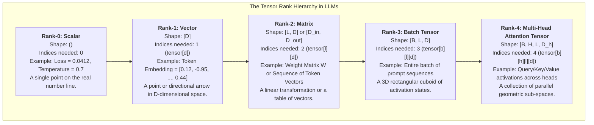
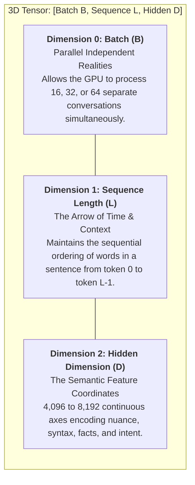
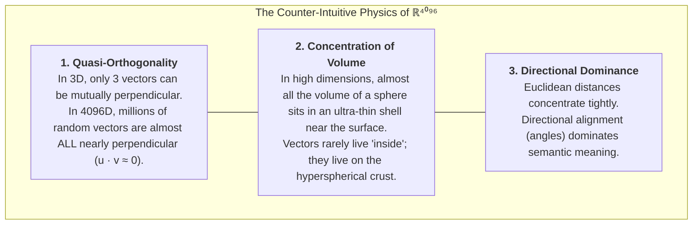
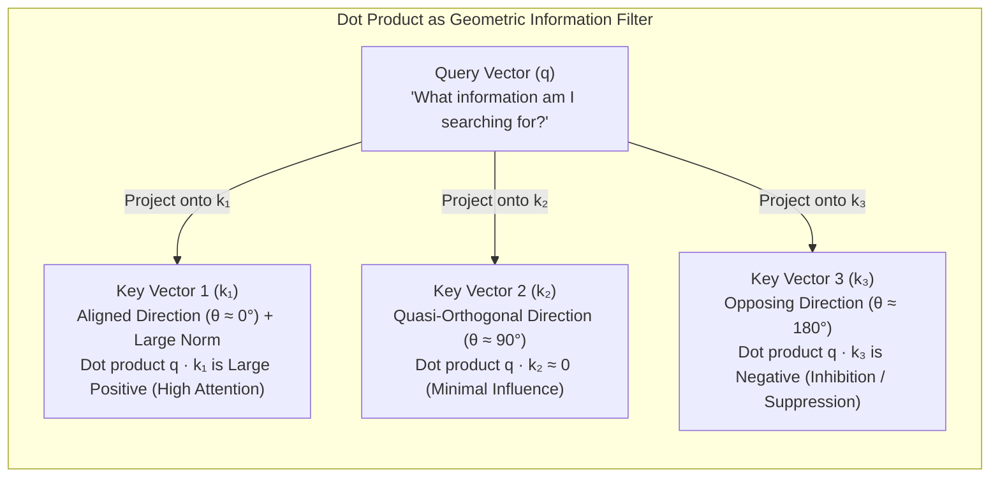
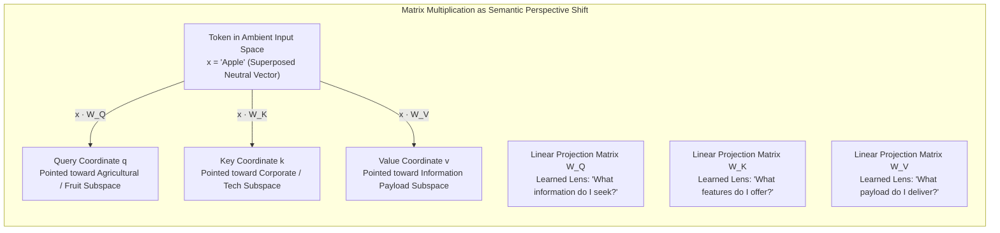
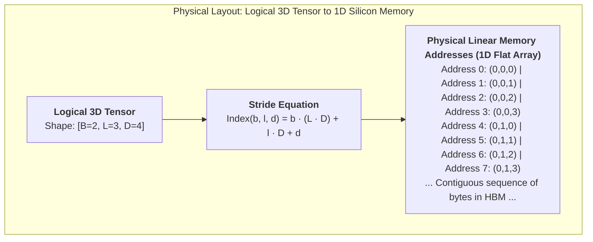
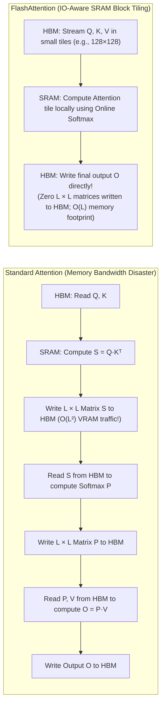

# Chapter 3: The Geometry of Multi-Dimensional Tensors

## 1. Executive Summary & Narrative Arc

In computer science, we often use terms inherited from physics and pure mathematics without pausing to appreciate their physical and conceptual reality. Few terms are more mystifying to newcomers than **"tensor"**. Popular machine learning discourse often introduces tensors either with dry, impenetrable mathematical definitions (multilinear maps from vector spaces to the real numbers) or with vague dismissals ("it is just a multi-dimensional array").

Both descriptions miss the fundamental engineering truth: **a tensor is the geometric language that allows continuous physical hardware (GPUs) to reason about discrete human thought.**

Human language is symbolic, relational, and temporal. Computers, specifically modern Graphics Processing Units (GPUs) and Tensor Processing Units (TPUs), are essentially massive, highly parallel floating-point calculators. To bridge this divide, Large Language Models convert words into coordinates inside high-dimensional spaces. 

This chapter breaks down:
1. What tensors are, from rank-0 scalars to rank-4 multi-head attention tensors, with software and hardware mental models.
2. Why multi-dimensional tensors are structurally indispensable for modern LLMs (the Batch, Sequence, Hidden, and Head dimensions).
3. The counter-intuitive geometry of 4,096-dimensional vector spaces (quasi-orthogonality, hyperspherical volume concentration, superposition, and unnormalized dot products).
4. How matrix multiplications act as geometric coordinate transformations, rotations, and projection lenses.
5. How tensors are physically laid out in GPU high-bandwidth memory (HBM) and how FlashAttention overcomes the memory wall through online softmax and SRAM block tiling.

---

## 2. From Scalars to High-Rank Tensors: A Programmer's Mental Model

Before manipulating tensors in neural architectures, we must establish a concrete mental model of what a tensor is in software and hardware.

### Plain-Language Definitions of the Core Terminology

- **Rank (Order / Dimensionality)**: The rank of a tensor is the number of independent indices (or coordinate axes) required to pinpoint a single scalar element within the data structure. In software terms, rank is the number of nested brackets or array dimensions (e.g., `tensor[i]` has rank 1; `tensor[i][j]` has rank 2; `tensor[i][j][k]` has rank 3).
- **Scalar (Rank-0 Tensor)**: A single isolated number with magnitude but no direction or spatial axes (e.g., a loss value, a temperature parameter, or a learning rate). It requires zero indices to address: `()`.
- **Vector (Rank-1 Tensor)**: An ordered one-dimensional list of numbers representing a point or directional arrow in a geometric space. It requires one index to address: `[D]`. In an LLM, a vector represents a single token's latent semantic state.
- **Matrix (Rank-2 Tensor)**: A two-dimensional rectangular grid of numbers organized into rows and columns. It requires two indices to address: $`[L, D]`$ or $`[D_{\text{in}}, D_{\text{out}}]`$. In an LLM, a matrix can represent a sequence of token vectors or a learned linear transformation weight matrix.
- **3D Tensor (Rank-3 Tensor)**: A three-dimensional cuboid of numbers formed by stacking multiple matrices together along a new axis. It requires three indices to address: `[B, L, D]`. In an LLM, this represents an entire batch of sequences traveling through the network.
- **4D Tensor (Rank-4 Tensor)**: A four-dimensional collection of 3D tensors. It requires four indices to address: $`[B, H, L, D_h]`$. In an LLM, this represents the activation states of multiple attention heads operating simultaneously across a batch of sequences.
- **Batch Dimension ($B$)**: The number of independent, parallel sequences or user requests processed simultaneously in a single forward pass.
- **Sequence Dimension ($L$)**: The number of consecutive tokens (words, subwords, or characters) in a given prompt or generated sequence, representing the arrow of time.
- **Hidden Dimension ($D$)**: The number of continuous numerical features allocated to represent the semantic state of each token (typically 4,096 in 8B models and 8,192 in 70B models).
- **Attention Heads ($H$)**: The number of parallel attention mechanisms running simultaneously within a single layer (typically 32 to 64 heads).
- **Head Dimension ($D_h$)**: The size of the feature subspace allocated to each individual attention head, defined strictly as $`D_h = D / H`$ (typically 128 dimensions).

### Rank Breakdown in Modern LLM Architecture

| Rank | Mathematical Entity | Tensor Shape | Indices Needed | Physical / Operational Role in LLMs |
| :--- | :--- | :--- | :--- | :--- |
| **0** | Scalar | `()` | 0 | Loss values, learning rates, generation temperatures, scaling factors ($`1 / \sqrt{d_k}`$). |
| **1** | Vector | `[D]` | 1 (`d`) | A single token's embedding vector, layer normalization scale parameter ($\boldsymbol{\gamma}$), positional frequency vector. |
| **2** | Matrix | `[L, D]` or $`[D_{\text{in}}, D_{\text{out}}]`$ | 2 (`l, d`) | A sequence of $L$ token vectors; a linear projection weight matrix ($`\mathbf{W}_Q, \mathbf{W}_K, \mathbf{W}_V, \mathbf{W}_{\text{gate}}`$); an attention score matrix `[L, L]`. |
| **3** | 3D Tensor | `[B, L, D]` | 3 (`b, l, d`) | The primary data package traveling along the **Residual Stream**: $B$ independent sequences, each with $L$ tokens, each token represented by a $D$-dimensional vector. |
| **4** | 4D Tensor | $`[B, H, L, D_h]`$ | 4 (`b, h, l, d`) | Multi-Head Attention internal state: $B$ sequences, split into $H$ parallel attention heads, with sequence length $L$, and head dimension $`D_h = D / H`$. |

### Mathematical Deconstruction of the Rank Hierarchy

Let us deconstruct each rank's mathematical definition, software memory layout, and hardware execution role:

#### 1. Rank-0: Scalar `()`

$$s \in \mathbb{R}$$

- **Mathematical Meaning**: A zero-dimensional quantity possessing magnitude but no directional orientation.
- **Software Intuition**: A single primitive float in memory (`float32` or `bfloat16`), occupying 4 or 2 bytes.
- **Hardware Intuition**: Held directly inside a single 32-bit GPU register. Used as a broadcast multiplier across vectors or matrices (such as multiplying all attention logits by $`1/\sqrt{D_h}`$).

#### 2. Rank-1: Vector `[D]`

$$\mathbf{x} = \begin{bmatrix} x_0 \\ x_1 \\ \vdots \\ x_{D-1} \end{bmatrix} \in \mathbb{R}^D$$

- **Mathematical Meaning**: A point in a $D$-dimensional continuous vector space. Each coordinate $x_d$ represents the magnitude of the projection along axis $d$.
- **Software Intuition**: A 1D contiguous array `float x[D]`. In an 8B model where $D = 4096$, in BF16 precision, this array occupies $4096 \times 2 = 8,192\text{ bytes}$ (8 KB).
- **Hardware Intuition**: A vector fits neatly into the Level 1 (L1) cache / Shared Memory of a modern Streaming Multiprocessor (SM). SIMD (Single Instruction, Multiple Data) vector execution units process these elements in lockstep across 32-thread warps.

#### 3. Rank-2: Matrix `[L, D]` or $`[D_{\text{in}}, D_{\text{out}}]`$

$$\mathbf{X} = \begin{bmatrix} x_{0,0} & x_{0,1} & \dots & x_{0,D-1} \\ x_{1,0} & x_{1,1} & \dots & x_{1,D-1} \\ \vdots & \vdots & \ddots & \vdots \\ x_{L-1,0} & x_{L-1,1} & \dots & x_{L-1,D-1} \end{bmatrix} \in \mathbb{R}^{L \times D}$$

- **Mathematical Meaning**: A 2D table representing either an ordered list of $L$ vectors (a sequence of tokens) or a linear operator mapping vectors from an input space of dimension $`D_{\text{in}}`$ to an output space of dimension $`D_{\text{out}}`$.
- **Software Intuition**: A 2D array flattened into 1D memory using row-major ordering: element $(l, d)$ sits at index $l \times D + d$.
- **Hardware Intuition**: The foundational operand of modern GPU **Tensor Cores**. Tensor Cores perform fused matrix multiply-accumulate operations ($`\mathbf{D} = \mathbf{A} \times \mathbf{B} + \mathbf{C}`$) on small sub-tiles (such as $16 \times 16 \times 16$) in hardware systolic arrays.

#### 4. Rank-3: 3D Batch Tensor `[B, L, D]`

$$\mathcal{X} \in \mathbb{R}^{B \times L \times D}, \quad \mathcal{X}_{b, l, d} \in \mathbb{R}$$

- **Mathematical Meaning**: A collection of $B$ independent matrices, each representing a sequence of $L$ token vectors in $D$-dimensional space.
- **Software Intuition**: A 3D contiguous block of memory. An element at batch index $b$, sequence index $l$, and feature index $d$ is located at:

$$\text{Index}(b, l, d) = b \cdot (L \cdot D) + l \cdot D + d$$

- **Hardware Intuition**: The primary currency of deep learning pipelines. By stacking $B$ sequences together, GPUs reuse weight matrices across multiple tokens simultaneously, maximizing the compute-to-memory ratio.

#### 5. Rank-4: 4D Multi-Head Attention Tensor $`[B, H, L, D_h]`$

$$\mathcal{A} \in \mathbb{R}^{B \times H \times L \times D_h}, \quad \text{where } H \times D_h = D$$

- **Mathematical Meaning**: A partitioned tensor where the original $D$-dimensional representation is divided into $H$ parallel subspaces, each of dimension $`D_h`$.
- **Software Intuition**: Reshaped from `[B, L, D]` by viewing $D$ as $H \times D_h$ and transposing the dimensions from `[B, L, H, D_h]` to $`[B, H, L, D_h]`$. This transposition groups all tokens for a given head contiguously in memory to enable fast batched matrix multiplications.
- **Hardware Intuition**: Enables independent GPU thread blocks to compute self-attention for different heads in parallel without thread synchronization.

---

## 3. Why Multi-Dimensional Tensors are Indispensable

Why can we not process language as a simple 1D stream of text? Why does modern deep learning require wrapping data in 3D and 4D tensor structures?

Every dimension in an LLM tensor represents an orthogonal operational axis:

### 1. Dimension 0: The Batch Dimension ($B$)
Modern GPUs (such as NVIDIA H100 or B200) contain tens of thousands of arithmetic execution units (ALUs and Tensor Cores). If you feed a GPU a single token or a single sentence ($B = 1$), 95% of those compute units sit idle, starved of data while waiting for weight matrices to crawl across the memory bus. 

The **Batch dimension ($B$)** stacks multiple independent sequences together. It enables the GPU to execute identical matrix instructions across multiple sentences in parallel, maximizing memory bandwidth saturation and floating-point operations per second (FLOPS).

### 2. Dimension 1: The Sequence Dimension ($L$)
Language is inherently temporal and causal. The meaning of the word *"bank"* in *"river bank"* is completely different from *"bank account"*. The **Sequence dimension ($L$)** preserves the sequential order of tokens. Within a single tensor of shape `[B, L, D]`, row $l$ represents the vector state of the $l$-th token in that sequence. This axis allows attention mechanisms to compute pairwise interaction scores across past context.

### 3. Dimension 2: The Hidden Embedding Dimension ($D$)
In an 8-billion-parameter model (such as LLaMA-3-8B), $D = 4,096$. In a 70-billion-parameter model, $D = 8,192$.

This dimension represents the **ambient space**: the overarching high-dimensional continuous coordinate system that spans all possible semantic, syntactic, and factual properties known to the model. Every token is assigned a coordinate point in this 4,096-dimensional space:
- Certain coordinate directions loosely track syntactic parts of speech (nouns, verbs, adjectives).
- Other directions track entity types (animate beings, geographical locations, software code tokens).
- Thousands of combined directions coordinate to represent subtle stylistic, emotional, or factual nuances.

### 4. Dimensions 3 & 4: Multi-Head Splitting ($H$ and $D_h$)
To compute attention, the model takes the `[B, L, D]` tensor and projects it into separate heads, reshaping it into a 4D tensor: $`[B, H, L, D_h]`$, where $H \times D_h = D$.
- If $D = 4,096$ and $H = 32$, then each head operates in a smaller sub-space of $D_h = 128$ dimensions.
- These heads act as parallel **projection lenses**: specialized optical filters that view the same sentence through different functional perspectives. One head might focus exclusively on syntactic grammar (matching verbs to direct objects), while another head tracks pronoun coreference ("it" $\to$ "the server"), and a third head tracks quotation boundaries or code indentation levels.

---

## 4. The Geometry of 4,096-Dimensional Space

Our human visual intuition is locked into three spatial dimensions. When engineers try to visualize high-dimensional vector spaces, they often imagine a 3D room with extra axes squeezed in. This intuition is dangerously misleading. High-dimensional geometry behaves in ways that seem alien compared to classical Euclidean 3D space.

### 1. Quasi-Orthogonality: Exponential Capacity for Concepts

In 3D space, if you have three mutually perpendicular unit vectors ($\hat{\mathbf{x}}, \hat{\mathbf{y}}, \hat{\mathbf{z}}$), there is no room left to add a fourth vector without it projecting onto the existing three. The maximum number of mutually orthogonal vectors in $\mathbb{R}^d$ is strictly $d$.

In $\mathbb{R}^{4096}$, however, space is unimaginably vast. A foundational property of high-dimensional geometry is **quasi-orthogonality**: almost any two randomly chosen unit vectors are nearly perpendicular.

Let $\mathbf{u}, \mathbf{v} \in \mathbb{R}^d$ be two independent random unit vectors drawn uniformly from the surface of the unit hypersphere $\mathbb{S}^{d-1}$. Their inner product (cosine of the angle $\theta$ between them) satisfies:

$$\mathbb{E}[\mathbf{u} \cdot \mathbf{v}] = 0$$

$$\text{Var}(\cos \theta) = \text{Var}(\mathbf{u} \cdot \mathbf{v}) \approx \frac{1}{d}$$

#### Symbol Breakdown:
- $\mathbf{u}, \mathbf{v} \in \mathbb{R}^d$: Two independent random unit vectors ($`\|\mathbf{u}\| = \|\mathbf{v}\| = 1`$).
- $\mathbf{u} \cdot \mathbf{v}$: The vector dot product, equal to $\cos \theta$.
- $\theta$: The angle between the two vectors in radians.
- $\mathbb{E}[\cdot]$: The statistical expected value (mean). By spherical symmetry, the average dot product is zero.
- $\text{Var}(\cos \theta)$: The variance of the cosine of the angle between two random vectors.
- $d$: The dimension of the ambient space ($d = 4,096$).

#### Mathematical and Physical Breakdown:
For $d = 4,096$:

$$\text{Var}(\cos \theta) \approx \frac{1}{4096} \approx 0.00024414$$

The standard deviation $\sigma$ is:

$$\sigma = \sqrt{\frac{1}{4096}} = \frac{1}{64} \approx 0.015625$$

Under a Gaussian approximation, over 99.7% (a $3\sigma$ confidence interval) of all randomly sampled pairs of vectors will have a dot product within:

$$-0.0469 \le \mathbf{u} \cdot \mathbf{v} \le +0.0469$$

Converting this to angles:

$$\arccos(0.0469) \approx 87.3^\circ, \quad \arccos(-0.0469) \approx 92.7^\circ$$

**Physical Meaning**: In 4,096 dimensions, any two arbitrary concepts picked at random are separated by an angle between $87.3^\circ$ and $92.7^\circ$. They are virtually perpendicular. This means random concepts naturally do not interfere with one another.

### 2. Hyperspherical Volume Concentration: The Hollow Bubble Paradox

In high dimensions, the volume of a sphere does not distribute evenly throughout its interior. Almost all the volume is concentrated in an infinitesimally thin shell directly beneath the surface.

The volume of a $d$-dimensional hypersphere of radius $r$ is:

$$V_d(r) = C_d \cdot r^d$$

Where $C_d = \frac{\pi^{d/2}}{\Gamma(d/2 + 1)}$ is a dimension-dependent constant.

Now consider the volume of a slightly smaller concentric sphere of radius $r - \epsilon$, where $\epsilon$ is a small fraction of the radius. The fraction of the total volume contained within the thin outer crust of thickness $\epsilon$ is given by:

$$\frac{V_d(r) - V_d(r - \epsilon)}{V_d(r)} = 1 - \frac{C_d (r - \epsilon)^d}{C_d r^d} = 1 - \left(1 - \frac{\epsilon}{r}\right)^d \approx 1 - e^{-\frac{\epsilon d}{r}}$$

#### Symbol Breakdown:
- $V_d(r)$: Total volume of a $d$-dimensional sphere of radius $r$.
- $V_d(r - \epsilon)$: Volume of the inner core of radius $r - \epsilon$.
- $\epsilon$: Thickness of the outer surface shell.
- $r$: Outer radius of the hypersphere.
- $d$: Number of dimensions ($4,096$).
- $e$: Base of the natural logarithm ($\approx 2.71828$).

#### Numerical Intuition:
Let $\epsilon = 0.01 \cdot r$ (an ultra-thin surface shell occupying only 1% of the sphere's radius). In $d = 4,096$:

$$\left(1 - 0.01\right)^{4096} = (0.99)^{4096} = \exp(4096 \ln 0.99) \approx 1.32 \times 10^{-18}$$

$$\text{Fraction of volume in outer 1-percent shell} = 1 - 1.32 \times 10^{-18} \approx 0.9999999999999999987$$

That is over 99.99999999999999987% of the total volume concentrated in the outermost 1% rim of the sphere.

**Physical Meaning**: In 4,096 dimensions, high-dimensional spheres are completely hollow. There is virtually nothing in the interior. In neural networks, activation vectors do not wander freely in the interior volume; their lengths concentrate tightly on a high-dimensional spherical crust.

### 3. Superposition, Cross-Talk, and Sparsity

Because almost any two directions are quasi-orthogonal, neural networks can exploit **Superposition** (Elhage et al., 2022, *Toy Models of Superposition*):

- **Superposition**: A mechanism by which a network represents vastly more independent features than it has physical dimensions ($N \gg D$). For example, an LLM with $D = 4,096$ can store tens of thousands or even millions of distinct factual and grammatical features by assigning each feature to an almost-orthogonal direction in ambient space.
- **Cross-Talk**: Because these vectors are only *quasi-orthogonal* rather than *strictly orthogonal*, projecting one feature vector onto another yields a small non-zero residual score ($\mathbf{u} \cdot \mathbf{v} \approx \pm 0.02$, with standard deviation $\sigma = 1/\sqrt{4096} = 1/64 \approx 0.0156$). This residual interference is called **cross-talk**.
- **Sparsity**: Why does cross-talk not destroy the model's reasoning? Because human language and real-world concepts are **sparse**. Out of millions of latent features the model knows, only a tiny handful (perhaps 50 to 100) are actively relevant for any single token in context. Because quasi-orthogonal overlaps have independent, zero-mean random signs, their accumulated interference noise adds in quadrature (root-sum-of-squares): $\sqrt{50} \times \sigma = \sqrt{50} \times \frac{1}{64} \approx 7.07 \times 0.0156 \approx 0.11$. Because this accumulated noise magnitude ($0.11$) is small relative to a unit-strength active feature ($1.0$), non-linear activation functions like ReLU or SwiGLU easily filter it out.
### 4. Euclidean Distance vs. Cosine Similarity Coupling

A common claim in introductory machine learning literature asserts that high-dimensional spaces force models to use Cosine Similarity because Euclidean distance "fails." In reality, for normalized vectors of radius $r$, Euclidean distance and cosine similarity are mathematically locked together by the Law of Cosines:

$$
\lVert \mathbf{u} - \mathbf{v} \rVert^2 = \lVert \mathbf{u} \rVert^2 + \lVert \mathbf{v} \rVert^2 - 2 (\mathbf{u} \cdot \mathbf{v})
$$

When both vectors lie on a hypersphere of radius $r$ (so $`\lVert \mathbf{u} \rVert = \lVert \mathbf{v} \rVert = r`$):

$$
\lVert \mathbf{u} - \mathbf{v} \rVert^2 = r^2 + r^2 - 2 (\lVert \mathbf{u} \rVert \lVert \mathbf{v} \rVert \cos \theta) = 2r^2 (1 - \cos \theta)
$$

#### Symbol Breakdown:
- $`\lVert \mathbf{u} - \mathbf{v} \rVert^2`$: The squared Euclidean ($L_2$) distance between vectors $\mathbf{u}$ and $\mathbf{v}$ (straight-line distance through the space).
- $`\lVert \mathbf{u} \rVert, \lVert \mathbf{v} \rVert`$: The lengths (norms) of vectors $\mathbf{u}$ and $\mathbf{v}$.
- $r$: The hyperspherical radius ($`r = \lVert \mathbf{u} \rVert = \lVert \mathbf{v} \rVert`$).
- $\mathbf{u} \cdot \mathbf{v}$: The inner dot product.
- $\cos \theta$: The cosine similarity between the two vectors, ranging from $-1.0$ (opposing) to $+1.0$ (identical).

#### Mathematical and Software Breakdown:
Because $2r^2$ is a positive constant:
- Minimizing Euclidean distance $\|\mathbf{u} - \mathbf{v}\|$ is **strictly equivalent** to maximizing cosine similarity $\cos \theta$.
- Any nearest-neighbor ranking produced by Euclidean distance is mathematically identical to that produced by cosine similarity on normalized vectors.

### 5. Why Unnormalized Dot Products Govern Attention: Magnitude and QK-Norm

Why, then, do Transformers use **unnormalized dot products** ($\mathbf{q} \cdot \mathbf{k}$) rather than strict cosine similarity?

$$
\mathbf{q} \cdot \mathbf{k} = \lVert \mathbf{q} \rVert \lVert \mathbf{k} \rVert \cos \theta
$$

1. **Directional Alignment ($\cos \theta$)**: Measures semantic match. If a Query vector searching for a verb meets a Key vector advertising a verb, $\cos \theta \to 1.0$.
2. **Magnitude Carries Informational Saliency ($`\lVert \mathbf{q} \rVert, \lVert \mathbf{k} \rVert`$)**: Unlike cosine similarity, the raw dot product allows the network to modulate the strength of a connection using vector lengths:
   - A token with critical factual information can grow a larger Key norm $`\lVert \mathbf{k} \rVert`$, broadcasting a powerful signal that attracts attention from multiple Queries across the sequence.
   - **Attention Sinks**: Baseline tokens (such as token 0, often `<s>` or newline) develop large Key norms to absorb surplus attention probability when no other token in the context is semantically relevant.

#### QK-Normalization in Frontier Models
While unnormalized dot products provide expressive flexibility, unconstrained vector norms can cause dot products to grow excessively on ultra-long sequences, leading to attention logit explosion and entropy collapse (where softmax produces an extreme one-hot distribution).

To prevent this instability, modern frontier architectures (including Gemma 3, Qwen3, and OLMo 2) introduce **QK-Norm**: applying Root Mean Square Normalization (RMSNorm) to Queries and Keys immediately before computing the dot product:

$$S_{ij} = \frac{\text{RMSNorm}(\mathbf{q}_i) \cdot \text{RMSNorm}(\mathbf{k}_j)}{\sqrt{D_h}}$$

#### Symbol Breakdown:
- $S_{ij}$: Attention logit score between query token $i$ and key token $j$.
- $\text{RMSNorm}(\cdot)$: Normalizes the vector variance to 1.0 while preserving its directional angles.
- $`\mathbf{q}_i, \mathbf{k}_j \in \mathbb{R}^{D_h}`$: Query and Key vectors for tokens $i$ and $j$.
- $D_h$: Head dimension ($128$).
- $\sqrt{D_h}$: Variance scaling factor that prevents the sum of $D_h$ random components from growing proportionally to $\sqrt{D_h}$.

QK-Norm bounds the maximum possible logit, eliminating training instabilities on long contexts while retaining exact directional alignment.

---

## 5. Linear Transformations: Rotating and Warping Semantic Space

What physically and geometrically happens inside an LLM when an activation tensor multiplies a weight matrix?

$$\mathbf{Y} = \mathbf{X} \mathbf{W}$$

Where:
- $\mathbf{X} \in \mathbb{R}^{B \times L \times D_{\text{in}}}$: The input activation tensor.
- $`\mathbf{W} \in \mathbb{R}^{D_{\text{in}} \times D_{\text{out}}}`$: The learned weight projection matrix.
- $\mathbf{Y} \in \mathbb{R}^{B \times L \times D_{\text{out}}}$: The transformed output activation tensor.

### Detailed Symbol & Operation Breakdown

- $\mathbf{X}$: The incoming token activations traveling along the residual stream. For a single token, this is a vector $\mathbf{x} \in \mathbb{R}^{D_{\text{in}}}$.
- $\mathbf{W}$: A learned parameter matrix consisting of $D_{\text{out}}$ column vectors, each of length $D_{\text{in}}$. Each column represents a target coordinate axis in the new space.
- Matrix Multiplication ($\mathbf{X} \mathbf{W}$): Each output feature $y_j$ is the dot product of the input vector $\mathbf{x}$ with the $j$-th column of $\mathbf{W}$:

$$y_j = \sum_{i=0}^{D_{\text{in}}-1} x_i W_{i,j} = \mathbf{x} \cdot \mathbf{w}_{*,j}$$

### Geometric Intuition: Coordinate Transformations
In computer science, matrix multiplication is often introduced as nested `for` loops. In geometry, however, multiplying by a matrix is a **coordinate transformation** that alters how we view the semantic space:
1. **Rotation**: Tilting the coordinate axes to align with new semantic relationships without changing vector lengths.
2. **Scaling**: Stretching certain axes (amplifying important features, such as subject-verb agreement) while squashing others (suppressing noise).
3. **Projection**: Mapping vectors into a different dimensional subspace ($`D_{\text{in}} \to D_{\text{out}}`$), isolating a specific slice of meaning.

### Concrete Linguistic Example: Polysemy Disambiguation
When the token `"Apple"` enters the model, its initial embedding vector sits in ambient space containing all possible meanings in superposition: an edible fruit, a multinational consumer electronics corporation, a record label, or New York City ("The Big Apple").

As the token multiplies the projection weight matrices:
- Multiplied by $\mathbf{W}_Q$, it is transformed into a **Query coordinate**: *"Does this sentence have words like 'iPhone' or 'orchard'?"*
- Multiplied by $\mathbf{W}_K$, it is transformed into a **Key coordinate**: *"I am a noun that can serve as a subject or an object."*
- Multiplied by $\mathbf{W}_V$, it is transformed into a **Value coordinate**: *"If another token attends to me in a tech context, supply features related to NASDAQ, iOS, and hardware."*

The projection matrices do not invent new words; they act as **projection lenses**, rotating the raw token vector so that specific semantic facets face the appropriate computational sub-circuits.

---

## 6. Hardware Reality: GPU Memory Hierarchy, Strides, and FlashAttention

While a multi-dimensional tensor is an elegant multi-axis mathematical abstraction, **physical silicon memory is strictly a one-dimensional sequence of contiguous bytes**.

A 4D tensor with shape $[B=2, H=32, L=2048, D_h=128]$ contains:

$$2 \times 32 \times 2048 \times 128 = 16,777,216 \text{ elements}$$

In 16-bit precision (`bfloat16`, 2 bytes per number), this tensor occupies exactly:

$$16,777,216 \times 2 = 33,554,432 \text{ bytes} = 32.0 \text{ MiB}$$

All 32 MiB must be laid out sequentially in physical memory addresses across GPU memory.

### Plain-Language Definitions of Hardware Architecture

- **High-Bandwidth Memory (HBM)**: The main off-chip DRAM installed on the GPU board (e.g., 80 GB of HBM3 on an NVIDIA H100). It has massive capacity but relatively slow bandwidth ($\sim 3.35\text{ TB/s}$).
- **SRAM (Static RAM / Shared Memory)**: Ultra-fast on-chip memory located directly inside each Streaming Multiprocessor (SM), right next to the compute units. It has tiny capacity ($\sim 228\text{ KB}$ per SM, totaling tens of megabytes across the whole chip) but astronomical bandwidth ($\sim 33\text{ TB/s}$, roughly 10x faster than HBM).
- **Register Files**: The fastest storage on silicon, holding variables directly inside ALU/Tensor Core execution pipelines with single-cycle latency.
- **Strides**: The number of individual memory elements that must be skipped in the 1D physical address space to advance by one index in a given logical dimension.
- **Row-Major Flattening**: The memory layout convention where the last dimension's indices change fastest and sit adjacent in physical memory addresses.
- **Tensor Cores**: Specialized silicon hardware units on modern GPUs engineered to perform high-speed matrix multiply-accumulate operations in hardware.
- **Systolic Arrays**: Grids of interconnected processing units inside Tensor Cores that pass intermediate products directly to neighboring units without reading/writing back to registers on every clock cycle.
- **Fused Multiply-Accumulate (FMA)**: An elementary hardware instruction that computes $a \cdot b + c$ in a single clock cycle with a single rounding step.
- **The Memory Wall**: The hardware bottleneck where compute speed (arithmetic FLOPS) outpaces memory transfer speed (bandwidth) by orders of magnitude. The GPU spends most of its time waiting for numbers to travel from HBM rather than doing math.
- **FlashAttention**: An IO-aware algorithm that tiles matrix operations to compute self-attention entirely inside fast on-chip SRAM, avoiding reading and writing the quadratic $L \times L$ attention matrix to slow HBM.
- **IO-Aware Block Tiling**: Splitting large input matrices into small rectangular blocks sized specifically to fit within SRAM capacity.
- **Online Softmax**: A mathematical reformulation of the softmax function that computes running maximums and normalizers incrementally across tiles without needing to see the entire sequence at once.

### Stride Indexing Equation and Memory Addressing

For a 3D tensor with shape $[B, L, D]$ stored in standard row-major layout, the 1D element offset is given by:

$$\text{Index}(b, l, d) = b \cdot S_0 + l \cdot S_1 + d \cdot S_2$$

Where the stride tuple $`(S_0, S_1, S_2)`$ is:

$$S_0 = L \cdot D, \quad S_1 = D, \quad S_2 = 1$$

To calculate the exact physical byte address in GPU RAM:

$$\text{Address}(b, l, d) = \text{BasePointer} + \left( b \cdot (L \cdot D) + l \cdot D + d \right) \times \text{sizeof}(\text{dtype})$$

#### Symbol Breakdown:
- $\text{Index}(b, l, d)$: The 0-indexed integer position of the element in the flattened 1D array.
- $b$: Batch index, ranging from $0$ to $B-1$.
- $l$: Sequence token index, ranging from $0$ to $L-1$.
- $d$: Feature coordinate index, ranging from $0$ to $D-1$.
- $`S_0, S_1, S_2`$: The strides for dimensions 0, 1, and 2.
- $\text{BasePointer}$: The 64-bit virtual memory address where the tensor starts in GPU memory.
- $\text{sizeof}(\text{dtype})$: The byte width per element (2 bytes for `bfloat16` and `float16`, 4 bytes for `float32`).

#### Software Performance Implications:
- **`tensor.view()` vs `tensor.contiguous()`**: In PyTorch, calling `tensor.view()` or `tensor.transpose()` does not move or copy a single byte in physical HBM. It merely creates a new metadata header with updated strides and shapes in $\mathcal{O}(1)$ time.
- **The Memory Thrashing Trap**: If a tensor is transposed (e.g., swapping sequence and head dimensions), its elements may no longer be contiguous along the last dimension ($S_{\text{last}} \ne 1$). Passing a non-contiguous tensor into CUDA kernels that expect contiguous memory requires calling `.contiguous()`, which forces an expensive physical copy in GPU memory.

---

### The Memory Wall & FlashAttention: Online Softmax Rescaling

The central bottleneck of the Transformer architecture on long sequences is the **memory wall**: the attention matrix $\mathbf{S} = \mathbf{Q}\mathbf{K}^T$ has shape $[L, L]$.

For a sequence of length $L = 32,768$ with 32 attention heads:
- The attention score matrix across heads contains $32 \times 32,768 \times 32,768 \approx 3.43 \times 10^{10} \text{ elements}$.
- In BF16, storing this single intermediate matrix requires **68.7 GB of VRAM**.
- Writing this matrix to HBM and reading it back to compute softmax saturates memory bandwidth, grinding computation to a halt.

### The Mathematics of Online Softmax Rescaling

Standard softmax requires three passes over the entire sequence:
1. Find the global row maximum: $`m = \max_j x_j`$ (to prevent numerical overflow when computing $e^{x_j}$).
2. Compute the normalization sum: $`\ell = \sum_j e^{x_j - m}`$.
3. Divide each exponential by $\ell$: $`p_j = \frac{e^{x_j - m}}{\ell}`$.

This three-pass structure requires having the entire row available at once. **FlashAttention** (Dao et al., 2022; Dao, 2023) replaces this with **Online Softmax** (Milakov & Gimelshein, 2018), which computes softmax incrementally as small blocks of Keys and Values are streamed into SRAM.

Let an existing accumulator have processed prior blocks with running maximum $m_{\text{old}}$, running denominator $\ell_{\text{old}}$, and running partial attention output $\mathbf{O}_{\text{old}}$.

When a new block of Keys and Values arrives in SRAM, it produces a new block of raw attention scores $`\mathbf{S}_{\text{block}}`$ with local row maximum $`m_{\text{block}}`$:

#### Step 1: Update the Global Maximum

$$m_{\text{new}} = \max(m_{\text{old}}, m_{\text{block}})$$

#### Step 2: Rescale and Accumulate the Normalizer

$$\ell_{\text{new}} = \ell_{\text{old}} \cdot e^{m_{\text{old}} - m_{\text{new}}} + \sum_{j \in \text{block}} e^{S_{\text{block}, j} - m_{\text{new}}}$$

#### Step 3: Rescale and Accumulate the Output Vector

$$\mathbf{O}_{\text{new}} = \mathbf{O}_{\text{old}} \cdot \left( \frac{\ell_{\text{old}} \cdot e^{m_{\text{old}} - m_{\text{new}}}}{\ell_{\text{new}}} \right) + \mathbf{P}_{\text{block}} \mathbf{V}_{\text{block}} \cdot \left( \frac{1}{\ell_{\text{new}}} \right)$$

Where $`\mathbf{P}_{\text{block}} = e^{\mathbf{S}_{\text{block}} - m_{\text{new}}}`$.

### Detailed Symbol Breakdown

- $m_{\text{old}}$: The maximum attention logit observed in all previous key blocks processed so far.
- $m_{\text{block}}$: The maximum attention logit within the newly arrived block currently in SRAM.
- $m_{\text{new}}$: The updated maximum across all observed blocks.
- $`e^{m_{\text{old}} - m_{\text{new}}}`$: **The correction factor**. Because $`m_{\text{new}} \ge m_{\text{old}}`$, this exponent is $\le 0$, meaning the correction factor is a fraction between $0.0$ and $1.0$. It retroactively scales down previously accumulated numbers so they match the new, higher max.
- $\ell_{\text{old}}$: The running sum of exponentials accumulated from prior blocks.
- $\ell_{\text{new}}$: The updated sum of exponentials including both the scaled prior sum and the new block's sum.
- $\mathbf{O}_{\text{old}}$: The running weighted attention output vector stored in SRAM registers.
- $\mathbf{O}_{\text{new}}$: The updated weighted attention output vector.
- $`\mathbf{P}_{\text{block}} \mathbf{V}_{\text{block}}`$: The unnormalized matrix product of the current block's attention probabilities and value vectors.

### Software and Hardware Intuition of Online Softmax
- **Zero HBM Memory Footprint for Attention Matrices**: Because the running state consists only of small vectors ($m, \ell, \mathbf{O}$), everything stays in ultra-fast on-chip SRAM registers. The massive $L \times L$ attention matrix is **never materialized in HBM**.
- **Peak Memory Drops from $\mathcal{O}(L^2)$ to $\mathcal{O}(L)$**: The memory required to run attention scales strictly linearly with sequence length.
- **Wall-Clock Speedup**: Even though online softmax performs slightly more floating-point arithmetic (to rescale running terms), it runs **2x to 4x faster** than standard attention because it eliminates the massive memory bandwidth penalty of reading and writing to slow HBM.

---

## 7. Key Engineering Takeaways

1. **Tensors are Geometric Bridge Languages**: A multi-dimensional tensor is not an arbitrary programming abstraction; it is the geometric structure that maps discrete human language into continuous floating-point spaces optimized for parallel GPU hardware.
2. **Every Tensor Dimension Serves a Distinct Physical Purpose**:
   - **Batch ($B$)**: Satiates GPU Tensor Cores by processing multiple conversations in parallel.
   - **Sequence ($L$)**: Preserves temporal sequence ordering and causal context.
   - **Hidden ($D$)**: Spans the 4,096-dimensional ambient semantic coordinate system.
   - **Heads ($H$)**: Decomposes the space into parallel geometric projection lenses.
3. **High Dimensions Expand Capacity Exponentially**: Due to quasi-orthogonality ($\text{Var}(\cos \theta) \approx 1/d$), vectors in $\mathbb{R}^{4096}$ are naturally almost perpendicular. This allows models to pack millions of features into superposition ($N \gg D$), while real-world concept sparsity keeps cross-talk noise negligible.
4. **Volume Concentrates on the Hyperspherical Crust**: High-dimensional spheres are hollow bubbles: over 99.99% of their volume resides in an ultra-thin outer shell. Vector length represents informational saliency, while angular direction encodes semantic identity.
5. **Linear Transformations Shift Perspective**: Multiplying an activation tensor by a weight matrix $\mathbf{Y} = \mathbf{X}\mathbf{W}$ performs a geometric coordinate transformation, projecting general token embeddings into specialized Query, Key, and Value subspaces.
6. **Physical Memory is Strictly 1D**: Multi-dimensional tensors are flattened into 1D memory using strides. Strided views (`.view()`) are zero-cost metadata operations, while non-contiguous transpositions can trigger costly GPU memory copies.
7. **FlashAttention Defeats the Memory Wall**: Compute is cheap; memory bandwidth across HBM is the true bottleneck. FlashAttention uses online softmax and IO-aware block tiling to compute attention entirely within fast on-chip SRAM, cutting peak memory from $\mathcal{O}(L^2)$ to $\mathcal{O}(L)$ and delivering dramatic speedups.
