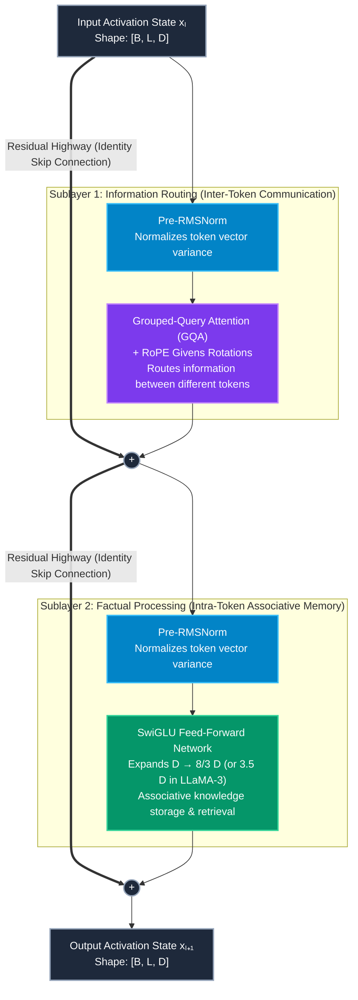
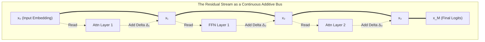
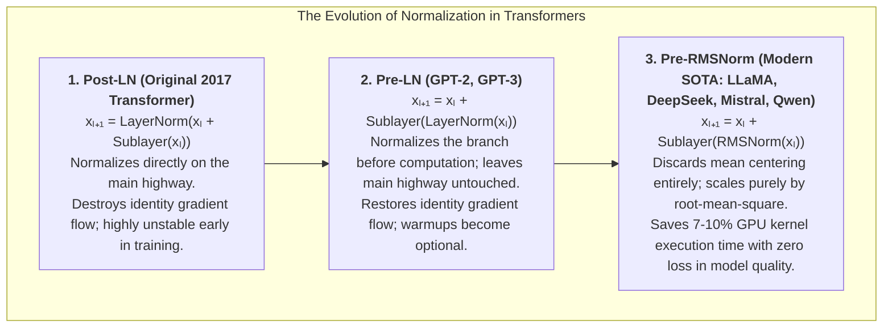
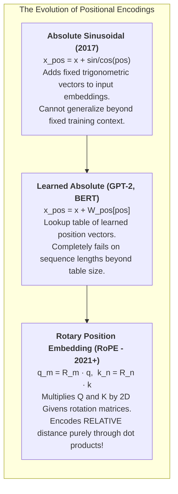
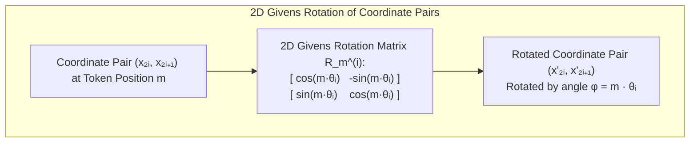
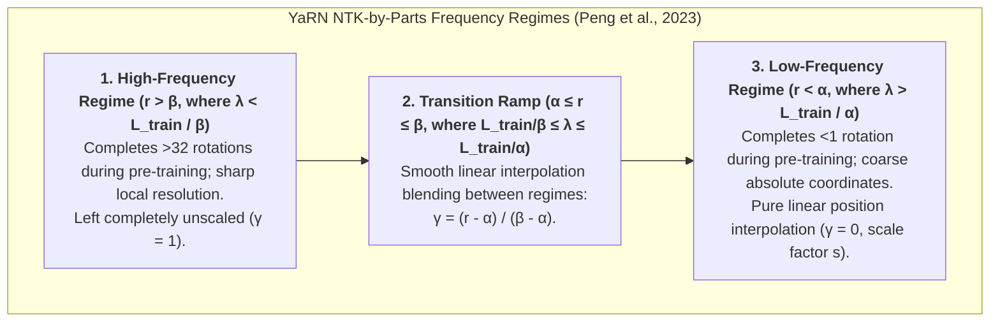
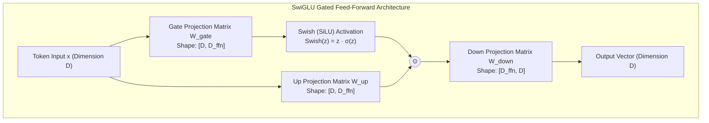
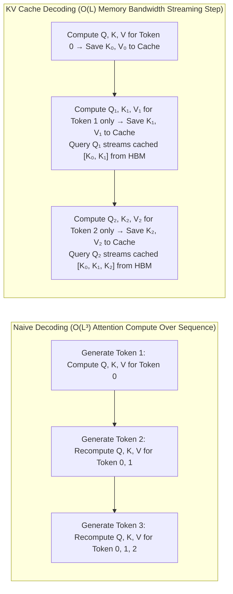
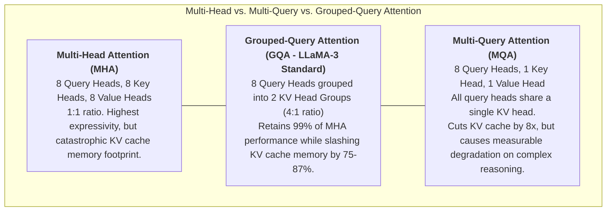

# Chapter 4: Transformer Layer Mechanics Deep Dive

## 1. Executive Summary & Narrative Arc

In 2017, researchers at Google published a deceptively titled paper: *"Attention Is All You Need"* (Vaswani et al.). Originally designed for sequence-to-sequence machine translation, the Transformer rapidly dismantled and replaced decades of specialized deep learning architectures—including Recurrent Neural Networks (RNNs, LSTMs) and Convolutional Neural Networks (CNNs).

Today, virtually all frontier Large Language Models—from Meta's LLaMA-3, to Anthropic's Claude 3.5, OpenAI's GPT-4o, and DeepSeek-V3—are built upon a specific, streamlined variant: the **decoder-only autoregressive Transformer**.

While popular literature often treats a Transformer layer as a monolithic black box that "predicts the next word", in reality it is a precision-engineered sequence of linear and non-linear physical operations.

### Plain-Language Definitions of the Core Terminology

- **Decoder-Only Autoregressive Transformer**: A neural network architecture that generates text strictly one token at a time from left to right. Each newly predicted token is appended to the input sequence to predict the subsequent token, without needing a separate encoder network.
- **Prefill Phase (Prompt Ingestion)**: The initial phase of LLM inference where the entire input prompt (all $L$ tokens) is processed simultaneously in parallel. Because all prompt tokens are known upfront, GPUs compute self-attention across the whole sequence at once using high-throughput matrix multiplication kernels (like FlashAttention).
- **Decode Phase (Token Generation)**: The subsequent interactive generation phase where tokens are produced incrementally, one token per step. Because each token depends on the previously generated token, decoding cannot be fully parallelized across time; it must run sequentially.
- **Residual Stream Highway**: A continuous, additive communication backbone that spans the entire depth of the network from the embedding layer to the final output head. Sublayers "read" from this highway, compute small adjustments (delta vectors $\Delta \mathbf{x}$), and "add" them back into the stream.
- **Identity Gradient Flow**: A mathematical property of residual connections where the derivative of an addition node contains the identity matrix $\mathbf{I}$. This creates an unimpeded gradient expressway, allowing backpropagation training signals to flow directly from the final layer back to the first layer without exponentially decaying or exploding.
- **Post-LN vs. Pre-LN vs. Pre-RMSNorm**: The architectural placement and mathematical formulation of normalization layers:
  - *Post-LN*: Normalization sits on the main residual highway *after* the sublayer addition, which distorts the identity gradient flow and destabilizes early training.
  - *Pre-LN*: Normalization is moved onto the sublayer branch *before* attention or MLP computation, leaving the main residual highway pristine.
  - *Pre-RMSNorm*: Modern state-of-the-art normalization that eliminates the mean-centering step of LayerNorm and scales activations solely by their root-mean-square, saving 7% to 10% GPU kernel compute.
- **RMSNorm (Root Mean Square Normalization)**: A high-performance normalization method that rescales a vector by the square root of the average squared value of its components, preventing numerical explosion across deep networks.
- **Variance Scaling**: The core stabilizing operation of normalization, dividing activations by their spread so that numbers remain within a well-behaved range (typically around standard deviation 1.0).
- **Epsilon ($\epsilon$)**: A tiny scalar constant (such as $10^{-5}$ or $10^{-6}$) added inside square roots to prevent division by zero during normalization.
- **Permutation Equivariance**: A mathematical symmetry of standard self-attention: if you shuffle the order of input tokens, the output vectors shuffle by the exact same permutation without changing their content. Self-attention has no innate awareness of word order.
- **Causal Masking**: An upper-triangular mask of negative infinities ($-\infty$) applied to attention scores before softmax, preventing token $i$ from attending to future tokens $j > i$.
- **Rotary Position Embeddings (RoPE)**: A position encoding mechanism that rotates Query and Key vectors in 2D coordinate planes by angles proportional to their position index, encoding relative token distances directly into inner products.
- **2D Givens Rotations**: Elementary linear algebra rotations that rotate vectors within a single 2D plane without altering orthogonal coordinates. RoPE applies Givens rotations across paired dimensions.
- **Relative Distance Invariance ($n - m$)**: The property where the attention score between a query at position $m$ and a key at position $n$ depends purely on their distance $n - m$, rather than their absolute positions in the document.
- **Base Frequency ($b$)**: The fundamental frequency hyperparameter in RoPE (originally $10,000$, increased to $500,000$ in LLaMA-3) determining how rapidly rotation frequencies decay across feature dimensions.
- **Context Window Extension**: Algorithmic techniques used to enable models trained on short sequences (e.g., 8,192 tokens) to process long documents (e.g., 131,072 tokens) without retraining from scratch.
- **Position Interpolation (PI)**: Extending context by linearly compressing position indices $`m \to m \cdot (L_{\text{train}} / L_{\text{target}})`$, keeping rotation angles within the training range but blurring high-frequency details.
- **NTK-Aware Base Scaling**: A non-linear frequency scaling method based on Neural Tangent Kernel theory that scales low frequencies more than high frequencies, preserving sharp local syntax while extending long-range capacity.
- **YaRN (Yet another RoPE extensioN)**: A state-of-the-art context extension technique that partitions feature dimensions into distinct wavelength regimes and applies a smooth frequency ramp combined with temperature rescaling.
- **Wavelength Regimes**: Categorizing RoPE feature dimensions into high-frequency (short wavelength, left unscaled), low-frequency (long wavelength, linearly interpolated), and intermediate bands.
- **Feed-Forward Network (FFN)**: The sublayer within each Transformer block that processes each token completely independently across the feature dimension.
- **Associative Memory**: The cognitive and computational mechanism where FFN layers act as a key-value storage bank: the first linear layer detects pattern keys, and the second linear layer injects corresponding factual knowledge values.
- **SwiGLU Gating**: A high-capacity non-linear activation mechanism combining the Swish (SiLU) activation function with a multiplicative gating branch ($`\mathbf{x}\mathbf{W}_{\text{gate}} \odot \mathbf{x}\mathbf{W}_{\text{up}}`$).
- **Parameter Sizing ($8/3 D$ vs. $3.5 D$)**: Sizing the FFN hidden dimension. Setting $D_{\text{ffn}} = \frac{8}{3} D$ (11,008 in LLaMA-1/2 7B) matches the parameter count of a standard two-matrix FFN ($8 D^2$). Setting $D_{\text{ffn}} = 3.5 D$ (14,336 in LLaMA-3-8B) deliberately expands factual parameter capacity.
- **KV Cache**: Storing historical Key and Value vectors in GPU memory during autoregressive generation to avoid recomputing past representations at every decode step.
- **Autoregressive Memory Bandwidth Bottleneck**: The physical hardware limit where single-token decoding is throttled by the speed of transferring the massive KV cache from off-chip HBM into on-chip registers, rather than GPU compute FLOPS.
- **Multi-Head Attention (MHA)**: Standard attention where every attention head has its own dedicated Query, Key, and Value projection matrices (1:1 ratio).
- **Multi-Query Attention (MQA)**: Extreme compression where all Query heads share a single Key head and a single Value head ($H:1$ ratio), drastically cutting KV cache size at the cost of reasoning nuance.
- **Grouped-Query Attention (GQA)**: Modern architectural standard where Query heads are grouped (e.g., 8 Query heads share 1 KV head), slashing KV cache memory by 75% to 87.5% while maintaining 99% of MHA performance.

---

## 2. Anatomical Blueprint of a Modern Transformer Block

A modern LLM is not a tangled web of ad-hoc connections; it is a clean, repetitive pipeline. An 8-billion-parameter model stacks 32 identical blocks; a 70-billion-parameter model stacks 80 blocks.

### Functional Comparison of the Two Sublayers

| Architectural Dimension | Sublayer 1: Attention (GQA + RoPE) | Sublayer 2: Feed-Forward (SwiGLU) |
| :--- | :--- | :--- |
| **Operational Scope** | **Inter-token** (across the Sequence dimension $L$). Tokens communicate with past tokens. | **Intra-token** (across the Hidden dimension $D$). Operates on each token completely independently. |
| **Cognitive Function** | Contextual routing, syntax binding, dynamic pronoun resolution, attention tracking. | Factual memory bank, associative knowledge recall, common-sense reasoning patterns. |
| **Linear Transformations** | 4 projections: $`\mathbf{W}_Q, \mathbf{W}_K, \mathbf{W}_V, \mathbf{W}_O`$. | 3 projections: $`\mathbf{W}_{\text{gate}}, \mathbf{W}_{\text{up}}, \mathbf{W}_{\text{down}}`$. |
| **Parameter Share** | Accounts for approximately **25% to 33%** of total layer parameters. | Accounts for approximately **67% to 75%** (up to 80% in LLaMA-3) of total layer parameters. |
| **Batching Mechanics** | Computes quadratic or linear attention across tokens. | High-throughput dense matrix multiplications ($`[B \cdot L, D] \times [D, D_{\text{ffn}}]`$). |

---

## 3. The Residual Stream: The Central Information Highway

In early deep neural networks (such as 20-layer Multi-Layer Perceptrons or deep convolutional nets), training deeper architectures was notoriously difficult due to **vanishing and exploding gradients**: during backpropagation, error signals multiplied through dozens of weight matrices, exponentially decaying to zero or blowing up to infinity.

The Transformer overcomes this barrier using the **Residual Stream** (adapted from He et al., 2016 *Deep Residual Learning for Image Recognition*).

### Mathematical Formulation & Symbol Breakdown

The state transition of the residual stream from layer $l$ to layer $l+1$ is defined as:

$$\mathbf{x}_{l+1} = \mathbf{x}_l + \text{Sublayer}(\text{RMSNorm}(\mathbf{x}_l))$$

Where:
- $\mathbf{x}_l \in \mathbb{R}^{B \times L \times D}$: The input activation tensor entering block $l$ along the residual highway.
- $\text{RMSNorm}(\mathbf{x}_l)$: The normalized version of $\mathbf{x}_l$, scaling vector variance to 1.0 before computation.
- $\text{Sublayer}(\cdot)$: The operational block (either Self-Attention or the SwiGLU Feed-Forward Network).
- $`\text{Sublayer}(\text{RMSNorm}(\mathbf{x}_l)) = \Delta \mathbf{x}_l`$: The **delta vector** computed by the sublayer. This delta represents a small semantic refinement or factual contribution.
- $+$: Pure elementwise addition into the running residual stream.
- $\mathbf{x}_{l+1} \in \mathbb{R}^{B \times L \times D}$: The updated activation tensor emerging from block $l$.

### Identity Gradient Flow: The Mathematical Guarantee Against Gradient Decay

To understand why this architecture can scale to 80+ layers without gradient degradation, we take the partial derivative of the state $\mathbf{x}_{l+1}$ with respect to the input state $\mathbf{x}_l$:

$$\frac{\partial \mathbf{x}_{l+1}}{\partial \mathbf{x}_l} = \mathbf{I} + \frac{\partial \text{Sublayer}(\text{RMSNorm}(\mathbf{x}_l))}{\partial \mathbf{x}_l}$$

Where:
- $\mathbf{I} \in \mathbb{R}^{D \times D}$: The **identity matrix**.
- $\frac{\partial \text{Sublayer}(\dots)}{\partial \mathbf{x}_l}$: The Jacobian matrix of partial derivatives through the sublayer weights and activations.

Now, let us unroll this equation across an entire network of $M$ layers (from layer 0 to layer $M$):

$$\mathbf{x}_M = \mathbf{x}_0 + \sum_{l=0}^{M-1} \Delta \mathbf{x}_l$$

Differentiating the final output $\mathbf{x}_M$ with respect to the initial input $\mathbf{x}_0$:

$$\frac{\partial \mathbf{x}_M}{\partial \mathbf{x}_0} = \mathbf{I} + \sum_{l=0}^{M-1} \frac{\partial \Delta \mathbf{x}_l}{\partial \mathbf{x}_0}$$

#### Physical & Software Intuition:
1. **The Additive Identity Term ($\mathbf{I}$)**: The identity matrix $\mathbf{I}$ means that the gradient signal can flow from layer $M$ directly back to layer 0 **completely unaltered**, regardless of what happens inside the sublayers.
2. **No Exponential Decay**: Even if every single sublayer in the network has weights that produce near-zero derivatives ($`\frac{\partial \Delta \mathbf{x}_l}{\partial \mathbf{x}_0} \approx 0`$), the total gradient $`\frac{\partial \mathbf{x}_M}{\partial \mathbf{x}_0}`$ never vanishes because it is bounded from below by the identity term:

$$\frac{\partial \mathbf{x}_M}{\partial \mathbf{x}_0} \approx \mathbf{I} \ne \mathbf{0}$$

This mathematical guarantee provides an uninterrupted gradient expressway, enabling 80+ layer networks to train with supreme stability.

---

## 4. Layer Normalization: From Post-LN to Pre-RMSNorm

As a tensor travels through dozens of additive residual additions, the magnitude (variance) of its numbers naturally grows, which can cause internal activations to destabilize. Normalization stabilizes this variance.

### The Mathematics of Standard LayerNorm vs. RMSNorm

#### 1. Standard LayerNorm (Ba, Kiros, & Hinton, 2016)
Standard LayerNorm centers the input vector by subtracting its mean $\mu$ and scales it by its standard deviation $\sigma$:

$$\mu = \frac{1}{d} \sum_{i=1}^{d} x_i$$

$$\sigma^2 = \frac{1}{d} \sum_{i=1}^{d} (x_i - \mu)^2$$

$$\text{LN}(x_i) = \frac{x_i - \mu}{\sqrt{\sigma^2 + \epsilon}} \cdot \gamma_i + \beta_i$$

#### 2. Root Mean Square Normalization (RMSNorm; Zhang & Sennrich, 2019)
Zhang & Sennrich demonstrated that the mean-centering step ($x_i - \mu$) provides almost zero regularization benefit in deep networks; **variance scaling is what prevents gradient instability**.

RMSNorm strips away the mean and bias parameters entirely:

$$\text{RMS}(\mathbf{x}) = \sqrt{\frac{1}{d} \sum_{i=1}^{d} x_i^2 + \epsilon}$$

$$\text{RMSNorm}(x_i) = \frac{x_i}{\text{RMS}(\mathbf{x})} \cdot \gamma_i$$

### Detailed Symbol Breakdown

- $`\mathbf{x} = [x_1, x_2, \dots, x_d]^T \in \mathbb{R}^d`$: The hidden activation vector of a single token at a given layer.
- $d$: The dimension of the vector ($D = 4,096$ in LLaMA-3-8B).
- $\text{RMS}(\mathbf{x})$: The root-mean-square statistic, representing the quadratic mean of the vector coordinates.
- $\epsilon$: A tiny numerical stabilization scalar (typically $10^{-5}$ or $10^{-6}$) preventing division by zero.
- $\gamma_i$: A learned elementwise scaling parameter that allows the network to rescale individual features adaptively.
- $\beta_i$: The learned bias parameter (omitted entirely in RMSNorm).

### Hardware & Kernel Performance Intuition

Why does every modern frontier LLM (LLaMA-3, DeepSeek-V3, Mistral, Qwen) use RMSNorm instead of LayerNorm?

1. **Two-Pass vs. One-Pass Memory Reductions**:
   - Standard LayerNorm requires **two reduction passes** over the vector in GPU memory: Pass 1 calculates the mean $\mu = \frac{1}{d} \sum x_i$, and Pass 2 calculates the variance $\sigma^2 = \frac{1}{d} \sum (x_i - \mu)^2$.
   - RMSNorm requires only **a single reduction pass**: it sums the squares $\sum x_i^2$ in one sweep across GPU registers.
2. **Elimination of Global Memory Synchronization**:
   - Because RMSNorm needs only one reduction pass, the entire normalization operation can be executed within a single fused CUDA or Triton kernel without intermediate thread barrier synchronizations.
3. **Wall-Clock Speedup**:
   - On memory-bandwidth-bound hardware like NVIDIA A100 or H100 GPUs, RMSNorm yields a **7% to 10% speedup** in raw layer execution time while maintaining identical downstream evaluation accuracy.

---

## 5. Position Encoding: Rotary Position Embeddings (RoPE)

Standard self-attention is **permutation equivariant**: if you take a sequence of tokens and scramble their order, the resulting output vectors are identical except for being scrambled in the exact same order.

In decoder-only autoregressive models, applying a lower-triangular **causal mask** breaks strict permutation equivariance because token $i$ can only attend to the $i+1$ preceding tokens. While this provides coarse positional information (which is why models without positional encodings—NoPE—can still learn basic language patterns), causal masking alone lacks the precise relative-distance resolution needed for syntax, code indentation, and long-range factual recall.

To provide exact spatial coordinates, models inject positional representations.

### The Mathematics of RoPE: 2D Givens Rotations

Introduced by Jianlin Su et al. (2021) in *RoFormer*, **RoPE** has become the universal standard across LLaMA, Mistral, Qwen, and DeepSeek.

Instead of *adding* positional vectors to token embeddings, RoPE pairs consecutive coordinates of the Query and Key vectors ($`x_{2i}, x_{2i+1}`$) and **rotates** them in a 2D plane by an angle proportional to the token's position index $m$:

For a 2D coordinate pair $`(q_{2i}, q_{2i+1})`$ at token position $m$, the rotation is computed as:

$$\begin{pmatrix} q'_{2i} \\ q'_{2i+1} \end{pmatrix} = \begin{pmatrix} \cos(m \theta_i) & -\sin(m \theta_i) \\ \sin(m \theta_i) & \cos(m \theta_i) \end{pmatrix} \begin{pmatrix} q_{2i} \\ q_{2i+1} \end{pmatrix}$$

Where:
- $`m \in \{0, 1, \dots, L-1\}`$: The integer sequence index of the token.
- $`i \in \{0, 1, \dots, \frac{D_h}{2} - 1\}`$: The coordinate pair index within the head dimension $D_h$.
- $\theta_i$: The base rotation frequency for coordinate pair $i$, defined as:

$$\theta_i = b^{-\frac{2i}{D_h}}$$

Where:
- $b$: The base frequency (traditionally $b = 10,000$; increased to $b = 500,000$ in LLaMA-3).
- $D_h$: The head dimension ($D_h = 128$).

The full $`D_h \times D_h`$ transformation matrix $\mathbf{R}_m$ is a block-diagonal matrix composed of $D_h / 2$ individual 2D Givens rotation blocks:

$$\mathbf{R}_m = \begin{pmatrix} \mathbf{R}_m^{(0)} & \mathbf{0} & \dots & \mathbf{0} \\ \mathbf{0} & \mathbf{R}_m^{(1)} & \dots & \mathbf{0} \\ \vdots & \vdots & \ddots & \vdots \\ \mathbf{0} & \mathbf{0} & \dots & \mathbf{R}_m^{(D_h/2 - 1)} \end{pmatrix}$$

---

### Step-by-Step Proof of Relative Distance Invariance

The brilliance of RoPE lies in the fact that the inner product between Query at position $m$ and Key at position $n$ depends **strictly on the relative distance $(n - m)$**, not their absolute positions.

#### Theorem:

$$
\langle \mathbf{R}_m \mathbf{q}, \mathbf{R}_n \mathbf{k} \rangle = \mathbf{q}^T \mathbf{R}_{n - m} \mathbf{k}
$$
#### Proof:
1. Express the inner product in matrix notation:

$$\langle \mathbf{R}_m \mathbf{q}, \mathbf{R}_n \mathbf{k} \rangle = (\mathbf{R}_m \mathbf{q})^T (\mathbf{R}_n \mathbf{k}) = \mathbf{q}^T \mathbf{R}_m^T \mathbf{R}_n \mathbf{k}$$

2. Inspect the product $`\mathbf{R}_m^T \mathbf{R}_n`$ for a single 2D block $i$. Because 2D rotation matrices are orthogonal, the transpose is simply the inverse rotation by angle $-m\theta_i$:

$$(\mathbf{R}_m^{(i)})^T = \begin{pmatrix} \cos(m \theta_i) & \sin(m \theta_i) \\ -\sin(m \theta_i) & \cos(m \theta_i) \end{pmatrix} = \mathbf{R}_{-m}^{(i)}$$

3. Multiply $(\mathbf{R}_m^{(i)})^T$ by $\mathbf{R}_n^{(i)}$:

$$(\mathbf{R}_m^{(i)})^T \mathbf{R}_n^{(i)} = \begin{pmatrix} \cos(m\theta_i) & \sin(m\theta_i) \\ -\sin(m\theta_i) & \cos(m\theta_i) \end{pmatrix} \begin{pmatrix} \cos(n\theta_i) & -\sin(n\theta_i) \\ \sin(n\theta_i) & \cos(n\theta_i) \end{pmatrix}$$

4. Expanding the top-left element using the angle subtraction identity $\cos(A - B) = \cos A \cos B + \sin A \sin B$:

$$\cos(m\theta_i)\cos(n\theta_i) + \sin(m\theta_i)\sin(n\theta_i) = \cos((n - m)\theta_i)$$

5. Expanding the top-right element using $\sin(A - B) = \sin A \cos B - \cos A \sin B$:

$$-\cos(m\theta_i)\sin(n\theta_i) + \sin(m\theta_i)\cos(n\theta_i) = -\sin((n - m)\theta_i)$$

6. Expanding the bottom-left element:

$$-\sin(m\theta_i)\cos(n\theta_i) + \cos(m\theta_i)\sin(n\theta_i) = \sin((n - m)\theta_i)$$

7. Expanding the bottom-right element:

$$\sin(m\theta_i)\sin(n\theta_i) + \cos(m\theta_i)\cos(n\theta_i) = \cos((n - m)\theta_i)$$

8. Reassembling the matrix:

$$(\mathbf{R}_m^{(i)})^T \mathbf{R}_n^{(i)} = \begin{pmatrix} \cos((n - m)\theta_i) & -\sin((n - m)\theta_i) \\ \sin((n - m)\theta_i) & \cos((n - m)\theta_i) \end{pmatrix} = \mathbf{R}_{n - m}^{(i)}$$

Since this holds for every independent 2D block along the diagonal, we obtain:

$$\mathbf{R}_m^T \mathbf{R}_n = \mathbf{R}_{n - m}$$

$$\langle \mathbf{R}_m \mathbf{q}, \mathbf{R}_n \mathbf{k} \rangle = \mathbf{q}^T \mathbf{R}_{n - m} \mathbf{k} \quad \blacksquare$$

The attention mechanism naturally measures relative spatial distance without needing any absolute position lookup tables!

---

### Context Window Extension: YaRN and Wavelength Regimes

While RoPE guarantees relative distance invariance, naive RoPE **fails to extrapolate** when evaluated on context lengths significantly longer than its training context (e.g., running an 8k-trained model at 64k or 128k tokens).

**The Out-of-Distribution Angle Problem**: In the low-frequency dimensions (large $i$), the rotation angle $(n - m)\theta_i$ rotates very slowly and never completes a full circle ($2\pi$) during 8k training. When the model encounters relative distances up to 128k, these angles enter previously unseen values. The attention softmax operates over all keys simultaneously, causing attention logits to go out-of-distribution and perplexity to explode.

Modern frontier models overcome this using advanced frequency scaling techniques:

1. **Position Interpolation (PI)** (Chen et al., 2023): Compresses position indices by scaling $`m \to m \cdot \frac{L_{\text{train}}}{L_{\text{target}}}`$. This keeps all rotation angles within the trained range, but blurs high-frequency local distinctions.
2. **NTK-Aware Base Scaling**: Adjusts the base frequency $b$ (e.g., Meta increased $b = 10,000 \to 500,000$ in LLaMA-3). High-frequency dimensions are scaled less, while low-frequency dimensions are scaled more.
3. **YaRN (Yet another RoPE extensioN)** (Peng et al., 2023): Used by **DeepSeek-V3** and **Qwen 2.5** to extend context from 4k to 128k.

#### Wavelength Regimes and YaRN Mathematical Formulation:
The wavelength $\lambda_i$ of coordinate pair $i$ represents the number of tokens required to complete a full $2\pi$ rotation in the complex plane:

$$\lambda_i = \frac{2\pi}{\theta_i} = 2\pi \cdot b^{\frac{2i}{D_h}}$$

YaRN defines the rotational cycle ratio $r_i$ as the number of full rotations completed within the pre-training context length $L_{\text{train}}$:

$$r_i = \frac{L_{\text{train}}}{\lambda_i}$$

Under YaRN's **NTK-by-parts** framework (Peng et al., 2023), dimensions are partitioned into three distinct operational regimes using boundary hyperparameters $\alpha$ and $\beta$ (empirically set to $\alpha = 1$ and $\beta = 32$):

1. **High-Frequency Regime ($r_i > \beta$, or $\lambda_i < \frac{L_{\text{train}}}{\beta}$)**:
   - These dimensions complete more than $\beta = 32$ full rotations within the training context. They encode fine-grained local syntax and relative distances.
   - Because these periodic rotations were thoroughly learned during pre-training, **no interpolation is applied** ($\gamma_i = 1$). The original rotation frequency $\theta_i$ is preserved unaltered.
2. **Low-Frequency Regime ($r_i < \alpha$, or $\lambda_i > \frac{L_{\text{train}}}{\alpha}$)**:
   - These dimensions complete fewer than $\alpha = 1$ full rotation (meaning their wavelength $\lambda_i$ is longer than the entire pre-training context $L_{\text{train}}$).
   - Because the model never observed a complete rotational cycle during pre-training, these dimensions act as coarse absolute coordinates. They are **purely interpolated** by the scale factor $s = \frac{L_{\text{target}}}{L_{\text{train}}}$ ($\gamma_i = 0$), scaling the frequency to $\theta_i / s$.
3. **Intermediate Transition Ramp ($\alpha \le r_i \le \beta$)**:
   - For dimensions with intermediate wavelengths ($\frac{L_{\text{train}}}{\beta} \le \lambda_i \le \frac{L_{\text{train}}}{\alpha}$), YaRN applies a smooth linear blending ramp $\gamma_i = \frac{r_i - \alpha}{\beta - \alpha}$ that smoothly connects pure interpolation ($\gamma_i = 0$) with unscaled extrapolation ($\gamma_i = 1$):

$$h(\theta_i) = (1 - \gamma_i) \frac{\theta_i}{s} + \gamma_i \theta_i$$

4. **Attention Temperature Rescaling**:
   As the context window expands by scale factor $s$ (e.g. extending from 4k to 128k, where $s = 32$), the attention softmax distributes probability mass over 32 times as many keys, causing attention entropy to dilute. YaRN counteracts this entropy inflation by scaling the attention logits by a factor of $1/t = (0.1 \ln(s) + 1)^2$. In software implementations, this is applied by multiplying the Query and Key vector representations by $\sqrt{1/t} = 0.1 \ln(s) + 1$ prior to computing the attention dot product.
---

## 6. Feed-Forward Networks (FFN) & SwiGLU: The Factual Memory Banks

While the Attention sublayer routes relationships between tokens, the **Feed-Forward Network (FFN)** sublayer processes tokens individually. FFNs account for roughly **two-thirds of the total parameters** in a modern LLM.

Mechanistic interpretability research (e.g., Geva et al., 2021) has revealed that FFN layers act as **key-value associative memory banks**:
- The first linear layer acts as a key detector: it checks if the token representation activates specific factual patterns (e.g., "capital city of" + "France").
- The second linear layer acts as a value provider: it injects the corresponding factual knowledge (e.g., "Paris") into the residual stream.

### The Mathematics of SwiGLU

Modern frontier models replace classical ReLU/GELU activations with **SwiGLU** (Shazeer, 2020 *GLU Variants Improve Transformer*):

$$\text{SwiGLU}(\mathbf{x}) = \left( \text{Swish}(\mathbf{x} \mathbf{W}_{\text{gate}}) \odot (\mathbf{x} \mathbf{W}_{\text{up}}) \right) \mathbf{W}_{\text{down}}$$

Where the Swish (or SiLU) activation function is:

$$\text{Swish}(z) = z \cdot \sigma(z) = \frac{z}{1 + e^{-z}}$$

### Detailed Symbol Breakdown

- $\mathbf{x} \in \mathbb{R}^{B \times L \times D}$: The token activation vector entering the FFN sublayer from Pre-RMSNorm.
- $`\mathbf{W}_{\text{gate}} \in \mathbb{R}^{D \times D_{\text{ffn}}}`$: The gate projection weight matrix that determines which factual features are activated or suppressed.
- $`\mathbf{W}_{\text{up}} \in \mathbb{R}^{D \times D_{\text{ffn}}}`$: The up-projection weight matrix that projects features into the high-dimensional intermediate space.
- $`\mathbf{W}_{\text{down}} \in \mathbb{R}^{D_{\text{ffn}} \times D}`$: The down-projection weight matrix that collapses the intermediate representations back into the residual stream dimension $D$.
- $\odot$: Elementwise (Hadamard) product.
- $\sigma(z) = \frac{1}{1 + e^{-z}}$: The standard sigmoid function.

### Parameter Sizing Derivation: $8/3 D$ vs. $3.5 D$

A standard, classical two-matrix FFN (such as in the original 2017 Transformer or GPT-3) uses two weight matrices with hidden size $4D$:

$$\text{Params}_{\text{Standard}} = (\mathbf{W}_1 \text{ size}) + (\mathbf{W}_2 \text{ size}) = (D \times 4D) + (4D \times D) = 8D^2$$

SwiGLU, however, introduces **three** projection matrices ($`\mathbf{W}_{\text{gate}}, \mathbf{W}_{\text{up}}, \mathbf{W}_{\text{down}}`$):

$$\text{Params}_{\text{SwiGLU}} = (D \times D_{\text{ffn}}) + (D \times D_{\text{ffn}}) + (D_{\text{ffn}} \times D) = 3 \cdot D \cdot D_{\text{ffn}}$$

#### 1. The Parameter-Matched Baseline ($\frac{8}{3} D$)
To ensure that switching to SwiGLU does not increase total parameter count or compute cost over a standard $4D$ FFN, Shazeer set their parameter counts equal:

$$3 \cdot D \cdot D_{\text{ffn}} = 8D^2 \implies D_{\text{ffn}} = \frac{8}{3} D \approx 2.667 D$$

For an 8B model where $D = 4,096$:

$$D_{\text{ffn}} = \frac{8}{3} \times 4096 = 10,922.67$$

To ensure optimal memory alignment on GPU Tensor Cores, deep learning frameworks require dimensions to be multiples of 256. Rounding to the nearest multiple of 256 yields:

$$D_{\text{ffn}} = \mathbf{11,008} \quad \text{(used in LLaMA-1 and LLaMA-2 7B)}$$

#### 2. Expanded Frontier Sizing ($3.5 D$)
In **LLaMA-3-8B**, Meta recognized that factual knowledge capacity is overwhelmingly bottlenecked by FFN capacity. They deliberately broke the parameter-matched constraint and expanded the FFN hidden dimension to:

$$D_{\text{ffn}} = 3.5 \times D = 3.5 \times 4096 = \mathbf{14,336}$$

In LLaMA-3-70B ($D = 8,192$):

$$D_{\text{ffn}} = 3.5 \times 8192 = \mathbf{28,672}$$

This expansion increases the parameter share of the FFN sublayer to **over 70% of the entire model's parameters**, providing vastly greater capacity for factual recall, multi-lingual knowledge, and code generation.

---

## 7. The KV Cache & Grouped-Query Attention (GQA)

Understanding text generation requires understanding the **fundamental asymmetry** between prompt ingestion and autoregressive decoding:

- **Prompt Ingestion (Prefill Phase)**: At the start of inference, the model processes the entire prompt of $L$ tokens simultaneously in parallel. Because all prompt tokens are known upfront, attention is computed in a single parallel pass using FlashAttention.
- **Token Generation (Decoding Phase)**: The model generates text **one token at a time** autoregressively. To generate token $t+1$, it feeds the generated token back as input.

### The KV Cache Mechanism
Because prior tokens never change their historical representations during inference, recomputing their Key ($\mathbf{K}$) and Value ($\mathbf{V}$) vectors at every step is a catastrophic waste of GPU compute.

Instead, we cache all past $\mathbf{K}$ and $\mathbf{V}$ vectors in GPU memory:
- At step $t$, we compute $`\mathbf{Q}_t, \mathbf{K}_t, \mathbf{V}_t`$ **only for the single new token**.
- We append $\mathbf{K}_t$ and $\mathbf{V}_t$ to the growing **KV Cache**.
- $\mathbf{Q}_t$ is multiplied against all cached Keys to calculate attention scores and extract the weighted sum of cached Values.

---

### The KV Cache Memory Equation & The Inference Memory Wall

While the KV cache saves massive compute, it introduces a severe **memory capacity crisis**.

The physical memory required to store the KV cache across all layers in 16-bit precision (`bfloat16` or `float16`, 2 bytes per element) is:

$$\text{Memory}_{\text{KV}} = 2 \times 2 \times n_{\text{layers}} \times n_{\text{KV}} \times d_{\text{head}} \times L \times B \quad \text{bytes}$$

Where:
- The first $2$: Accounts for the two separate cached tensors (Keys and Values).
- The second $2$: Accounts for the 2 bytes required per element in 16-bit precision (`bfloat16` or `float16`).
- $n_{\text{layers}}$: The number of Transformer layers in the model (e.g., 32 in 8B, 80 in 70B).
- $`n_{\text{KV}}`$: The number of Key-Value heads per layer.
- $d_{\text{head}}$: The head dimension ($128$).
- $L$: The sequence context length (e.g., 32,768 or 131,072 tokens).
- $B$: The batch size (number of concurrent user requests).

Combining the leading constants:

$$\text{Memory}_{\text{KV}} = 4 \cdot n_{\text{layers}} \cdot n_{\text{KV}} \cdot d_{\text{head}} \cdot L \cdot B \quad \text{bytes}$$

#### Concrete Example: The Multi-Head Attention (MHA) Crisis
Consider a 70B parameter model with standard Multi-Head Attention ($`n_{\text{KV}} = n_{\text{Q}} = 64`$), $n_{\text{layers}} = 80$, $d_{\text{head}} = 128$, processing a 32,000-token context for a single user ($B = 1$):

$$\text{Memory}_{\text{KV}} = 4 \times 80 \times 64 \times 128 \times 32,000 \times 1 = 83,886,080,000 \text{ bytes} \approx 78.1 \text{ GiB}$$

A single conversation at 32k context requires **78.1 GiB of VRAM** solely to hold the KV cache! An NVIDIA A100 GPU provides 80 GiB of memory. The KV cache alone fills the entire GPU, leaving zero space to load the actual model weights (which require $\sim 140\text{ GB}$ in BF16).

Furthermore, during single-token decoding, arithmetic intensity is virtually zero: the GPU spends 99% of its time streaming gigabytes of past KV pairs from off-chip HBM into on-chip registers just to perform a few matrix-vector multiplications. **Decoding is strictly memory-bandwidth-bound, not compute-bound.**

---

### Grouped-Query Attention (GQA): Mathematical Formulation & Sharing Ratio

To shatter this memory wall, modern LLMs transitioned from Multi-Head Attention (MHA) to **Grouped-Query Attention (GQA)** (Ainslie et al., 2023):

In GQA, Query heads are divided into groups of size $\text{Ratio}_{\text{GQA}}$:

$$\text{Ratio}_{\text{GQA}} = \frac{n_{\text{Q}}}{n_{\text{KV}}}$$

The reduction in KV cache memory and memory bandwidth consumption is:

$$\text{Reduction Factor} = 1 - \frac{n_{\text{KV}}}{n_{\text{Q}}} = 1 - \frac{1}{\text{Ratio}_{\text{GQA}}}$$

#### Real-World Case Study: LLaMA-3-70B
In LLaMA-3-70B:
- $`n_{\text{Q}} = 64`$ (Query heads)
- $`n_{\text{KV}} = 8`$ (Key-Value heads)
The GQA sharing ratio is:

$$\text{Ratio}_{\text{GQA}} = \frac{64}{8} = 8$$

The memory reduction factor is:

$$\text{Reduction} = 1 - \frac{1}{8} = \frac{7}{8} = 0.875$$

This constitutes an 87.5% reduction in KV cache memory capacity and bandwidth consumption.

### KV Cache Memory Comparison Across Context Lengths (LLaMA-3-70B, $B=1$)

| Context Length ($L$) | Standard MHA (64 KV Heads) | Grouped-Query Attention (8 KV Heads) | VRAM Saved |
| :--- | :--- | :--- | :--- |
| **8,000 tokens (Baseline Context)** | 20.97 GB (19.53 GiB) | **2.62 GB** (2.44 GiB) | **18.35 GB** (87.5%) |
| **32,000 tokens (Extended Context)** | 83.89 GB (78.12 GiB; fills an 80 GiB A100) | **10.49 GB** (9.77 GiB) | **73.40 GB** (87.5%) |
| **128,000 tokens (Frontier Long Context)** | 335.54 GB (312.50 GiB; requires 4× 80 GiB GPUs for KV alone) | **41.94 GB** (39.06 GiB; fits on 1× H100) | **293.60 GB** (87.5%) |

By reducing the KV cache memory footprint by 87.5%, GQA enables high-throughput multi-user inference on commodity GPU clusters while maintaining virtually identical modeling accuracy to full Multi-Head Attention.

---

## 8. Key Engineering Takeaways

1. **Residual Stream is an Additive Communication Bus**: Modern Transformers maintain a shared highway where sublayers read current representations and add small delta refinements ($`\mathbf{x}_{l+1} = \mathbf{x}_l + \Delta \mathbf{x}`$). The identity term $\mathbf{I}$ in the gradient derivative ($`\frac{\partial \mathbf{x}_{l+1}}{\partial \mathbf{x}_l} = \mathbf{I} + \frac{\partial \Delta \mathbf{x}}{\partial \mathbf{x}_l}`$) guarantees that backpropagation signals never vanish, even across 80+ layers.
2. **Pre-RMSNorm Maximizes GPU Hardware Efficiency**: Moving normalization before sublayers ensures clean residual addition. Discarding the mean-centering step of LayerNorm allows RMSNorm to run in a single fused GPU reduction pass, saving 7% to 10% kernel execution time without compromising stability.
3. **RoPE Encodes Relative Distance Geometrically**: By applying 2D Givens rotations to Query and Key coordinate pairs ($`\mathbf{R}_m \mathbf{q}`$ and $`\mathbf{R}_n \mathbf{k}`$), the inner product depends strictly on the relative distance $`\mathbf{q}^T \mathbf{R}_{n-m} \mathbf{k}`$.
4. **YaRN Extends Context Beyond Training Limits**: High-frequency RoPE dimensions preserve sharp local syntax without scaling, while low-frequency dimensions are purely interpolated. Combined with an attention logit temperature multiplier $1/t = (0.1\ln(s) + 1)^2$ (scaling Queries and Keys by $\sqrt{1/t} = 0.1\ln(s) + 1$), YaRN expands context windows from 4k to 128k tokens without entropy collapse.
5. **FFNs are Factual Knowledge Stores**: Consuming 67% to 80% of total parameters, FFNs act as associative memory banks. SwiGLU gating provides dynamic feature filtering. While $D_{\text{ffn}} = \frac{8}{3} D$ matches standard FFN compute ($8D^2$), modern frontier models like LLaMA-3 expand sizing to $3.5 D$ ($14,336$ in 8B) to dramatically boost factual capacity.
6. **Autoregressive Decoding is Memory-Bandwidth-Bound**: Generating text token by token requires streaming past Keys and Values from off-chip HBM into registers at every step. Grouped-Query Attention (GQA) groups Query heads (e.g., 8:1 ratio in LLaMA-3-70B), slashing KV cache memory and memory bandwidth consumption by 87.5% with negligible quality loss.
