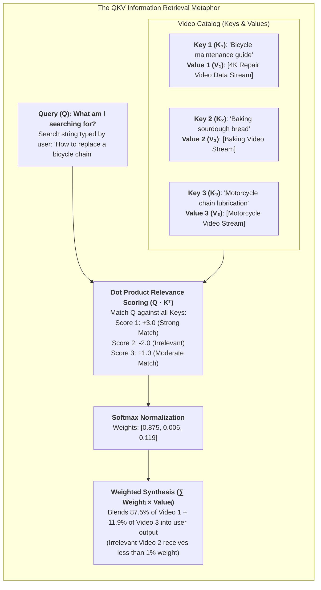
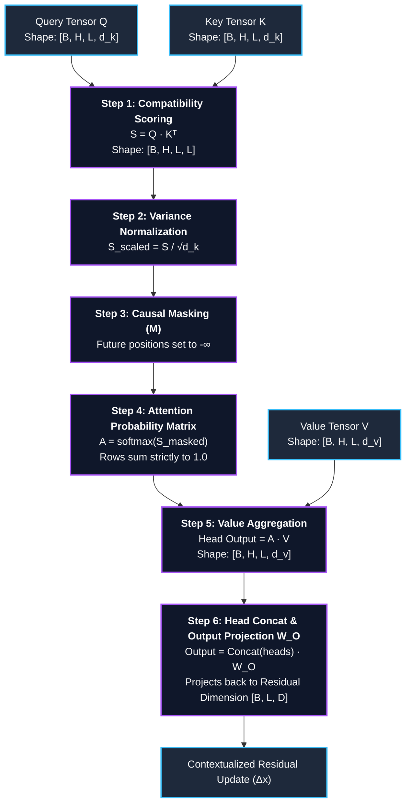
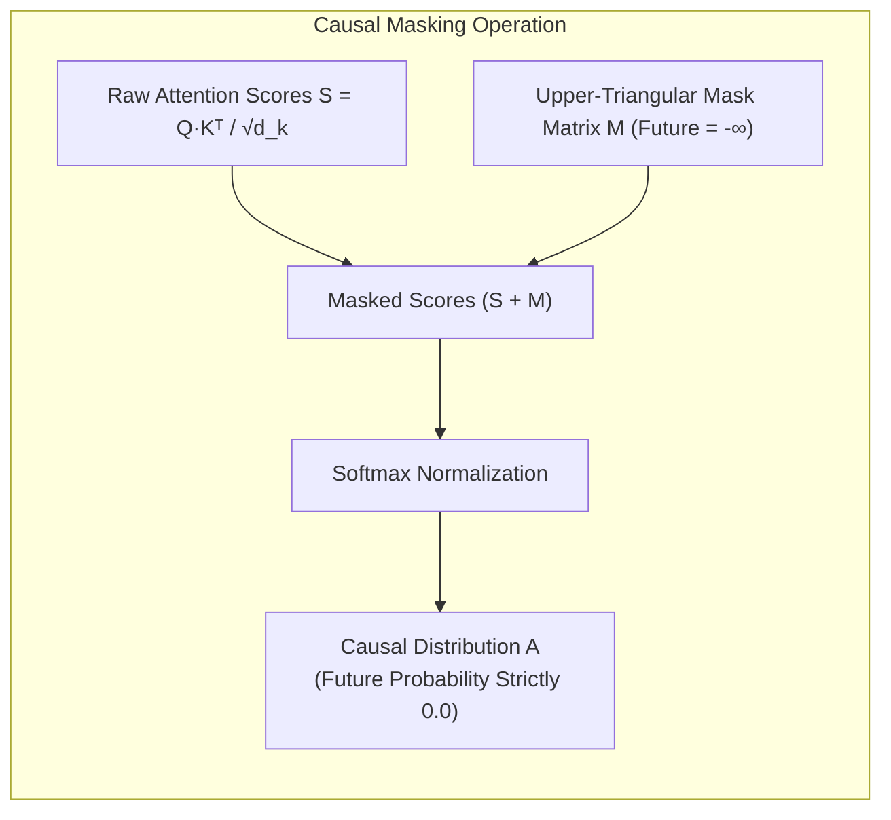
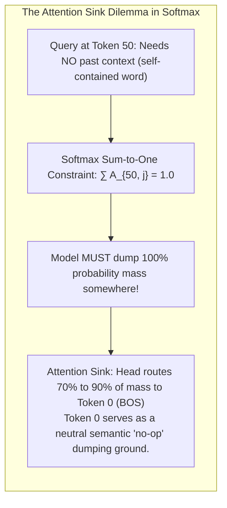
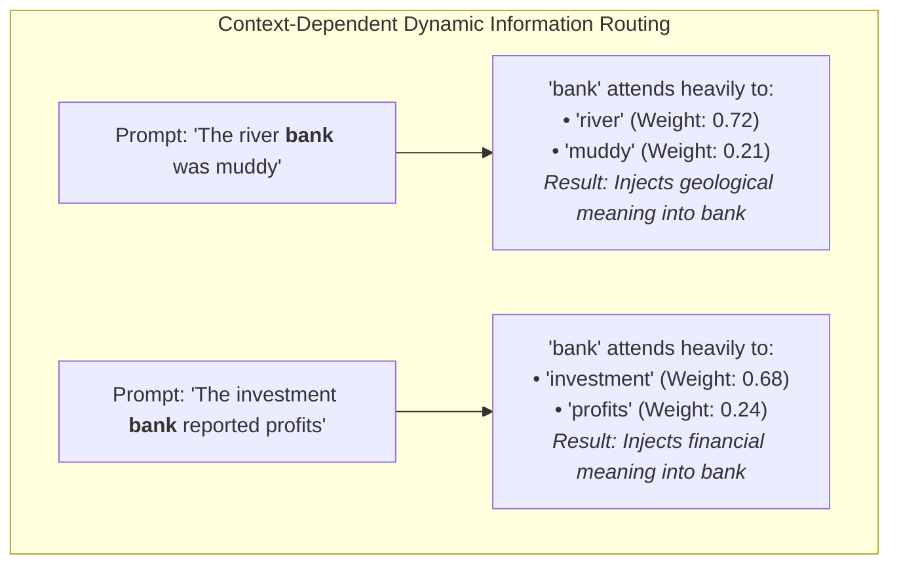
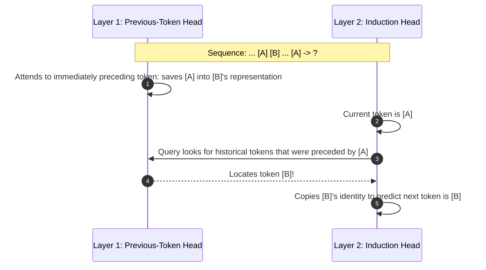
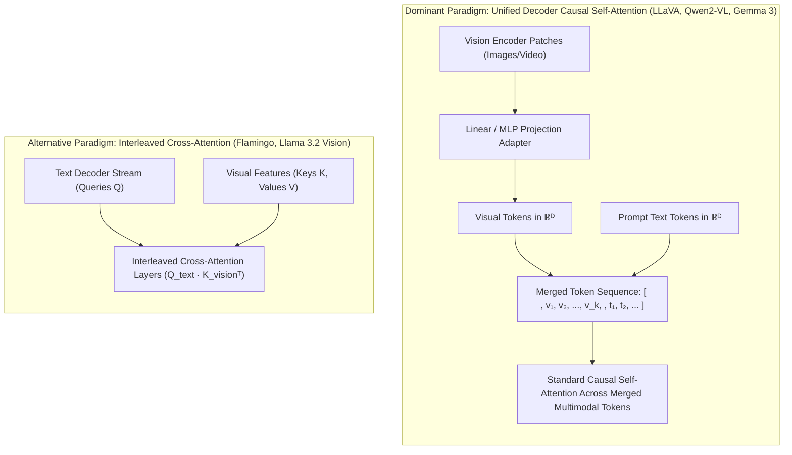

# Chapter 5: The Mechanics of Attention: Information Routing and Dynamic Retrieval

## 1. Executive Summary & Narrative Arc

In classical computer architectures (such as the Von Neumann CPU), memory access is **discrete and address-based**: a program supplies a specific 64-bit hexadecimal memory address (`0x7FFF0042`), and the memory controller retrieves the exact bits stored in that physical capacitor. If the address is off by a single bit, the program crashes with a segmentation fault.

The defining breakthrough of the Transformer is that it replaces rigid address-based memory with **continuous, content-based associative retrieval**. This mechanism is called **Attention**.

Attention allows every token in a sequence to dynamically look across the entire context window, evaluate which other words are relevant to its current task, and pull their semantic information into its own representation.

In this chapter, we unpack:
1. The **Plain-Language Foundation**: A clear, human glossary of every foundational concept.
2. The **Query-Key-Value (QKV)** database metaphor.
3. The exact mathematical mechanics of **Scaled Dot-Product Attention** with step-by-step proofs.
4. Why the scaling factor $`\frac{1}{\sqrt{d_k}}`$ is an indispensable numerical stabilizer against vanishing gradients.
5. The **Multi-Head Projection and the Output-Value (OV) Circuit**.
6. **Causal Masking and Attention Sinks**: Preserving the arrow of time and solving the softmax sum-to-one constraint in long streaming contexts.
7. **Attention Maps as Dynamic Graphs**: How Transformers build ephemeral neural circuits at runtime.
8. **Induction Heads**: The biological-like microcircuits that enable in-context learning.
9. **Self-Attention vs. Cross-Attention and Multimodal Fusion**: Routing within vs. across modalities.

---

## 2. Plain-Language Foundation: Demystifying Attention Terminology

Before diving into high-dimensional matrix algebra, let us establish intuitive, plain-language definitions for every core concept in the attention toolkit:

- **Query ($\mathbf{q}$)**: The *seeker*. This is an active vector emitted by a token asking: *"What missing information do I need right now to understand my role in this sentence?"* (For example, the pronoun *"it"* searching for the physical object it refers to).
- **Key ($\mathbf{k}$)**: The *advertisement label*. This is a passive vector emitted by a token telling the rest of the sequence: *"Here is my identity, grammatical category, and attributes."* (For example, the noun *"glass"* advertising that it is a physical, fragile vessel).
- **Value ($\mathbf{v}$)**: The *payload*. This is the actual substantive semantic content delivered if a Query matches a Key. (For example, the descriptive qualities of *"glass"*—brittle, transparent, liquid-holding—ready to be blended into *"it"*).
- **Scaled Dot-Product Attention**: The mathematical engine that compares Queries to Keys, calculates similarity percentages, and calculates a weighted blend of the Values.
- **Compatibility Scoring**: Taking the geometric dot product of a Query and a Key. When two vectors point in similar directions, their product is high, signaling that the two tokens are semantically relevant to each other.
- **Variance Scaling**: Dividing the raw compatibility score by the square root of the head dimension ($`\sqrt{d_k}`$). Because summing many numbers inflates their spread (variance), dividing keeps the numbers at a moderate scale, preventing the mathematical functions downstream from locking up.
- **Causal Masking**: A triangular mathematical filter placed over future words during text generation. It acts like a blindfold, ensuring that token 5 can see tokens 1 through 4, but cannot peek ahead at token 6.
- **Attention Maps as Dynamic Graphs**: Unlike traditional software where connections between functions are hardcoded, attention builds a brand-new, customized web of connections (a temporary network graph) for every single sentence it processes.
- **Induction Heads**: Mini two-step reasoning circuits discovered inside trained Transformers that detect repetition patterns ($`[A][B] \dots [A] \to [B]`$). They explain how language models can learn new tasks directly from prompt examples without updating their stored weights.
- **Attention Sinks & StreamingLLM**: The mathematical discovery that language models dump excess attention probability onto the very first tokens of a document (like the initial token 0), treating them as an "overflow valve" when no other words are relevant.
- **Self-Attention vs. Cross-Attention**: *Self-attention* lets words within the same sequence talk to each other (e.g., text tokens attending to earlier text tokens). *Cross-attention* lets one sequence query a completely different sequence or modality (e.g., a text generator querying image features from a vision encoder).
- **Multimodal Fusion**: The architectural technique of combining different data types (images, audio, code, natural text) into a single unified vector stream so self-attention can process them together.

---

## 3. The Information Retrieval Metaphor: Queries, Keys, and Values

To understand Attention without getting lost in matrix algebra, imagine modern search systems (like YouTube or a relational database).

### The Three Operational Perspectives

In a Transformer, every token in the sequence is projected into three distinct vector perspectives:
1. **The Query ($\mathbf{q}$)**: *"What information do I currently need to complete my meaning?"*
   - Example: The pronoun `"it"` in *"The robot dropped the glass because it was fragile"* emits a query searching for: *What physical entity does "it" refer to, and what causes fragility?*
2. **The Key ($\mathbf{k}$)**: *"What informational identity or attributes do I offer to other tokens?"*
   - Example: The word `"glass"` offers keys broadcasting: *I am a physical noun, brittle, transparent, and dropped.*
3. **The Value ($\mathbf{v}$)**: *"Here is my actual semantic payload to give to any token that matches my key."*
   - Example: The vector payload containing physical properties of glass, ready to be blended into the representation of `"it"`.

### Comparison of the Three Attention Vectors

| Vector Component | Real-World Analogy | Mathematical Projection | Primary Purpose | Typical Dimensionality ($d$) |
| :--- | :--- | :--- | :--- | :--- |
| **Query ($\mathbf{q}$)** | Search Bar Input | $`\mathbf{q} = \mathbf{x} \mathbf{W}_Q`$ | Expresses the missing contextual need of the current token. | $`d_k = 128`$ |
| **Key ($\mathbf{k}$)** | Video Title / Tag | $`\mathbf{k} = \mathbf{x} \mathbf{W}_K`$ | Advertises the semantic identity and grammatical properties of past tokens. | $`d_k = 128`$ |
| **Value ($\mathbf{v}$)** | Video Content Stream | $`\mathbf{v} = \mathbf{x} \mathbf{W}_V`$ | The actual contextual information to be transported across the sequence. | $`d_v = 128`$ |

---

## 4. The Scaled Dot-Product Attention Pipeline

The mathematical engine of modern deep learning was formulated in Vaswani et al. (2017):

$$
\text{Attention}(\mathbf{Q}, \mathbf{K}, \mathbf{V}) = \text{softmax}\left( \frac{\mathbf{Q} \mathbf{K}^T}{\sqrt{d_k}} + \mathbf{M} \right) \mathbf{V}
$$

Let us trace this exact mathematical pipeline step by step:

### Detailed Symbol Breakdown

- $\mathbf{Q} \in \mathbb{R}^{B \times H \times L \times d_k}$: The **Query tensor**, representing the active search vectors for all tokens across $B$ batch items, $H$ heads, and sequence length $L$.
- $\mathbf{K} \in \mathbb{R}^{B \times H \times L \times d_k}$: The **Key tensor**, representing the catalog labels of all candidate tokens.
- $\mathbf{V} \in \mathbb{R}^{B \times H \times L \times d_v}$: The **Value tensor**, containing the raw informational payloads of all tokens.
- $\mathbf{K}^T \in \mathbb{R}^{B \times H \times d_k \times L}$: The transposed Key tensor, configured to allow parallel dot products across all token pairs via matrix multiplication.
- $d_k$: The **head dimension** of Queries and Keys (typically 64 or 128).
- $\sqrt{d_k}$: The **variance normalization scalar** (e.g., $\sqrt{128} \approx 11.31$), keeping dot products inside the steep gradient zone of softmax.
- $\mathbf{M} \in \mathbb{R}^{L \times L}$: The **causal mask matrix**, populated with $0$ for valid past/present tokens and $-\infty$ for future positions.
- $\text{softmax}(\cdot)$: The row-wise exponential normalization function:

$$
  \text{softmax}(\mathbf{z})_j = \frac{e^{z_j}}{\sum_{k} e^{z_k}}
$$

  It converts arbitrary real numbers into a probability distribution summing strictly to $1.0$.

### Tensor Shapes Across the Pipeline

| Stage | Operation | Input Shapes | Output Shape | Physical Meaning |
| :--- | :--- | :--- | :--- | :--- |
| **1. Score** | $`\mathbf{S} = \mathbf{Q} \mathbf{K}^T`$ | $`[B, H, L, d_k] \times [B, H, d_k, L]`$ | $`[B, H, L, L]`$ | Pairwise raw compatibility scores between every token $i$ and token $j$. |
| **2. Scale** | $`\mathbf{S}_{\text{scaled}} = \mathbf{S} / \sqrt{d_k}`$ | $`[B, H, L, L]`$ | $`[B, H, L, L]`$ | Rescales score variance from $d_k$ back down to unit variance $1.0$. |
| **3. Mask** | $`\mathbf{S}_{\text{masked}} = \mathbf{S}_{\text{scaled}} + \mathbf{M}`$ | $`[B, H, L, L] + [L, L]`$ | $`[B, H, L, L]`$ | Sets all future tokens ($j > i$) to $-\infty$. |
| **4. Softmax** | $`\mathbf{A} = \text{softmax}(\mathbf{S}_{\text{masked}})`$ | $`[B, H, L, L]`$ | $`[B, H, L, L]`$ | Attention weights; every row sums to $1.0$. Future weights become $0.0$. |
| **5. Aggregate** | $`\mathbf{O}_h = \mathbf{A} \mathbf{V}`$ | $`[B, H, L, L] \times [B, H, L, d_v]`$ | $`[B, H, L, d_v]`$ | Contextualized vectors; each token is a weighted mixture of relevant past Values. |
| **6. Project** | $`\Delta \mathbf{x} = \text{Concat}(\mathbf{O}_1 \dots \mathbf{O}_H) \mathbf{W}_O`$ | $`[B, L, H \cdot d_v] \times [H \cdot d_v, D]`$ | $`[B, L, D]`$ | Merges all heads and projects back to the residual highway dimension $D$. |

---

### Step 1: Raw Compatibility Scoring ($\mathbf{Q} \mathbf{K}^T$)

We multiply the Query tensor of shape $[L, d_k]$ by the transposed Key tensor of shape $[d_k, L]$. 

This computes an $[L, L]$ matrix where entry $(i, j)$ represents the raw geometric dot product between the query of token $i$ and the key of token $j$:

$$
S_{ij} = \mathbf{q}_i \cdot \mathbf{k}_j = \sum_{m=1}^{d_k} q_{i,m} k_{j,m}
$$

**Intuition**: The dot product measures directional alignment. When $\mathbf{q}_i$ and $\mathbf{k}_j$ point in identical directions in vector space, their dot product is large and positive. When they are perpendicular (orthogonal), the score is $0.0$ (no relation). When pointing in opposite directions, the score is negative.

---

### Step 2: The Critical Scaling Factor ($\frac{1}{\sqrt{d_k}}$) and Variance Proof

Why do we divide by the square root of the head dimension ($d_k$, typically 128)?

#### Mathematical Proof: Variance of the Dot Product

Let $`\mathbf{q} = [q_1, q_2, \dots, q_{d_k}]^T`$ and $`\mathbf{k} = [k_1, k_2, \dots, k_{d_k}]^T`$ be two independent random feature vectors whose individual components are independent and identically distributed (i.i.d.) random variables with zero mean and unit variance:

$$
\mathbb{E}[q_m] = 0, \quad \text{Var}(q_m) = 1
$$

$$
\mathbb{E}[k_m] = 0, \quad \text{Var}(k_m) = 1
$$

Consider each component product $`z_m = q_m k_m`$:
1. The expected value (mean) of $z_m$ is:

$$
   \mathbb{E}[z_m] = \mathbb{E}[q_m k_m] = \mathbb{E}[q_m] \cdot \mathbb{E}[k_m] = 0 \cdot 0 = 0
$$

2. The variance of $z_m$ is:

$$
   \text{Var}(z_m) = \mathbb{E}[z_m^2] - (\mathbb{E}[z_m])^2 = \mathbb{E}[q_m^2 k_m^2] - 0
$$

   Because $q_m$ and $k_m$ are independent:

$$
   \mathbb{E}[q_m^2 k_m^2] = \mathbb{E}[q_m^2] \cdot \mathbb{E}[k_m^2] = (\text{Var}(q_m) + (\mathbb{E}[q_m])^2) \cdot (\text{Var}(k_m) + (\mathbb{E}[k_m])^2) = (1 + 0)(1 + 0) = 1
$$

   Therefore:

$$
   \text{Var}(z_m) = 1
$$

3. The full dot product $`S = \mathbf{q} \cdot \mathbf{k} = \sum_{m=1}^{d_k} z_m`$ is the sum of $d_k$ independent random variables. By the Bienaymé formula (the variance of the sum of independent random variables is the sum of their variances):

$$
   \text{Var}(\mathbf{q} \cdot \mathbf{k}) = \text{Var}\left( \sum_{m=1}^{d_k} z_m \right) = \sum_{m=1}^{d_k} \text{Var}(z_m) = \sum_{m=1}^{d_k} 1 = d_k
$$

4. The standard deviation of the unscaled dot product is therefore:

$$
   \sigma(\mathbf{q} \cdot \mathbf{k}) = \sqrt{\text{Var}(\mathbf{q} \cdot \mathbf{k})} = \sqrt{d_k}
$$

   For $d_k = 128$, the standard deviation is $\sqrt{128} \approx 11.31$.

5. Now consider scaling the dot product by $c = \frac{1}{\sqrt{d_k}}$:
   Using the scalar property of variance ($\text{Var}(c X) = c^2 \text{Var}(X)$):

$$
   \text{Var}\left( \frac{\mathbf{q} \cdot \mathbf{k}}{\sqrt{d_k}} \right) = \left( \frac{1}{\sqrt{d_k}} \right)^2 \text{Var}(\mathbf{q} \cdot \mathbf{k}) = \frac{1}{d_k} \cdot d_k = 1.0
$$

#### The Vanishing Gradient Problem in Softmax

What happens if you feed unscaled dot products with variance $d_k = 128$ into the Softmax function?

With a standard deviation of $\sigma \approx 11.31$, score differences between tokens routinely span 20 to 30 units.
- The exponential $e^{20} \approx 485,165,195$ dwarfs non-maximal entries.
- The Softmax distribution collapses into an extreme, near-one-hot spike where the winning token receives probability $1.0$ and all other tokens receive $0.0$.

The derivative of the Softmax function for output $S_i$ with respect to input logit $z_j$ is:

$$
\frac{\partial S_i}{\partial z_j} = S_i (\delta_{ij} - S_j)
$$

Where $\delta_{ij} = 1$ if $i = j$, and $0$ otherwise.
- When Softmax saturates, $S_{\text{winner}} \approx 1.0$, which means:

$$
  \frac{\partial S_{\text{winner}}}{\partial z_{\text{winner}}} = 1.0 \times (1.0 - 1.0) = 0.0
$$

- For all losing tokens ($S_{\text{loser}} \approx 0.0$):

$$
  \frac{\partial S_{\text{loser}}}{\partial z_j} \approx 0.0 \times (\dots) = 0.0
$$

**Result**: In saturated plateaus, the gradient of Softmax vanishes to zero. Backpropagation signals cannot pass through the attention layer, and network training completely stalls. Dividing by $\sqrt{d_k}$ rescales the variance back to $1.0$, keeping raw logits inside the active, steep-gradient operating zone of Softmax.

---

### Step 3: Causal Masking Matrix ($\mathbf{M}$)

In autoregressive language generation, token $i$ can only attend to tokens $j \le i$. We add an upper-triangular mask matrix $\mathbf{M}$:

$$
M_{ij} = \begin{cases} 0 & \text{if } j \le i \\ -\infty & \text{if } j > i \end{cases}
$$

When Softmax exponentiates the scores:

$$
e^{S_{ij} / \sqrt{d_k} + (-\infty)} = e^{-\infty} = 0.0
$$

This mathematically zeroes out any attention to future tokens.

---

### Step 4: Softmax Normalization

Each row of the masked score matrix is normalized so that the total attention weight allocated by token $i$ across all visible tokens equals $1.0$:

$$
A_{ij} = \frac{\exp\left( \frac{\mathbf{q}_i \cdot \mathbf{k}_j}{\sqrt{d_k}} + M_{ij} \right)}{\sum_{m=1}^L \exp\left( \frac{\mathbf{q}_i \cdot \mathbf{k}_m}{\sqrt{d_k}} + M_{im} \right)}
$$

Because future tokens have score $-\infty$, the denominator only sums up to position $i$, and $A_{ij} = 0.0$ for all $j > i$.

---

### Step 5: Value Aggregation ($\mathbf{A} \mathbf{V}$)

The model computes a weighted combination of all Value vectors:

$$
\mathbf{o}_i = \sum_{j=1}^i A_{ij} \mathbf{v}_j
$$

If token $i$ assigns 70% attention weight to token 2 and 30% to token 4, its contextualized output vector $\mathbf{o}_i$ will be composed of $`0.70 \mathbf{v}_2 + 0.30 \mathbf{v}_4`$.

---

### Step 6: Multi-Head Concatenation and the Output Projection Matrix ($\mathbf{W}_O$)

Computing $\mathbf{A} \mathbf{V}$ produces a contextualized tensor for each attention head of shape $[B, H, L, d_v]$. A $[B, H, L, d_v]$ tensor cannot be added directly to the $[B, L, D]$ residual stream.

To integrate all heads back into the residual stream:
1. The $H$ head outputs are concatenated along the feature axis into $`\mathbf{O}_{\text{concat}} \in \mathbb{R}^{B \times L \times (H \cdot d_v)}`$.
2. This concatenated matrix is multiplied by the learned **Output Projection Matrix** $`\mathbf{W}_O \in \mathbb{R}^{(H \cdot d_v) \times D}`$:

$$
\text{MultiHead}(\mathbf{Q}, \mathbf{K}, \mathbf{V}) = \text{Concat}(\text{head}_1, \dots, \text{head}_H) \mathbf{W}_O
$$

#### Detailed Symbol Breakdown for Multi-Head Assembly

- $`\text{head}_h \in \mathbb{R}^{B \times L \times d_v}`$: Contextualized output tensor computed by attention head $h$.
- $\text{Concat}(\dots) \in \mathbb{R}^{B \times L \times (H \cdot d_v)}$: Full tensor combining all $H$ heads side-by-side.
- $`\mathbf{W}_O \in \mathbb{R}^{(H \cdot d_v) \times D}`$: The learned linear transformation that mixes information across all heads and projects the channels back into the residual stream dimension $D$.
- $H$: Number of attention heads (e.g., $H = 32$ in LLaMA-3-8B).
- $d_v$: Dimension of each head's value vector ($d_v = 128$).
- $D$: Residual highway hidden dimension ($D = H \cdot d_v = 32 \times 128 = 4096$).

#### The OV (Output-Value) Circuit

As formalized in mechanistic interpretability (Elhage et al., 2021), the Multi-Head projection decomposes into two distinct, independent functional circuits:
1. **The QK (Query-Key) Circuit**: Computes $`\mathbf{W}_Q (\mathbf{W}_K)^T`$. It determines **where** information moves by calculating attention weights $A_{ij}$.
2. **The OV (Output-Value) Circuit**: Computes $`\mathbf{W}_V \mathbf{W}_O`$. It determines **what** information is moved. Each head $h$ independently computes:

$$
   \Delta \mathbf{x}_h = \mathbf{A}_h \mathbf{X} \mathbf{W}_V^h \mathbf{W}_O^h
$$

   The OV circuit reads a vector from the residual stream, transforms its semantic content via $\mathbf{W}_V^h$, scales it by the attention weights, and uses $\mathbf{W}_O^h$ to write the resulting additive delta vector directly back onto the residual highway.

---

## 5. Causal Masking and Attention Sinks

In an autoregressive language model, a token generating text at position $i$ must **never look into the future** ($j > i$). If the model could attend to token 15 while generating token 14, it would simply memorize the answer without learning causal reasoning.

We enforce causality using the upper-triangular **Causal Mask Matrix $\mathbf{M}$**:

| Position / Token | Token 0 ("The") | Token 1 ("cat") | Token 2 ("sat") | Token 3 ("down") |
| :--- | :---: | :---: | :---: | :---: |
| **Token 0: "The"** | $0.0$ | $-\infty$ | $-\infty$ | $-\infty$ |
| **Token 1: "cat"** | $0.0$ | $0.0$ | $-\infty$ | $-\infty$ |
| **Token 2: "sat"** | $0.0$ | $0.0$ | $0.0$ | $-\infty$ |
| **Token 3: "down"**| $0.0$ | $0.0$ | $0.0$ | $0.0$ |

When Softmax evaluates row $i$, the exponent $e^{-\infty} = 0.0$ zeroes out all future attention weights:

| Position / Token | Token 0 ("The") | Token 1 ("cat") | Token 2 ("sat") | Token 3 ("down") |
| :--- | :---: | :---: | :---: | :---: |
| **Token 0: "The"** | $1.000$ | $0.000$ | $0.000$ | $0.000$ |
| **Token 1: "cat"** | $0.350$ | $0.650$ | $0.000$ | $0.000$ |
| **Token 2: "sat"** | $0.150$ | $0.450$ | $0.400$ | $0.000$ |
| **Token 3: "down"**| $0.100$ | $0.200$ | $0.300$ | $0.400$ |

### The Sum-to-One Dilemma and Attention Sinks

Because Softmax normalizes each row to sum strictly to $1.0$:

$$
\sum_{j=1}^i A_{ij} = 1.0
$$

An interesting architectural challenge arises: **what happens when a query finds no relevant keys in the context window?**

In human thought, if a question has nothing to do with recent conversation, you simply ignore the past. But in an attention layer, the query **cannot emit zero attention mass**; it is mathematically forced to allocate $1.0$ total probability across the available tokens.

As discovered by Xiao et al. (2023) in *StreamingLLM*, modern autoregressive models solve this by designating the initial tokens (specifically the BOS token and token positions 0 through 3) as **Attention Sinks**:
- **Always Visible**: The initial tokens are visible to every subsequent token under the causal mask ($j = 0 \le i$ for all $i$).
- **The "No-Op" Dump**: In layers where a token has no strong semantic dependency on previous text, attention heads dump their leftover probability mass onto these initial tokens.
- **Attention Sink Mechanism**: Because initial tokens (positions 0 through 3, including `<bos>`) are causally visible to every subsequent token across the entire generation, the model naturally learns to route unneeded attention probability mass onto them whenever a query finds no semantically relevant keys, satisfying Softmax's sum-to-one normalization without distorting meaningful representations.
- **The Eviction Crash**: If an engineer uses a naive sliding-window KV cache that evicts tokens 0–3 once the context exceeds the window length, the model's perplexity catastrophically explodes from a normal $\approx 10$ to over $1000$ (complete gibberish). Without the sink tokens to absorb leftover probability mass, the softmax function dumps mass onto arbitrary recent tokens, corrupting their semantic updates.
- **The StreamingLLM Fix**: Retaining just **4 initial sink tokens** permanently in the KV cache alongside a standard sliding window allows models to stream millions of tokens with rock-solid perplexity stability.

---

## 6. Attention Maps as Dynamic Neural Circuits

In classical convolutional or feed-forward networks, the "circuitry" of the network is fixed once weights are trained. Every input passes through identical static pathways.

Attention is fundamentally different: **the attention matrix $\mathbf{A} \in [L, L]$ is a dynamic adjacency matrix of a directed graph constructed on the fly for each input prompt**.

When the ambiguous word `"bank"` is processed:
- In Prompt 1, the Query of `"bank"` resonates with the Key of `"river"`. High attention weight is assigned, and the Value vector of river is mixed into the representation of bank.
- In Prompt 2, the exact same word `"bank"` resonates with the Key of `"investment"`. 

The network does not possess a hardcoded disambiguation rule; it instantiates a custom information-routing circuit dynamically based on context.

---

## 7. Induction Heads: The Microcircuits of In-Context Learning

How do LLMs learn new tasks from a few examples in the prompt (few-shot in-context learning) without updating any weights?

Anthropic researchers (Elhage et al., 2021) discovered a specific two-layer attention circuit called an **Induction Head**:

### The Induction Mechanism

An Induction Head completes the general repetition and pattern-completion algorithm:

$$
\dots [A] [B] \dots [A] \longrightarrow [B]
$$

1. **Layer 1 (Previous-Token Head)**: A simple attention head that attends to position $i-1$. When token $B$ is processed, this head copies the identity of the preceding token $A$ into the activation vector of $B$. As a result, token $B$'s representation now says: *"I am B, and I was preceded by A."*
2. **Layer 2 (Induction Head)**: Much later in the document, token $A$ appears again. The Induction Head at Layer 2 emits a Query searching for: *"Any token whose representation shows it was preceded by A."*
3. **Retrieval and Copying**: The Query matches the Key of token $B$ from Layer 1. The Induction Head places near 100% attention weight on $B$, reads its Value vector, and outputs a prediction that the next token should be $B$.

Induction heads explain how models can instantly adapt to novel names in a story, follow unique few-shot prompt templates, and solve unfamiliar algorithmic puzzles on the fly without gradient descent.

---

## 8. Self-Attention vs. Cross-Attention and Multimodal Fusion

In modern generative architectures, attention routes information both within a single modality and across different modalities:

### Mathematical Distinction: Self-Attention vs. Cross-Attention

#### 1. Self-Attention
In self-attention, all three matrices ($\mathbf{Q}, \mathbf{K}, \mathbf{V}$) are derived from the **same sequence** $\mathbf{X} \in \mathbb{R}^{L \times D}$:

$$
\mathbf{Q} = \mathbf{X} \mathbf{W}_Q, \quad \mathbf{K} = \mathbf{X} \mathbf{W}_K, \quad \mathbf{V} = \mathbf{X} \mathbf{W}_V
$$

Every token in $\mathbf{X}$ can attend to every other visible token in $\mathbf{X}$.

#### 2. Cross-Attention
In cross-attention, Queries are generated from a primary sequence $\mathbf{X} \in \mathbb{R}^{L_x \times D}$ (e.g., text tokens in a decoder), while Keys and Values are generated from an external conditioning sequence $`\mathbf{Y} \in \mathbb{R}^{L_y \times D_{\text{enc}}}`$ (e.g., visual image patch features from a vision encoder):

$$
\mathbf{Q} = \mathbf{X} \mathbf{W}_Q, \quad \mathbf{K} = \mathbf{Y} \mathbf{W}_K, \quad \mathbf{V} = \mathbf{Y} \mathbf{W}_V
$$

The resulting attention matrix has dimensions $`[L_x, L_y]`$, allowing the text stream to query the visual memory directly without changing the length or causal structure of the text sequence.

### Architectural Trade-Offs in Multimodal Fusion

| Architectural Dimension | Unified Decoder Self-Attention (LLaVA, Qwen2-VL, Gemma 3) | Interleaved Cross-Attention (Flamingo, Llama 3.2 Vision) |
| :--- | :--- | :--- |
| **Mechanism** | Image patches are projected into $\mathbb{R}^D$ and prepended to text tokens. Standard self-attention runs over the entire joint sequence. | Text layers interleave dedicated cross-attention sublayers that query a frozen visual encoder cache. |
| **Cross-Modal Reasoning Depth** | **Maximal**: Every attention head in every layer can attend freely between any vision patch and any text token. | **Restricted**: Vision-text interaction occurs only inside the dedicated cross-attention layers. |
| **KV Cache Footprint** | Large: Visual tokens occupy precious context window slots in the main KV cache. | Modular: Visual features remain in their own encoder cache; text KV cache remains compact. |
| **Industry Adoption (2024–2026)** | **Dominant Standard**: Simpler training pipeline, unified architecture, superior fine-grained visual reasoning. | Specialized: Used primarily when attaching vision capabilities to an existing, frozen text model without disturbing core weights. |

---

## 9. Key Engineering Takeaways

1. **Attention is Content-Based Associative Retrieval**: Unlike CPU memory addresses, Attention computes a differentiable weighted mixture of Values based on the dot-product similarity between Queries and Keys.
2. **Scaling Factor Prevents Gradient Death**: Dividing by $\sqrt{d_k}$ normalizes the variance of dot products from $d_k$ back to $1.0$, preventing Softmax from collapsing into a flat gradient saturation trap where $\frac{\partial S}{\partial z} \to 0$.
3. **Causal Masking Enforces Temporal Logic**: Setting future positions to $-\infty$ guarantees that $P(\text{future}) = 0$, preserving strict autoregressive causality during generation.
4. **Attention Sinks Maintain Streaming Stability**: Due to the softmax sum-to-one constraint ($\sum A_{ij} = 1.0$), models dump leftover attention mass onto initial tokens (BOS). Pinning just 4 sink tokens in the KV cache prevents catastrophic perplexity explosions during long sequence streaming.
5. **OV Circuits Write Residual Updates**: Multi-head attention outputs are transformed by $\mathbf{W}_O$, forming an OV circuit ($`\mathbf{W}_V \mathbf{W}_O`$) that reads information from the residual highway, transforms it, and adds a delta $\Delta \mathbf{x}$ back into the stream.
6. **Attention Builds Dynamic Graphs at Runtime**: The attention matrix is an ephemeral adjacency matrix tailored to each unique input, dynamically routing semantic vectors.
7. **Induction Heads Enable In-Context Learning**: Two-layer attention circuits recognize recurring patterns ($`[A][B] \dots [A] \to [B]`$), allowing models to adapt to novel prompt instructions on the fly without gradient updates.
