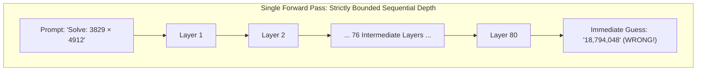
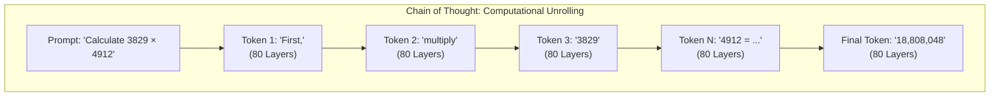
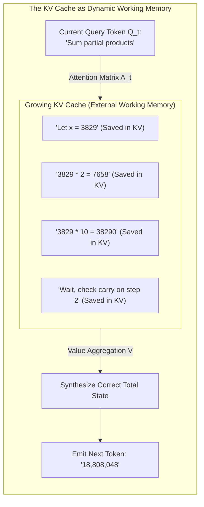
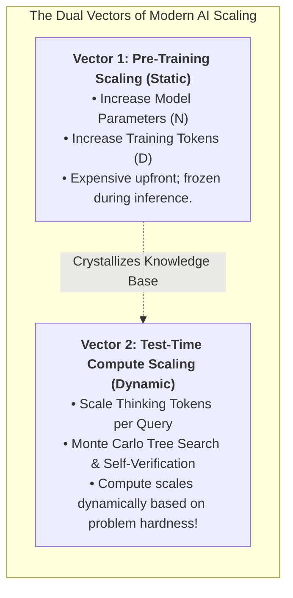
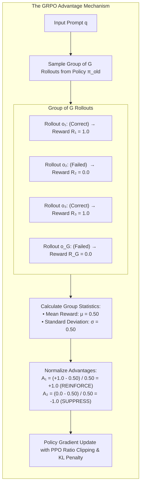
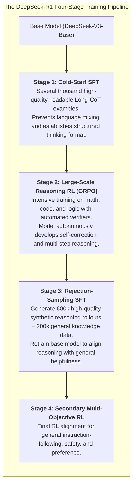

# Chapter 6: Chain of Thought and Modern Reasoning Models

## 1. Executive Summary & Narrative Arc

When Large Language Models first captured public consciousness, their capabilities resembled what cognitive psychologist Daniel Kahneman termed **System 1 thinking**: fast, automatic, intuitive, and reflexive pattern recognition. If you asked a model a straightforward question, it generated a fluent, instantaneous response. 

However, when presented with multi-step logical deduction, intricate algorithmic puzzles, or novel mathematical proofs, these early models failed miserably. They would hallucinate intermediate steps or leap directly to confident, incorrect answers.

The breakthrough that unlocked high-level analytical intelligence in frontier models—culminating in OpenAI’s **o1 / o3** and DeepSeek’s **R1**—is the formal operationalization of **System 2 thinking**: slow, deliberate, sequential, and self-correcting computation.

In popular engineering culture, **Chain of Thought (CoT)** is often described as an empirical prompt engineering trick: *"Just tell the model to think step by step!"*

Mechanistically, however, Chain of Thought is something far more profound: **it is the conversion of an autoregressive pattern matcher into a sequential state-space search engine through dynamic computational unrolling.**

In this chapter, we unpack:
1. The **Plain-Language Foundation**: Demystifying reasoning concepts, cognitive metaphors, and training frameworks.
2. The mathematical limit of a single forward pass (the **constant-depth computational bottleneck** and circuit complexity classes).
3. Why generating reasoning tokens is mathematically equivalent to **unrolling a Turing machine**.
4. How the **KV Cache** acts as an external dynamic scratchpad and working memory.
5. The shift from **Pre-Training Scaling Laws** to **Inference-Time (Test-Time) Compute Scaling Laws**.
6. How reasoning is trained without human imitation: **Reinforcement Learning with Verifiable Rewards (RLVR)** and **Group Relative Policy Optimization (GRPO)**.
7. Emergent reflection, self-verification, backtracking, and distillation.

---

## 2. Plain-Language Foundation: Demystifying Reasoning Terminology

Before examining formal circuit proofs and policy gradients, let us establish plain-language definitions for the technical terminology of reasoning models:

- **System 1 vs. System 2 Thinking**:
  - *System 1*: Instinctive, immediate reactions (e.g., recognizing a familiar face or completing the phrase *"peanut butter and..."*). In neural networks, this corresponds to generating an answer in a single forward pass.
  - *System 2*: Deliberate, conscious, step-by-step problem-solving (e.g., calculating $3829 \times 4912$ longhand in your head). In neural networks, this corresponds to emitting dozens of intermediate reasoning tokens before delivering a final verdict.
- **Constant-Depth Circuit Bottleneck**: A standard Transformer has a fixed number of layers (e.g., 80). In a single forward pass, an input vector can only be processed by 80 successive layers before an output is forced. No matter how difficult the question is, the model cannot "think longer" on that single step.
- **Circuit Complexity Classes ($\text{TC}^0$, $\text{NC}^1$-complete, $\text{NL}$-complete)**:
  - $\text{TC}^0$: The class of problems solvable in constant sequential time by parallel circuits (e.g., simple additions or pattern matches).
  - $\text{NC}^1$-complete: Problems requiring logarithmic sequential steps, like evaluating nested boolean logic or parenthesis structures.
  - $\text{NL}$-complete: Problems requiring sequential search through a network of possibilities, like determining whether two nodes in a graph are connected.
- **Computational Unrolling**: Every time a model generates an intermediate reasoning token, it feeds that token back into Layer 1 and executes another full forward pass. Emitting 1,000 reasoning tokens transforms an 80-layer model into an 80,000-layer sequential computing engine.
- **KV Cache as Working Memory Scratchpad**: The GPU memory where intermediate Key and Value vectors are stored. Just like human working memory in the prefrontal cortex holds partial numbers during mental arithmetic, the KV cache stores intermediate reasoning steps so subsequent tokens can look back and reference them.
- **Discrete Token Information Bottleneck**: Each reasoning step must pick a specific, discrete word from a fixed vocabulary (typically 128,000 tokens). This forces the continuous hidden state (4,096 numbers) through a tiny informational funnel of about 17 bits ($\log_2(128,000)$).
- **Non-Differentiable Sampling**: Because choosing a discrete word is a hard choice (like flipping a switch), calculus cannot trace gradients backward through generated words. Standard backpropagation cannot train the model's reasoning thoughts directly; reinforcement learning is required instead.
- **Test-Time (Inference-Time) Compute Scaling Laws**: The mathematical discovery that giving a model more "thinking tokens" during inference increases its problem-solving accuracy following a predictable mathematical curve, trading GPU power at test time for higher intelligence.
- **RLVR (Reinforcement Learning with Verifiable Rewards)**: A training method where the model is given a hard problem (math or code) and allowed to explore reasoning paths freely. An automated grader (compiler or unit test) awards points only if the final answer is verifiably correct.
- **GRPO (Group Relative Policy Optimization)**: A reinforcement learning algorithm created by DeepSeek that trains models without needing a second "critic" neural network. It generates a group of candidate answers for the same prompt, compares them against each other, and updates the model based on which answers outperformed the group average.
- **Group-Normalized Advantage**: A mathematical score indicating how much better or worse a specific reasoning attempt was compared to the average of all attempts generated for that question.
- **Critic-Free Reinforcement Learning**: Standard RL algorithms (like PPO) require maintaining a massive secondary "critic" model to estimate expected scores. Removing the critic saves roughly 50% of GPU memory and compute during training.
- **Clipped Surrogate Objective**: A mathematical guardrail that prevents reinforcement learning updates from changing the model's neural network weights too violently in a single step.
- **Self-Verification and Backtracking**: Emergent behaviors where a reasoning model detects that an ongoing calculation is leading to a contradiction, writes tokens like *"Wait, let me rethink this"*, and pivots to an alternative problem-solving strategy.

---

## 3. The Constant-Depth Bottleneck of a Single Forward Pass

To understand why Chain of Thought works, we must first examine the strict computational boundaries of a standard Transformer forward pass.

Consider a modern LLM with $L = 80$ layers (such as LLaMA-3-70B). When you submit a prompt and demand an immediate answer on the very first token, the input passes through exactly 80 attention and MLP layers.

### The Circuit Complexity Limit

From the perspective of computational complexity theory (specifically circuit complexity classes such as $\text{TC}^0$), an $L$-layer Transformer performing next-token prediction can only execute a **strictly bounded number of sequential computational steps** ($O(L)$ sequential matrix multiplications per token).

While fixed-precision integer multiplication technically belongs to $\text{TC}^0$ in idealized non-uniform circuits (Hesse et al., 2002), in practice an autoregressive language model forced to emit an 8-digit product on its first output token must compute all intermediate partial products and complex cross-digit carry propagations simultaneously in a single parallel pass over the input.

Furthermore, computational tasks that are formally outside $\text{TC}^0$ cannot be solved in constant sequential depth by any Transformer regardless of parameter width:
- **Boolean Formula Evaluation & Permutation Composition**: Composing permutations in $S_5$ is $\text{NC}^1$-complete and requires logarithmic sequential depth.
- **Graph Connectivity & Reachability**: Determining if two arbitrary nodes in a graph are connected is $\text{NL}$-complete, requiring state-dependent path traversal.
- **Formal Code Execution**: Interpreting loops, recursion, or pointer indirection requires dynamic runtime steps proportional to execution trace length.

If you force an 80-layer model to emit the final answer immediately, it cannot unroll an iterative loop; it can only sample a statistical guess from surface-level pre-training correlations.

### Structural Comparison: Single Forward Pass vs. Reasoning Chain

| Computational Dimension | Single Forward Pass (Zero-Shot) | Chain of Thought (Sequential Reasoning) |
| :--- | :--- | :--- |
| **Cognitive Mode** | System 1 (Reflexive, intuitive pattern matching). | System 2 (Deliberate, multi-step deduction). |
| **Sequential Layer Depth** | Exactly $L$ layers (e.g., 80 matrix operations). | $L \times N_{\text{tokens}}$ layers (e.g., 80,000 operations for 1,000 tokens). |
| **Circuit Complexity Class** | Strictly bounded by constant-depth $\text{TC}^0$. | Unrolled Turing-complete recurrence. |
| **Working Memory** | None (instantaneous feed-forward collapse). | Dynamic scratchpad backed by GPU KV cache. |
| **Error Handling** | Fatal: Any early misstep corrupts the final token. | Resilient: Model can catch errors, backtrack, and self-correct. |

---

## 4. Chain of Thought as Dynamic Computational Unrolling

When an LLM generates a Chain of Thought—emitting dozens or thousands of intermediate reasoning tokens before delivering the final answer—it fundamentally transforms its computational model.

### The Arithmetic of Computational Depth

Each intermediate token generated by the model requires a **full forward pass** through all $L$ layers of the Transformer. The total sequential depth of the computation is given by:

$$
L_{\text{total}} = L \times N_{\text{tokens}}
$$

#### Detailed Symbol Breakdown

- $L_{\text{total}}$: The total number of sequential non-linear matrix transformations executed across the full reasoning trajectory.
- $L$: The physical depth of the Transformer network (the number of stacked Attention and MLP layers, e.g., $L = 80$ in LLaMA-3-70B or $L = 61$ in DeepSeek-V3).
- $N_{\text{tokens}}$: The number of generated intermediate reasoning tokens before emitting the final answer.

#### Computational Depth Scaling

| Generated Reasoning Tokens ($N_{\text{tokens}}$) | Network Layers ($L$) | Total Sequential Transformations ($L_{\text{total}}$) | Equivalent Physical Compute Scale |
| :--- | :--- | :--- | :--- |
| **1 token (Immediate Guess)** | 80 | 80 | Shallow feed-forward pass. |
| **100 tokens (Short Explanation)** | 80 | 8,000 | Equivalent to an 8,000-layer neural network. |
| **1,000 tokens (Standard Proof)** | 80 | 80,000 | Deep sequential state machine. |
| **15,000 tokens (Competition Math / Code)** | 80 | 1,200,000 | Over 1.2 million sequential non-linear matrix updates! |

By allowing the model to generate intermediate tokens, we liberate it from the constant-depth circuit bottleneck. The model effectively becomes a **recurrent computer with arbitrary sequential run-time**, unrolling as many computational steps as the problem requires.

---
### The KV Cache as an External Working Memory Scratchpad

In Chapter 2, we noted that biological brains rely on working memory in the prefrontal cortex to hold partial calculations while solving a problem.

In an LLM, the **KV Cache serves as this exact physical scratchpad**:

When the model writes:
1. *"Let $x = 3829 \times 2 = 7658$"*
2. That text is tokenized, projected into Keys and Values, and appended to the KV cache in GPU memory.
3. When computing the next step ($3829 \times 10 = 38290$), the model's Queries **attend backward into the KV cache**, retrieving the exact numbers it derived three steps earlier.
4. If it notices an inconsistency, it can emit tokens like *"Wait, let me check the carry"*, writing a correction into the context window, and attending to the corrected numbers in subsequent steps.

### The Discrete Information Bottleneck and Non-Differentiable Sampling

Tokens are not just output text for human reading; **they are the physical registers of a discrete, non-differentiable working memory scratchpad**.

At each step $t$:
1. The top layer produces a continuous hidden activation vector $\mathbf{h}_t \in \mathbb{R}^{D}$ ($D = 4096$).
2. The unembedding matrix projects $\mathbf{h}_t$ to vocabulary logits $\mathbf{z}_t \in \mathbb{R}^{V}$ ($V = 128,000$).
3. A discrete token $`y_t \sim \text{softmax}(\mathbf{z}_t / T)`$ is sampled.

This sampling step forces the continuous activation state through a discrete information bottleneck of only:

$$
\mathcal{B} = \log_2(V) = \log_2(128,000) \approx 16.97 \text{ bits}
$$

Because discrete sampling is a non-differentiable step ($`\frac{\partial y_t}{\partial \mathbf{h}_t}`$ does not exist in standard calculus), error gradients cannot flow backward through time from token 1,000 to token 1 using standard backpropagation. This mathematical reality makes it impossible to train reasoning chains using standard supervised gradient descent across intermediate steps, necessitating **policy-gradient reinforcement learning**.

---

## 5. Inference-Time Compute Scaling Laws

For the past five years, AI scaling was governed by the **Pre-Training Scaling Laws** (Kaplan et al., 2020; Hoffmann et al., 2022 / Chinchilla):

$$
L(N, D) \approx \left(\frac{N_c}{N}\right)^{\alpha_N} + \left(\frac{D_c}{D}\right)^{\alpha_D} + L_0
$$

### Detailed Symbol Breakdown: Pre-Training Scaling Law

- $L(N, D)$: The cross-entropy test loss (prediction error) of the trained model, measured in nats or bits per token.
- $N$: The number of trainable parameters in the model (excluding vocabulary embedding tables).
- $N_c$: The parameter scale constant ($\approx 8.8 \times 10^{13}$ in Kaplan et al., 2020).
- $\alpha_N$: The power-law scaling exponent for model size ($\approx 0.076$ in Kaplan; $\approx 0.34$ in Chinchilla).
- $D$: The number of tokens in the pre-training dataset.
- $D_c$: The dataset scale constant ($\approx 5.4 \times 10^{13}$ tokens in Kaplan et al., 2020).
- $\alpha_D$: The power-law scaling exponent for training data volume ($\approx 0.095$ in Kaplan; $\approx 0.28$ in Chinchilla).
- $L_0$: The irreducible loss—the fundamental Shannon entropy of natural language that no model can compress away.

Pre-training scaling requires hundreds of millions of dollars in upfront GPU cluster training, and once the model weights are frozen, performance is capped.

### The Second Vector: Test-Time Compute Scaling

Frontier models (such as OpenAI o1/o3 and DeepSeek-R1) introduced a radical second scaling vector: **Inference-Time (Test-Time) Compute Scaling**.

### Trading Test-Time Energy for Intellectual Precision

Under inference-time compute scaling:
- For a simple trivia question (*"What is the capital of Peru?"*), the model generates 5 reasoning tokens and answers immediately in 200 milliseconds.
- For a fiendishly difficult competition math problem or formal code verification task, the model spends **15,000 reasoning tokens**—exploring hypotheses, generating counterexamples, writing simulation code mentally, backtracking from dead ends, and verifying edge cases—thinking for 45 seconds before emitting a single word of user-facing answer.

Empirical studies from OpenAI (o1, o3) and Snell et al. (2024) demonstrate that **accuracy on complex reasoning benchmarks scales roughly log-linearly with inference-time compute**:

$$
\text{Accuracy} \approx \alpha \cdot \log(\text{Compute}_{\text{inference}}) + \beta
$$

Alternatively expressed in terms of thought tokens:

$$
\text{Accuracy} \approx \alpha \cdot \log(N_{\text{thought}}) + \beta
$$

#### Detailed Symbol Breakdown: Test-Time Scaling Law

- $\text{Accuracy}$: Benchmark performance (e.g., percentage score on AIME, MATH-500, or SWE-bench).
- $\text{Compute}_{\text{inference}}$: Total floating-point operations (FLOPs) spent during inference, approximately $`2 \times N_{\text{params}} \times N_{\text{thought}}`$ (since an autoregressive forward pass executes approximately 2 FLOPs per parameter per token).
- $N_{\text{thought}}$: The total number of internal reasoning tokens emitted before providing the final user response.
- $\alpha$: The empirical scaling coefficient (the slope of accuracy improvement per order-of-magnitude increase in thinking compute).
- $\beta$: The baseline zero-shot accuracy of the base model without extended deliberation.

**Practical Consequence**: A compact 32-billion parameter model that is allowed to think for 10,000 tokens can dramatically outperform a massive 405-billion parameter model forced to answer on token 1.

---

## 6. How Reasoning is Trained: The Breakthrough of RLVR and GRPO

How do we teach a model to think, backtrack, and self-correct? 

For years, the standard alignment pipeline was **Supervised Fine-Tuning (SFT)** followed by **Direct Preference Optimization (DPO)** or RLHF based on human feedback. But this methodology collapses when applied to complex reasoning.

```mermaid
flowchart TD
    subgraph TrainingParadigms ["Why SFT Collapses and RLVR Excels"]
        direction TB
        subgraph SFT_Failure ["1. Supervised Fine-Tuning (Imitation Learning)"]
            H_Trace["Human writes 5,000-token math derivation"]
            SFT_Loss["Cross-Entropy Loss: Model forced to memorize exact human words"]
            SFT_Problem["Fails on out-of-distribution problems;<br/>Model cannot discover novel strategies beyond human trainer."]
            H_Trace --> SFT_Loss --> SFT_Problem
        end

        subgraph RLVR_Success ["2. Reinforcement Learning with Verifiable Rewards (RLVR)"]
            Problem["Math / Code Problem: Only input and ground-truth answer known"]
            Exploration["Model generates 8 parallel reasoning rollouts (Exploration)"]
            Verifier["Automated Ground-Truth Verifier<br/>(Unit tests pass? Math equation matches? Compiler succeeds?)"]
            Reward["Binary Reward: +1.0 for Correct, 0.0 for Incorrect"]
            PolicyUpdate["Policy Gradient Update (GRPO / PPO)<br/>Reinforces successful reasoning pathways; penalizes invalid steps"]

            Problem --> Exploration --> Verifier --> Reward --> PolicyUpdate
        end
    end
```

### The SFT Imitation Ceiling

If you train an LLM on reasoning using human-authored step-by-step solutions (Supervised Fine-Tuning):
1. **Human Annotation Bottleneck**: It is prohibitively expensive to hire PhD mathematicians to write hundreds of thousands of 10,000-token derivations.
2. **Brittle Memorization**: SFT forces the model to mimic the exact wording and stylistic habits of human annotators rather than finding optimal internal reasoning paths.

### Reinforcement Learning with Verifiable Rewards (RLVR)

In verifiable domains—such as mathematics, software engineering, and formal logic—we do not need to evaluate whether an intermediate sentence looks pretty. We only care whether the final answer is **verifiably true**:
- In Python programming, does the generated code pass 100% of the unit test suite without exceptions?
- In algebra, does the final numerical scalar match the ground-truth equation?

Under RLVR, we supply only the problem statement and an automated verification script. The model generates diverse reasoning paths, and the environment rewards true answers.

---

### Group Relative Policy Optimization (GRPO)

Standard Proximal Policy Optimization (PPO) requires maintaining four separate neural networks in GPU VRAM during training:
1. The **Actor (Policy)** network $\pi_\theta$ being trained.
2. The **Reference** network $\pi_{\text{ref}}$ (frozen base model) to prevent drift.
3. The **Critic (Value)** network $V_\phi$ estimating expected rewards.
4. The **Reward** network $R$.

Because the Critic model has the same parameter size as the Actor, standard PPO doubles the memory requirement, making training massive frontier reasoning models extraordinarily expensive.

Under **Group Relative Policy Optimization (GRPO)** (Shao et al., 2024; deployed in **DeepSeek-R1**), the critic network is **eliminated entirely**.

#### Step 1: Group Sampling
For each input prompt $q$, the policy generates a group of $G$ candidate reasoning rollouts:

$$
\mathcal{O}_q = \{o_1, o_2, \dots, o_G\} \sim \pi_{\theta_{\text{old}}}(O \mid q)
$$

Each rollout $o_i$ is evaluated by the rule-based verifier, yielding task rewards:

$$
\mathbf{R} = \{R_1, R_2, \dots, R_G\}
$$

#### Step 2: The Group-Normalized Advantage Equation

The advantage $\hat{A}_i$ for each rollout $o_i$ is calculated by **normalizing across the group**:

$$
\hat{A}_i = \frac{R_i - \text{mean}(\mathbf{R})}{\text{std}(\mathbf{R}) + \epsilon}
$$

##### Detailed Symbol Breakdown: Advantage Formula

- $\hat{A}_i$: The scalar advantage assigned to rollout $o_i$. A positive value indicates that rollout $o_i$ outperformed its peers on this specific prompt; a negative value indicates underperformance.
- $R_i$: The scalar reward assigned to rollout $o_i$ by the verifier ($R_i = 1.0$ for passing unit tests, $0.0$ for failure).
- $`\mathbf{R} = \{R_1, \dots, R_G\}`$: The collection of all rewards obtained by the $G$ sampled rollouts for the current question.
- $`\text{mean}(\mathbf{R}) = \frac{1}{G} \sum_{j=1}^G R_j`$: The baseline average performance of the model on this specific prompt.
- $`\text{std}(\mathbf{R}) = \sqrt{\frac{1}{G} \sum_{j=1}^G (R_j - \text{mean}(\mathbf{R}))^2}`$: The empirical standard deviation of rewards across the group.
- $\epsilon$: A tiny scalar constant (typically $10^{-6}$) ensuring numerical stability and preventing division by zero when all rollouts achieve identical scores.

**Physical Intuition**: If a problem is easy and all 8 rollouts get it right ($R_i = 1.0$ for all $i$), $\text{std}(\mathbf{R}) = 0$, the advantage is neutralized, and the model does not waste gradient updates. If a problem is hard and only 1 rollout succeeds, that winning trajectory receives a massive positive advantage, pulling the policy strongly toward that successful chain of deduction.

---

#### Step 3: The Full GRPO Clipped Surrogate Objective

The model parameters $\theta$ are updated by maximizing the following objective:

$$
\mathcal{J}_{\text{GRPO}}(\theta) = \mathbb{E} \left[ \frac{1}{G} \sum_{i=1}^G \frac{1}{|o_i|} \sum_{t=1}^{|o_i|} \left( \min \left( r_{i,t}(\theta) \hat{A}_i, \, \text{clip}\left(r_{i,t}(\theta), 1-\epsilon_{\text{clip}}, 1+\epsilon_{\text{clip}}\right) \hat{A}_i \right) - \beta D_{\text{KL}, t}(\pi_\theta \parallel \pi_{\text{ref}}) \right) \right]
$$

Where $q \sim P(Q)$, $`\{o_i\}_{i=1}^G \sim \pi_{\theta_{\text{old}}}(O \mid q)`$, and the importance probability ratio $r_{i,t}(\theta)$ is defined as:

$$
r_{i,t}(\theta) = \frac{\pi_\theta(o_{i,t} \mid q, o_{i,<t})}{\pi_{\theta_{\text{old}}}(o_{i,t} \mid q, o_{i,<t})}
$$

##### Detailed Symbol Breakdown: Objective Equation

- $\mathcal{J}_{\text{GRPO}}(\theta)$: The scalar expected objective function being maximized via gradient ascent.
- $\theta$: The current policy neural network parameters undergoing optimization.
- $\theta_{\text{old}}$: The snapshot of parameters used to sample the rollouts before the current gradient step.
- $q \sim P(Q)$: An input problem prompt sampled from the training dataset.
- $o_i$: The $i$-th generated rollout sequence, containing both intermediate thought tokens and the final answer.
- $|o_i|$: The total token length of rollout $o_i$. Dividing by $|o_i|$ normalizes token contributions across short and long trajectories.
- $t$: The token index position within the sequence ($1 \le t \le |o_i|$).
- $o_{i,t}$: The specific token emitted at step $t$.
- $o_{i,<t}$: The sequence of preceding tokens generated prior to step $t$.
- $r_{i,t}(\theta)$: The importance sampling ratio comparing the probability of emitting token $o_{i,t}$ under the updated policy $\pi_\theta$ versus the old policy $`\pi_{\theta_{\text{old}}}`$.
- $`\text{clip}(r, 1-\epsilon_{\text{clip}}, 1+\epsilon_{\text{clip}})`$: The PPO clipping function that bounds the ratio within $`[1-\epsilon_{\text{clip}}, 1+\epsilon_{\text{clip}}]`$ (typically $\epsilon_{\text{clip}} = 0.20$), preventing destructively large gradient steps.
- $\hat{A}_i$: The group-normalized advantage scalar from Step 2.
- $\beta$: The regularization scalar hyperparameter controlling the strength of the KL divergence penalty.
- $`D_{\text{KL}, t}(\pi_\theta \parallel \pi_{\text{ref}})`$: The per-token unbiased Kullback-Leibler divergence estimator between the policy $\pi_\theta$ and the frozen base reference model $\pi_{\text{ref}}$:

$$
D_{\text{KL}, t}(\pi_\theta \parallel \pi_{\text{ref}}) = \frac{\pi_{\text{ref}}(o_{i,t} \mid q, o_{i,<t})}{\pi_\theta(o_{i,t} \mid q, o_{i,<t})} - \log \frac{\pi_{\text{ref}}(o_{i,t} \mid q, o_{i,<t})}{\pi_\theta(o_{i,t} \mid q, o_{i,<t})} - 1
$$

Because $D_{\text{KL}, t}$ is computed per token inside the sequence length average $\frac{1}{|o_i|} \sum_{t=1}^{|o_i|}$, the regularization penalty scales gracefully per token without penalizing longer reasoning trajectories.
#### Credit Assignment and the Emergence of Backtracking

Because rewards in RLVR are evaluated at the outcome level, an intriguing dynamic occurs:
- If a model encounters a dead end in calculation, but then writes: *"Wait, this equation has no real roots. Let me go back and re-evaluate my assumption"*, and eventually reaches the correct final answer, the **entire rollout—including the dead end and the correction—receives a positive advantage**.
- The model is not penalized for making an intermediate mistake if it successfully recovers. Over thousands of GRPO updates, the model internalizes the meta-cognitive skill of **self-verification and backtracking**.

---

### The DeepSeek-R1 Curriculum: Emergent Reflection & Distillation

While **DeepSeek-R1-Zero** demonstrated that pure RL from an unaligned base model produces emergent self-correction ("Wait, let me rethink that"), it suffered from language mixing, erratic token lengths, and poor human readability.

To build production-grade reasoning, the full **DeepSeek-R1** pipeline introduced a four-stage curriculum:

#### The Power of Distillation
Crucially, DeepSeek demonstrated that distilling R1's reasoning trajectories into smaller standard models (such as Qwen-1.5B, 7B, 14B, 32B and LLaMA-8B, 70B) via standard SFT outperformed running large-scale RL on those smaller models directly.

Once a massive frontier model discovers successful deductive pathways, smaller models can absorb these reasoning patterns efficiently through high-quality demonstration data.

---

## 7. Key Engineering Takeaways

1. **Single Passes are Constant-Depth Circuits**: An $L$-layer Transformer cannot solve complex multi-step problems in a single forward pass due to the mathematical limits of constant-depth circuit complexity ($\text{TC}^0$).
2. **Chain of Thought Unrolls Sequential Computation**: Generating $N$ intermediate reasoning tokens transforms the model into an unrolled state machine, executing $`L_{\text{total}} = L \times N_{\text{tokens}}`$ sequential layer operations.
3. **The KV Cache is an External Scratchpad**: Intermediate reasoning tokens are stored as Keys and Values in GPU VRAM, providing a dynamic working memory where subsequent tokens can attend back to partial results.
4. **Discrete Token Bottleneck Requires Policy Gradients**: Sampling discrete tokens from a vocabulary bottleneck of $\approx 17$ bits introduces a non-differentiable boundary, making policy gradient RL necessary to optimize reasoning traces.
5. **Inference-Time Scaling is the New Frontier**: Model accuracy scales logarithmically with the compute spent at inference time ($\text{Accuracy} \approx \alpha \cdot \log(N_{\text{thought}}) + \beta$), enabling compact models to beat massive models by thinking longer.
6. **GRPO Enables Critic-Free RL**: By normalizing advantages across a group of rollouts ($`\hat{A}_i = (R_i - \bar{R})/\sigma`$), GRPO eliminates the PPO Value network, cutting training memory requirements in half while autonomously discovering self-verification and backtracking.
