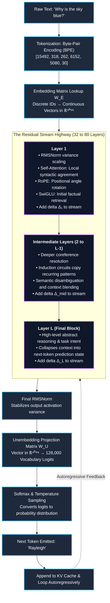
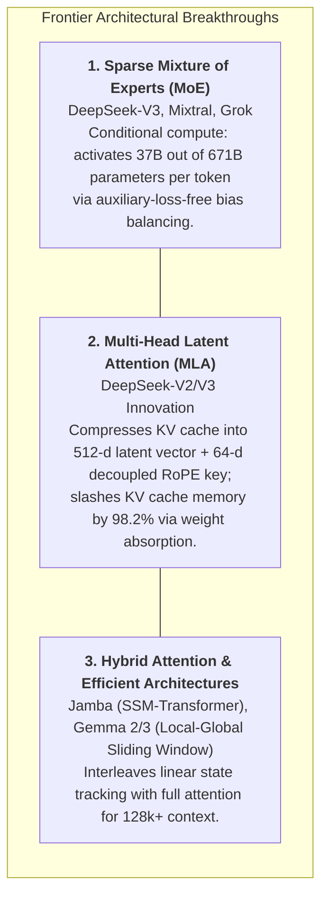
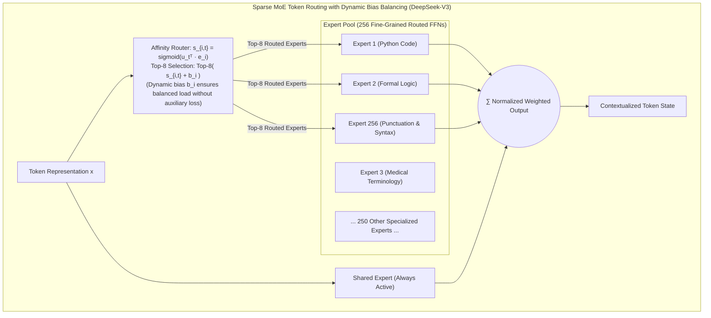
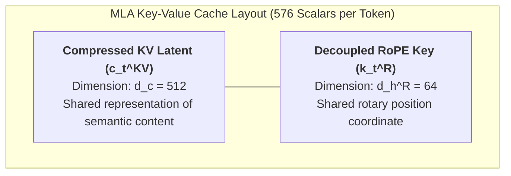
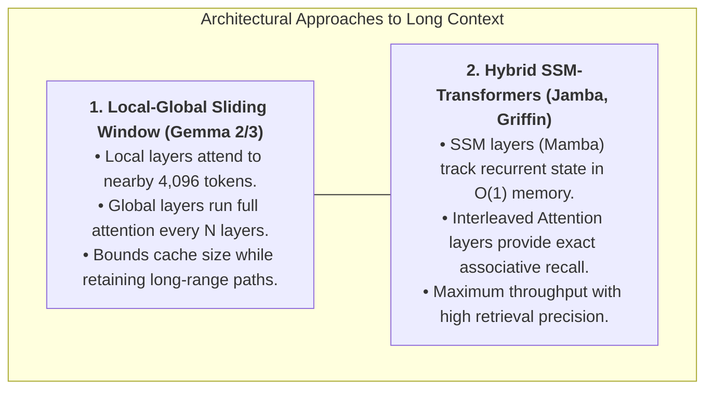
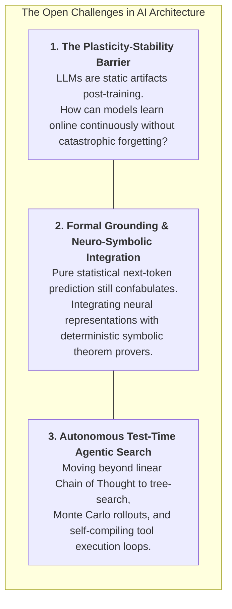

# Chapter 7: Synthesis and Future Frontiers

## 1. Executive Summary & Narrative Arc

Over the preceding six chapters, we have dismantled the modern Large Language Model from its elementary components to its emergent cognitive capabilities. 

We began in **Chapter 1** with the artificial neuron, demonstrating why non-linear activation functions (from Sigmoid to SwiGLU) allow neural networks to fold high-dimensional space and approximate complex functions. In **Chapter 2**, we contrasted these artificial units with the biological brain, finding that while the micro-substrates are radically different, both systems converge on the principle of **predictive error minimization**. In **Chapter 3**, we explored the geometry of multi-dimensional tensors, revealing why high-dimensional vector spaces ($\mathbb{R}^{4096}$) possess virtually inexhaustible capacity for independent concepts. In **Chapter 4** and **Chapter 5**, we unpacked the Transformer block and its attention engine, showing how the residual highway and scaled dot-product attention dynamically route information across sequence space. In **Chapter 6**, we explored how Chain of Thought unrolls sequential computational depth, turning feed-forward pattern recognizers into multi-step reasoning engines trained via reinforcement learning.

In this concluding chapter, we synthesize these threads into a single, cohesive mental model and examine the cutting-edge frontiers reshaping the landscape of AI in 2024–2026 and beyond.

In this chapter, we unpack:
1. The **Plain-Language Foundation**: A clear glossary of all frontier concepts, from MoE routers to weight absorption.
2. The **Unified Token Lifecycle**: Tracing a prompt end-to-end through 80 layers with complete mathematical formulations.
3. **Sparse Mixture of Experts (MoE)**: Fine-grained routed experts, shared experts, and auxiliary-loss-free dynamic bias balancing ($b_i$).
4. **Multi-Head Latent Attention (MLA)**: Mathematical proof of weight absorption and the 98.2% KV cache reduction.
5. **Hybrid Attention & Long-Context Architectures**: Sliding window attention, State Space Models (SSM), Mamba, and Jamba.
6. **Open Scientific Frontiers**: Continuous learning, neuro-symbolic integration, and autonomous reasoning agents.

---

## 2. Plain-Language Foundation: Demystifying Frontier Terminology

Before examining multi-head latent projections and dynamic routing proofs, let us define every frontier concept in straightforward human language:

- **End-to-End Token Lifecycle**: The complete round-trip journey that an idea takes inside a computer: starting as typed letters, turning into numerical tokens, traveling through 80 layers of vector addition, and finally emerging as a freshly predicted word.
- **BPE (Byte-Pair Encoding)**: A text-compression algorithm that cuts human words into reusable chunks (tokens). Common words like *"the"* get their own token, while rare words are broken into syllables or letters, allowing the model to read any language without an infinite dictionary.
- **Embedding Lookup ($\mathbf{W}_E$)**: A massive dictionary table where each token number is converted into a continuous coordinate vector (4,096 to 8,192 dimensions), placing the word onto a semantic map.
- **Residual Stream Accumulation**: The central vector highway of the Transformer. Instead of rewriting the token vector at each layer, layers merely add small vector adjustments ($\Delta \mathbf{x}$) onto this highway, preserving the core signal while refining its meaning.
- **Unembedding Projection ($\mathbf{W}_U$)**: The final exit ramp of the Transformer. It takes the token's refined coordinate vector and compares it against all 128,000 words in the dictionary to see which word it points to most strongly.
- **Temperature Sampling**: A mathematical control knob ($T$) for creativity. Setting $T = 0.0$ forces the model to pick only the single most probable word every time (deterministic). Higher temperatures flatten the probabilities, allowing the model to explore less expected, more creative word choices.
- **Sparse Mixture of Experts (MoE)**: An architecture where the giant feed-forward layer is broken into hundreds of smaller, specialized "experts". Instead of running all weights for every token, a traffic director (router) turns on only a tiny fraction (e.g., 8 out of 256) per word, saving massive amounts of compute.
- **Fine-Grained Routed Experts**: Dividing the model into many small expert networks rather than a few massive ones. This gives the model surgical modularity, letting it combine a "Python syntax" expert with a "cryptography" expert for a specific word.
- **Shared Expert**: A dedicated expert network that is *always* active for every single token, regardless of what the router decides. It handles universal tasks like grammar, punctuation, and common English words, freeing the routed experts to specialize.
- **Auxiliary-Loss-Free Dynamic Bias Balancing**: DeepSeek's method to keep all experts evenly loaded. Instead of adding an artificial penalty into the loss function that hurts language accuracy, it dynamically adds a tiny positive or negative bias ($b_i$) to popular or unpopular experts during selection.
- **Multi-Head Latent Attention (MLA)**: DeepSeek's breakthrough attention design that compresses the Key and Value vectors into a single tiny vector ($`\mathbf{c}_t^{KV}`$) before storing them in GPU memory, cutting cache memory consumption by over 98%.
- **Compressed KV Latent ($`\mathbf{c}_t^{KV}`$)**: A compact 512-dimensional vector that encapsulates the semantic information of all 128 attention heads in a single shared representation.
- **Decoupled RoPE Key ($`\mathbf{k}_t^R`$)**: A small, separate 64-dimensional vector dedicated purely to rotary position information, keeping spatial coordinates separate from semantic content.
- **Weight Absorption**: An algebraic identity where intermediate projection matrices are combined with Query or Output projections during generation. This allows the GPU to compute attention directly against the tiny compressed vector without ever unpacking it into full-sized keys and values.
- **Sliding Window Attention**: An efficiency technique where attention heads only look at a nearby window of words (e.g., the last 4,096 tokens) rather than the entire document, keeping memory usage constant.
- **State Space Models (SSM) & Mamba**: An alternative neural network design that processes sequences linearly ($O(L)$) by passing a fixed-size memory state forward like an internal tape recorder, rather than comparing every word to every other word ($O(L^2)$).
- **Jamba**: A hybrid model that combines Mamba layers (for fast, cheap processing of long text) with Transformer attention layers (for exact factual lookup).
- **Neuro-Symbolic Integration**: Combining the intuitive, creative pattern-matching of neural networks with the rigorous, 100% verifiable rules of symbolic engines (like math solvers, SAT solvers, or software compilers).

---

## 3. The Unified Mental Model: The Lifecycle of a Token

To truly understand how modern LLMs operate, consider the complete journey of a single prompt from raw keystrokes to generated thought.

### Full Mathematical Formulation of Token Transformation

Let us trace the complete mathematical transformation of token $t$ through an 80-layer architecture:

#### Step 1: Discrete Tokenization & Embedding Injection
The input string is tokenized into vocabulary indices. The initial activation vector $`\mathbf{x}_0 \in \mathbb{R}^D`$ is constructed by reading row $w_t$ of the embedding matrix $\mathbf{W}_E \in \mathbb{R}^{V \times D}$:

$$
\mathbf{x}_0 = \mathbf{w}_t \mathbf{W}_E
$$

Where:
- $`\mathbf{w}_t \in \{0, 1\}^V`$: A one-hot indicator vector for token ID $w_t$.
- $\mathbf{W}_E \in \mathbb{R}^{V \times D}$: The learned token embedding table containing continuous coordinate representations for all $V = 128,000$ words.
- $D$: The hidden dimension of the residual highway (matched pairs: $D = 4,096$ with $L = 32$ in LLaMA-3-8B; $D = 8,192$ with $L = 80$ in LLaMA-3-70B; $D = 7,168$ with $L = 61$ in DeepSeek-V3).

#### Step 2: Layer-by-Layer Residual Accumulation
For each layer $\ell = 1, \dots, L$ (e.g., $L = 80$ in LLaMA-3-70B, or $L = 61$ in DeepSeek-V3):

$$
\mathbf{x}_{\ell}^{(1)} = \mathbf{x}_{\ell-1} + \text{Attention}\left(\text{RMSNorm}(\mathbf{x}_{\ell-1})\right)
$$

$$
\mathbf{x}_{\ell} = \mathbf{x}_{\ell}^{(1)} + \text{FFN}\left(\text{RMSNorm}(\mathbf{x}_{\ell}^{(1)})\right)
$$

Where:
- $\mathbf{x}_{\ell-1}$: The input activation vector arriving on the residual highway.
- $\text{RMSNorm}(\cdot)$: Normalizes vector variance to $1.0$ before computation.
- $\text{Attention}(\cdot)$: Performs multi-head or latent attention, pulling information from past tokens and returning an additive update $\Delta \mathbf{x}_{\ell}^{\text{attn}}$.
- $\text{FFN}(\cdot)$: Feed-Forward Network (SwiGLU or MoE), retrieving factual associations and returning $\Delta \mathbf{x}_{\ell}^{\text{ffn}}$.
- $\mathbf{x}_{\ell}$: The updated activation state passed to layer $\ell+1$.

#### Step 3: Final Unembedding & Temperature Sampling
At layer $L$, the final activation row vector $\mathbf{x}_L \in \mathbb{R}^{1 \times D}$ is normalized and projected onto the entire vocabulary via the unembedding matrix $\mathbf{W}_U \in \mathbb{R}^{D \times V}$:

$$
\mathbf{z} = \text{RMSNorm}(\mathbf{x}_L) \mathbf{W}_U
$$

The raw logit vector $\mathbf{z} \in \mathbb{R}^V$ is scaled by temperature $T > 0$ and converted into a probability distribution:

$$
P(y = v \mid \mathbf{x}) = \frac{\exp(z_v / T)}{\sum_{j=1}^V \exp(z_j / T)}
$$

##### Detailed Symbol Breakdown: Generation Loop

- $\mathbf{z}$: The raw logit vector of dimension $V = 128,000$. Entry $z_v$ measures the unnormalized dot-product alignment between the final residual state and word $v$.
- $\mathbf{W}_U$: The unembedding matrix mapping internal semantic geometry back to human vocabulary.
- $T$: The sampling temperature scalar:
  - As $T \to 0$, the distribution collapses to an argmax spike ($P(y = \arg\max \mathbf{z}) = 1.0$), yielding deterministic outputs.
  - As $T \to \infty$, the distribution flattens into a uniform random distribution across all words.
  - At $T = 0.7$, probabilities retain sharp adherence to logical grammar while allowing creative diversity in descriptive word choice.

---

## 4. Frontier Architectural Innovations (2024–2026)

While the core Transformer architecture remains dominant, modern frontier models have introduced radical optimizations to overcome the memory wall, training bottlenecks, and compute constraints.

### 1. Sparse Mixture of Experts (MoE): Fine-Grained Routing & Dynamic Bias Balancing

In traditional dense models (like LLaMA-2), every single parameter is engaged for every token. If a model has 70 billion parameters, 70 billion weights are fetched and multiplied to process a simple period or comma.

Frontier models (such as **DeepSeek-V3** and **Mixtral 8x22B**) replace the monolithic Feed-Forward Network with a **Sparse Mixture of Experts**:
- DeepSeek-V3 contains **671 billion total parameters**, but for any given token, a lightweight router dynamically activates only **8 out of 256 fine-grained experts** plus 1 shared expert.
- The model spends only **37 billion active parameters per token**.
- This approaches the biological brain’s event-driven sparsity: the network maintains an enormous encyclopedia of specialized knowledge across 671 billion weights, but only draws electrical power for the specific 5% of neural circuits relevant to the current word.

#### Mathematical Formulation of MoE Routing

1. **Affinity Scoring**: For input token representation $\mathbf{u}_t \in \mathbb{R}^D$ and expert centroid $\mathbf{e}_i \in \mathbb{R}^D$:

$$
s_{i,t} = \text{sigmoid}(\mathbf{u}_t^T \mathbf{e}_i)
$$

2. **Top-$K$ Selection with Dynamic Bias**: To select the active set of $K$ experts ($K = 8$ out of $N_{\text{experts}} = 256$):

$$
\mathcal{K}_t = \text{Top-}K\left( \{ s_{i,t} + b_i \}_{i=1}^{N_{\text{experts}}} \right)
$$

3. **Gating Weight Normalization**: The actual mixing coefficients $g_{i,t}$ are computed by normalizing the raw affinities across the selected experts **without the bias term**:

$$
g_{i,t} = \begin{cases} \frac{s_{i,t}}{\sum_{j \in \mathcal{K}_t} s_{j,t}} & \text{if } i \in \mathcal{K}_t \\ 0 & \text{if } i \notin \mathcal{K}_t \end{cases}
$$

4. **Synthesized Output**: Combining the dedicated shared expert and the $K$ routed experts:

$$
\mathbf{y}_t = \text{FFN}_{\text{shared}}(\mathbf{x}_t) + \sum_{i \in \mathcal{K}_t} g_{i,t} \text{FFN}_i(\mathbf{x}_t)
$$

##### Detailed Symbol Breakdown: MoE Routing

- $\mathbf{u}_t \in \mathbb{R}^D$: The normalized token representation at position $t$.
- $\mathbf{e}_i \in \mathbb{R}^D$: The learned affinity embedding vector for expert $i$.
- $s_{i,t} \in (0, 1)$: The raw semantic compatibility score between token $t$ and expert $i$.
- $b_i$: The **dynamic balancing bias** for expert $i$.
- $\mathcal{K}_t$: The index set of the top $K$ selected experts for token $t$.
- $g_{i,t}$: The normalized gating weight assigned to expert $i$.
- $\text{FFN}_{\text{shared}}$: An expert that processes every token unconditionally, capturing general knowledge.
- $\text{FFN}_i$: Specialized expert feed-forward network $i$.

#### Auxiliary-Loss-Free Dynamic Bias Balancing

In classical MoE architectures (like Switch Transformer or Mixtral), routers are trained with an **auxiliary load-balancing loss**:

$$
\mathcal{L}_{\text{aux}} = \alpha \cdot N_{\text{experts}} \sum_{i=1}^{N_{\text{experts}}} f_i P_i
$$

Where $f_i$ is the fraction of tokens routed to expert $i$ and $P_i$ is the average routing probability.
- **The Auxiliary Loss Dilemma**: The auxiliary loss forces the neural network to satisfy two competing goals: predicting the next word accurately versus distributing tokens evenly across GPUs. Pushing tokens onto suboptimal experts to balance GPU loads degrades language modeling accuracy.

**DeepSeek-V3's Breakthrough: Dynamic Bias ($b_i$)**:
Instead of adding an auxiliary penalty to the backpropagation loss, DeepSeek-V3 monitors expert workloads during training and dynamically updates a bias term $b_i$ for each expert:
- After each training step, if expert $i$ received more tokens than the target average, its bias is decremented: $`b_i \leftarrow b_i - \gamma`$.
- If expert $i$ was underutilized, its bias is incremented: $`b_i \leftarrow b_i + \gamma`$.

Crucially:
- $b_i$ is used **only during selection** ($`\text{Top-}K(s_{i,t} + b_i)`$).
- $b_i$ is **completely omitted from gating weights** ($g_{i,t}$ is calculated purely from raw $s_{i,t}$).

**Result**: Near-perfect hardware utilization across 256 experts with **zero gradient corruption** of the primary language objective.

---

### 2. Multi-Head Latent Attention (MLA): Crushing the KV Cache Memory Wall

As sequence lengths expand to 128k+ tokens, storing the Key-Value (KV) cache creates a crippling memory bottleneck. In standard Multi-Head Attention (MHA), serving a long-context batch quickly exhausts 80GB GPU memory purely on cached vectors.

In **DeepSeek-V2 and DeepSeek-V3**, researchers introduced **Multi-Head Latent Attention (MLA)**, which achieves an astounding **98.2% reduction in KV cache footprint** through low-rank latent compression and mathematical weight absorption.

#### The RoPE Compression Dilemma and DeepSeek's Decoupled Solution

Why couldn't earlier models simply compress Keys and Values using standard low-rank matrix decomposition?

In standard attention without positional encodings, if you compress keys via $`\mathbf{k}_s = \mathbf{c}_s^{KV} \mathbf{W}^{UK}`$, the row-vector inner product is:

$$
\mathbf{q}_t \mathbf{k}_s^T = \mathbf{q}_t (\mathbf{c}_s^{KV} \mathbf{W}^{UK})^T = \left( \mathbf{q}_t (\mathbf{W}^{UK})^T \right) (\mathbf{c}_s^{KV})^T
$$

Here, $\mathbf{W}^{UK}$ could be absorbed directly into the query $\mathbf{q}_t$, requiring the GPU to cache only the compressed latent vector $\mathbf{c}_s^{KV}$.

However, modern LLMs inject positional awareness via Rotary Position Embeddings (RoPE). In standard RoPE, applying rotation to a row-vector key $\mathbf{k}_s \in \mathbb{R}^{1 \times d_h}$ uses right-multiplication by the orthogonal block-diagonal Givens rotation matrix $\mathbf{R}_s \in \mathbb{R}^{d_h \times d_h}$:

$$
\mathbf{k}_s = \left(\mathbf{c}_s^{KV} \mathbf{W}^{UK}\right) \mathbf{R}_s
$$

The inner product between the rotated query row vector $\mathbf{q}_t \mathbf{R}_t \in \mathbb{R}^{1 \times d_h}$ at step $t$ and key $\mathbf{k}_s$ at step $s$ becomes:

$$
(\mathbf{q}_t \mathbf{R}_t) \mathbf{k}_s^T = (\mathbf{q}_t \mathbf{R}_t) \left( (\mathbf{c}_s^{KV} \mathbf{W}^{UK}) \mathbf{R}_s \right)^T = \mathbf{q}_t \mathbf{R}_t \mathbf{R}_s^T (\mathbf{W}^{UK})^T (\mathbf{c}_s^{KV})^T = \mathbf{q}_t \mathbf{R}_{t-s} (\mathbf{W}^{UK})^T (\mathbf{c}_s^{KV})^T
$$

Because the relative rotation matrix $\mathbf{R}_{t-s} \in \mathbb{R}^{d_h \times d_h}$ depends dynamically on the token pair's relative distance $(t-s)$, it sits trapped directly between $\mathbf{q}_t$ and $(\mathbf{W}^{UK})^T$. Consequently, the composite term $\mathbf{q}_t \mathbf{R}_{t-s} (\mathbf{W}^{UK})^T$ depends on key position $s$ and **cannot be precomputed once per query independently of the key position**. To compute attention with standard RoPE, GPUs were historically forced to decompress and cache full uncompressed Key vectors ($`\mathbf{k}_s \in \mathbb{R}^{1 \times d_h}`$ per head, or $`\mathbb{R}^{H \times d_h}`$ across all heads) in memory, destroying low-rank compression.
DeepSeek's breakthrough was **Decoupled RoPE**: cleanly bisecting the attention mechanism into two orthogonal streams:
1. **An Unrotated Semantic Content Stream ($\mathbf{c}_s^{KV}$)**: A 512-dimensional compressed vector that carries factual and grammatical meaning without positional rotations, allowing full mathematical weight absorption.
2. **A Decoupled Rotary Positional Stream ($\mathbf{k}_s^R$)**: A compact 64-dimensional key carrying rotary coordinates, shared across all heads.

#### Step 1: Latent Down-Projection and Decoupled RoPE
Instead of projecting the input vector $\mathbf{x}_t \in \mathbb{R}^D$ into separate Key and Value vectors for all 128 heads, MLA compresses $\mathbf{x}_t$ into a compact **latent vector**:

$$
\mathbf{c}_t^{KV} = \mathbf{x}_t \mathbf{W}^{DKV}
$$

Where $\mathbf{W}^{DKV} \in \mathbb{R}^{D \times d_c}$ is a down-projection matrix, and $d_c = 512$.

At the same time, MLA generates a separate **decoupled positional key**:

$$
\mathbf{k}_t^R = \text{RoPE}(\mathbf{x}_t \mathbf{W}^{KR})
$$

Where $\mathbf{W}^{KR} \in \mathbb{R}^{D \times d_h^R}$, and $d_h^R = 64$.

#### Step 2: The Decoupled Attention Score
For each head $h$, the attention score between query $t$ and key $s$ is computed by summing the semantic content match and the positional match:

$$
\text{Score}_{t,s}^h = \frac{\mathbf{q}_{t}^{C, h} (\mathbf{k}_{s}^{C, h})^T + \mathbf{q}_{t}^{R, h} (\mathbf{k}_{s}^R)^T}{\sqrt{d_h + d_h^R}}
$$

Where:
- $\mathbf{q}_t^{C, h} \in \mathbb{R}^{1 \times d_h}$: Content query row vector for head $h$ ($d_h = 128$).
- $`\mathbf{k}_s^{C, h} = \mathbf{c}_s^{KV} \mathbf{W}^{UK, h} \in \mathbb{R}^{1 \times d_h}`$: Reconstructed content key row vector for head $h$, where $`\mathbf{W}^{UK, h} \in \mathbb{R}^{d_c \times d_h}`$.
- $`\mathbf{q}_t^{R, h} \in \mathbb{R}^{1 \times d_h^R}`$: Decoupled per-head RoPE query row vector carrying rotational coordinates ($d_h^R = 64$).
- $`\mathbf{k}_s^R \in \mathbb{R}^{1 \times d_h^R}`$: Decoupled shared RoPE key row vector ($d_h^R = 64$).

---

#### Step 3: Mathematical Proof of Weight Absorption

Why does MLA avoid storing $\mathbf{k}_s^{C, h}$ and $\mathbf{v}_s^{C, h}$ in GPU memory during generation?

##### 1. Key Weight Absorption Proof
The content inner product between row query $\mathbf{q}_t^{C, h} \in \mathbb{R}^{1 \times d_h}$ and row key $\mathbf{k}_s^{C, h} \in \mathbb{R}^{1 \times d_h}$ for head $h$ is:

$$
\mathbf{q}_t^{C, h} (\mathbf{k}_s^{C, h})^T = \mathbf{q}_t^{C, h} \left( \mathbf{c}_s^{KV} \mathbf{W}^{UK, h} \right)^T
$$

Using matrix transpose and associativity properties ($(\mathbf{A} \mathbf{B})^T = \mathbf{B}^T \mathbf{A}^T$):

$$
\mathbf{q}_t^{C, h} \left( \mathbf{c}_s^{KV} \mathbf{W}^{UK, h} \right)^T = \mathbf{q}_t^{C, h} (\mathbf{W}^{UK, h})^T (\mathbf{c}_s^{KV})^T = \left( \mathbf{q}_t^{C, h} (\mathbf{W}^{UK, h})^T \right) (\mathbf{c}_s^{KV})^T
$$

We define the **absorbed query row vector**:

$$
\mathbf{q}_t^{\prime C, h} = \mathbf{q}_t^{C, h} (\mathbf{W}^{UK, h})^T \in \mathbb{R}^{1 \times d_c}
$$

The content score simplifies to:

$$
\mathbf{q}_t^{C, h} (\mathbf{k}_s^{C, h})^T = \mathbf{q}_t^{\prime C, h} (\mathbf{c}_s^{KV})^T
$$

**Significance**: During autoregressive inference, the model multiplies the current query row vector $\mathbf{q}_t^{C, h}$ ($1 \times d_h$) by $(\mathbf{W}^{UK, h})^T$ ($d_h \times d_c$) **once on the query side** to produce $\mathbf{q}_t^{\prime C, h}$ ($1 \times d_c$). The attention score against every past token $s$ is computed directly against the cached 512-dimensional latent vector $(\mathbf{c}_s^{KV})^T$ ($d_c \times 1$). The GPU **never needs to reconstruct or store full-size keys** $\mathbf{k}_s^{C, h}$!
##### 2. Value Weight Absorption Proof
Similarly, for value aggregation across all past tokens $s$:

$$
\mathbf{o}_t^h = \sum_s A_{ts}^h \mathbf{v}_s^{C, h} = \sum_s A_{ts}^h \left( \mathbf{c}_s^{KV} \mathbf{W}^{UV, h} \right)
$$

Because $\mathbf{W}^{UV, h}$ is constant with respect to token index $s$, it can be factored outside the summation:

$$
\mathbf{o}_t^h = \left( \sum_s A_{ts}^h \mathbf{c}_s^{KV} \right) \mathbf{W}^{UV, h}
$$

When projecting all heads back to the residual stream via output projection $\mathbf{W}_O$, the up-projection $\mathbf{W}^{UV}$ is absorbed directly into the output projection:

$$
\mathbf{W}_O^{\prime h} = \mathbf{W}^{UV, h} \mathbf{W}_O^h
$$

**Significance**: The attention kernel aggregates directly over the cached latent vectors $\mathbf{c}_s^{KV}$. The GPU **never needs to reconstruct or store full-size values** $\mathbf{v}_s^{C, h}$!

---

#### Mathematical Proof: KV Cache Memory Reduction

Let us compare the number of scalar numbers that must be stored in GPU VRAM per token per layer between standard Multi-Head Attention (MHA) and Multi-Head Latent Attention (MLA).

##### Standard Multi-Head Attention (MHA)
In standard MHA with $H = 128$ attention heads and head dimension $d_k = 128$:
- Key vector per token: $H \times d_k = 128 \times 128 = 16,384$ scalars.
- Value vector per token: $H \times d_v = 128 \times 128 = 16,384$ scalars.
- Total stored elements per token per layer:

$$
\text{Elements}_{\text{MHA}} = 2 \times H \times d_k = 2 \times 128 \times 128 = 32,768 \text{ scalars}
$$

##### Multi-Head Latent Attention (MLA)
In MLA, thanks to weight absorption, the GPU stores only:
- Compressed KV latent vector: $\mathbf{c}_t^{KV} \in \mathbb{R}^{512}$ ($d_c = 512$ scalars).
- Decoupled RoPE key vector: $\mathbf{k}_t^R \in \mathbb{R}^{64}$ ($d_h^R = 64$ scalars).
- Total stored elements per token per layer:

$$
\text{Elements}_{\text{MLA}} = d_c + d_h^R = 512 + 64 = 576 \text{ scalars}
$$

##### Exact Memory Reduction Percentage

$$
\text{Retention Ratio} = \frac{\text{Elements}_{\text{MLA}}}{\text{Elements}_{\text{MHA}}} = \frac{576}{32,768} = \frac{9}{512} \approx 0.017578
$$

$$
\text{Memory Reduction Percentage} = (1 - 0.017578) \times 100 = 98.242 \approx 98.2
$$

#### Memory Footprint Across Attention Architectures

| Attention Architecture | Key Elements Stored | Value Elements Stored | Total Scalars per Token per Layer | 128k Context Memory per Stream (FP16, 80-Layer Baseline / DeepSeek-V3 61 Layers) | Memory Reduction vs. MHA |
| :--- | :--- | :--- | :--- | :--- | :--- |
| **Standard MHA** (128 heads, $d=128$) | 16,384 | 16,384 | 32,768 | 671.1 GB (80L) / 511.7 GB (61L) | 0.0% (Baseline) |
| **Grouped-Query Attention (GQA)** (8 KV heads, $d=128$) | 1,024 | 1,024 | 2,048 | 41.9 GB (80L) / 32.0 GB (61L) | 93.75% |
| **Multi-Head Latent Attention (MLA)** ($`d_c=512, d_h^R=64`$) | 64 (RoPE) | 0 (Absorbed) | **576** (512 latent + 64 RoPE) | **11.8 GB** (80L) / **9.0 GB** (61L DeepSeek-V3) | **98.24%** |

MLA delivers a massive **98.2% reduction in memory bandwidth and capacity**, allowing DeepSeek-V3 (which features 61 physical layers) to serve 128k long-context queries on standard clusters with only 9.0 GB of KV cache memory per stream while maintaining the full representational expressivity of 128 independent attention heads.

---

### 3. Hybrid Attention & Long-Context Architectures

While FlashAttention reduces the intermediate activation memory of attention from $\mathcal{O}(L^2)$ to linear $\mathcal{O}(L)$ via SRAM tiling during training, decoding over 1-million-token contexts during inference remains bottlenecked by quadratic compute ($\mathcal{O}(L^2)$ FLOPs) and massive KV cache transfer across memory buses.

Frontier models explore two primary architectural pathways to tame million-token sequences:

#### 1. Local-Global Attention Interleaving (Gemma 2 / Gemma 3)
Instead of running full global attention at every layer, models interleave local **sliding-window attention** (e.g., window size of 4,096 tokens) with global attention every 2 or 6 layers:
- Local layers process nearby syntax with constant $\mathcal{O}(W)$ cache size.
- Periodic global layers route long-distance document context.
- Information propagates across multiple local layers in a hierarchical receptive field, drastically reducing the total number of attention score calculations.

#### 2. Hybrid State Space Models (SSMs & Transformers: Jamba, Griffin)
Pure SSMs (like **Mamba-1** and **Mamba-2**) maintain a fixed-size hidden recurrent state $\mathbf{h}_t \in \mathbb{R}^{N}$ that updates in linear time $\mathcal{O}(L)$ and constant memory $\mathcal{O}(1)$:

$$
\mathbf{h}_t = \mathbf{A} \mathbf{h}_{t-1} + \mathbf{B} \mathbf{x}_t
$$

$$
\mathbf{y}_t = \mathbf{C} \mathbf{h}_t + \mathbf{D} \mathbf{x}_t
$$

- **The SSM Trade-Off**: Fixed-size recurrent states compress past history into a constant number of scalars. While this delivers blistering speed on long sequences, it struggles with exact, needle-in-a-haystack associative recall across 100,000 tokens because historical information is lossy-compressed.
- **The Hybrid Breakthrough (Jamba)**: Interleaves 7 Mamba layers for every 1 Transformer attention layer (a 1:7 ratio within each repeating 8-layer block). Mamba handles rapid, linear sequential state tracking in constant memory, while the periodic Transformer attention layers provide exact, lossless associative memory lookup across long contexts.

---

## 5. Open Scientific and Engineering Frontiers

Despite the staggering progress of the past decade, fundamental challenges remain unsolved at the frontier of artificial intelligence research.

### 1. The Plasticity-Stability Crisis (Continuous Online Learning)

As discussed in Chapter 2, mammalian brains continuously update their synaptic strengths without erasing childhood memories, thanks to hippocampal-neocortical consolidation during sleep.

Modern LLMs remain frozen in time:
- Once pre-training finishes, their weights are fixed.
- Any new knowledge must be awkwardly crammed into the ephemeral KV cache prompt window.
- If you attempt to update the weights on fresh data using standard SGD, the network suffers from **catastrophic forgetting**, overwriting previously learned concepts.

Creating artificial architectures that can continuously learn from daily interactions, consolidate memories during synthetic sleep cycles, and adapt their core weights safely remains one of the grand open challenges of machine learning.

### 2. Neuro-Symbolic Integration: Merging Intuition with Proof

Large Language Models excel at associative intuition, linguistic fluency, and inductive pattern recognition. However, they lack deductive guarantees. When an LLM asserts that a mathematical theorem is true, it does so because the words statistically align with valid proofs in its training manifold, not because it verified the deductive logic against formal axioms.

The frontier lies in **Neuro-Symbolic Integration**:
- Coupling the intuitive generative capabilities of LLMs with deterministic formal verification engines (such as Z3 SMT solvers, Lean 4 interactive theorem provers, and sandboxed code compilers).
- The neural network acts as the intuitive search guide (generating creative candidate hypotheses); the symbolic engine acts as the ground-truth verifier (rigorously checking every deduction step for axiomatic validity).

### 3. From Language Models to Autonomous Reasoning Agents

The transition from prompt-response text generation to autonomous reasoning agents marks the next phase of computing:
- An agent does not merely emit words; it formulates goals, breaks them down into Directed Acyclic Graphs (DAGs), spawns specialized subagents, writes and runs unit tests, audits its own frame conditions, and iterates until an objective is verifiably achieved.
- By embedding Transformers within rigorous engineering workflows—where adversarial panels inspect outputs, deterministic schemas govern tool calls, and formal verification gates prevent hallucinations—we transform probabilistic language predictors into reliable, enterprise-grade engineering directors.

---

## 6. Concluding Reflection: The Convergence of Mind and Machine

The story of the Transformer is ultimately a story of convergence.

Computer scientists did not set out to build a digital brain; they sought an efficient translation algorithm that could parallelize across GPU silicon. Yet, by following the mathematical imperatives of scale, gradient optimization, and predictive loss minimization, they converged upon structural principles that mirror nature's own solutions:
- **Stacked Modular Layers**: Mirroring the columnar architecture of the neocortex.
- **Dynamic Associative Routing**: Replicating cognitive selective attention.
- **Predictive Error Minimization**: Implementing the brain's predictive processing engine.
- **High-Dimensional Vector Geometry**: Organizing meaning as continuous shapes in vector space.

By understanding the exact mechanical physics of these layers—the residual highways, the rotary coordinate shifts, the dot-product projections, and the unrolled reasoning loops—we demystify artificial intelligence. It ceases to be magic or mimicry; it becomes what it has always been: a magnificent triumph of mathematics, computer systems engineering, and continuous geometric computation.

---

## 7. Key Engineering Takeaways

1. **The Token Lifecycle is Continuous Geometric Processing**: Tokens begin as discrete vocabulary IDs, map onto continuous manifolds via $\mathbf{W}_E$, accumulate additive updates through 80 residual layers, and project back to vocabulary logits through $\mathbf{W}_U$.
2. **MoE Achieves Event-Driven Biological Sparsity**: DeepSeek-V3 routes tokens to 8 out of 256 fine-grained experts plus 1 shared expert, spending only 37B active parameters per token out of 671B total weights.
3. **Dynamic Bias ($b_i$) Eliminates Auxiliary Loss Trade-Offs**: Updating expert biases $b_i$ purely during selection achieves near-perfect hardware load balancing without degrading language modeling loss gradients.
4. **MLA Slashes KV Cache Footprint by 98.2%**: By down-projecting Keys and Values into a 512-dimensional latent vector and absorbing projection weights ($\mathbf{W}^{UK}, \mathbf{W}^{UV}$) during decoding, MLA stores only 576 scalars per token per layer compared to 32,768 in MHA.
5. **Decoupled RoPE Preserves Weight Absorption**: Splitting content queries/keys from rotary position coordinates allows mathematical absorption of up-projection matrices, overcoming the RoPE rotation obstacle that blocked prior KV compression schemes.
6. **Hybrid Architectures Balance Speed and Retrieval**: Interleaving linear State Space Model layers (Mamba) with quadratic attention layers (Jamba) achieves fast million-token processing without sacrificing needle-in-a-haystack recall.
