# Understanding Modern Large Language Models: From Neural Foundations to Frontier Reasoning

> A comprehensive, publication-grade research analysis explaining how modern Large Language Models (LLMs) operate—deconstructing Transformer layers, biological neural parallels, tensor geometry, attention routing, and inference-time reasoning architectures.

---

## Executive Summary & Overview

Over the past decade, Artificial Intelligence has undergone a historic transition: shifting from handcrafted symbolic rules (`if-then-else`) to **connectionist representation learning**, where billions of floating-point parameters self-organize to model human language, software engineering, and scientific reasoning.

Despite their widespread deployment, the internal physics of modern Large Language Models (LLMs) are often shrouded in marketing buzzwords or obscured behind dense, unapproachable academic formalism.

This research paper provides a thorough, intuition-first, and mechanically precise deconstruction of state-of-the-art LLMs (as of 2024–2026, including LLaMA-3, DeepSeek-V3, and DeepSeek-R1). It is written in **plain human language directed at technical folk** (software engineers, systems architects, and technical researchers), featuring minimal necessary math, concrete hardware analogies, and interactive Mermaid diagrams throughout.

---

## Master Architecture & Research Narrative Arc

The research paper is organized into seven modular, sequentially linked chapters, forming a fluid and consistent story:

```mermaid
flowchart TD
    classDef found fill:#1e293b,stroke:#38bdf8,stroke-width:2px,color:#ffffff;
    classDef geo fill:#0f172a,stroke:#a855f7,stroke-width:2px,color:#ffffff;
    classDef arch fill:#064e3b,stroke:#34d399,stroke-width:2px,color:#ffffff;
    classDef reason fill:#701a75,stroke:#f472b6,stroke-width:2px,color:#ffffff;
    classDef synth fill:#7c2d12,stroke:#fb923c,stroke-width:2px,color:#ffffff;

    subgraph Part1 ["Part I: Theoretical & Biological Foundations"]
        C1["<b>Chapter 1: Foundations of Neural Computation</b><br/>Perceptrons, non-linear activations (SwiGLU),<br/>loss surfaces, and representation manifolds."]:::found
        C2["<b>Chapter 2: The Biological Brain vs. Artificial Neural Networks</b><br/>Spiking wetware vs continuous silicon, predictive coding,<br/>memory consolidation, and the weight transport problem."]:::found
        C1 --> C2
    end

    subgraph Part2 ["Part II: The Language of Space & Hardware"]
        C3["<b>Chapter 3: Geometry of Multi-Dimensional Tensors</b><br/>Rank-0 to Rank-4 tensors, [B, L, D] dimensions,<br/>high-dimensional space in ℝ⁴⁰⁹⁶, and GPU memory layouts."]:::geo
        C2 --> C3
    end

    subgraph Part3 ["Part III: The Engine of the Modern LLM"]
        C4["<b>Chapter 4: Transformer Layer Mechanics Deep Dive</b><br/>The Residual Stream highway, Pre-RMSNorm, RoPE,<br/>SwiGLU memory banks, and GQA KV-cache economics."]:::arch
        C5["<b>Chapter 5: The Mechanics of Attention: Information Routing and Dynamic Retrieval</b><br/>Query-Key-Value soft retrieval, scaled dot-product math,<br/>causal masking, dynamic graphs, and Induction Heads."]:::arch
        C3 --> C4 --> C5
    end

    subgraph Part4 ["Part IV: Deliberative Reasoning & System 2"]
        C6["<b>Chapter 6: Chain of Thought and Modern Reasoning Models</b><br/>Constant-depth circuit limits, computational unrolling,<br/>test-time scaling laws, and RL with Verifiable Rewards (RLVR)."]:::reason
        C5 --> C6
    end

    subgraph Part5 ["Part V: The Grand Synthesis & Future Frontiers"]
        C7["<b>Chapter 7: Synthesis and Future Frontiers</b><br/>The end-to-end token lifecycle, Sparse MoE (DeepSeek-V3),<br/>Multi-Head Latent Attention (MLA), and hybrid SSM models."]:::synth
        C6 --> C7
    end
```

---

## Sequential Reading Order & Chapter Guide

To experience the research paper as a continuous narrative, follow the recommended reading order below:

| Sequence | Chapter Document | Core Themes & Mechanical Insights | Key Diagrams |
| :---: | :--- | :--- | :--- |
| **01** | [**01_neural_network_foundations.md**](./01_neural_network_foundations.md) | **Foundations of Neural Computation** • Transition from symbolic AI to connectionism. • Why pure linearity fails (the XOR limitation). • Evolution of non-linear activations: Sigmoid $\to$ ReLU $\to$ GELU $\to$ SwiGLU. • The geometry of 70-billion-dimensional loss landscapes (saddle points vs local minima). • Representation learning and the continuous semantic manifold. | • Neuron linear summation & activation. • Geometric space folding. • Backprop chain rule error routing. • Semantic vector arithmetic. |
| **02** | [**02_biological_vs_artificial_intelligence.md**](./02_biological_vs_artificial_intelligence.md) | **The Biological Brain vs. Artificial Neural Networks** • Wetware action potentials vs continuous floating-point silicon. • The 20-Watt biological energy paradox: event-driven sparsity vs dense matrix compute. • Mountcastle’s cortical minicolumn hypothesis and homogeneous layer stacks. • **Predictive Coding**: minimizing prediction error as the unified engine of intelligence. • Dual memory architectures: Hippocampus/Neocortex vs frozen weights and KV caches. • The **Weight Transport Problem** and why the brain cannot run backpropagation. | • Biological neuron vs artificial unit. • Neocortical laminae vs Transformer depth. • Predictive coding vs autoregressive loss. • Hippocampal replay vs KV cache. • The weight transport barrier. |
| **03** | [**03_geometry_of_multidimensional_tensors.md**](./03_geometry_of_multidimensional_tensors.md) | **The Geometry of Multi-Dimensional Tensors** • Demystifying tensors: Rank-0 scalars to Rank-4 attention tensors. • The four operational axes: Batch ($B$), Sequence ($L$), Hidden ($D$), Heads ($H, D_h$). • High-dimensional geometry in $\mathbb{R}^{4096}$: quasi-orthogonality and **Superposition** (packing $N \gg D$ sparse features). • Why unnormalized dot products govern attention: magnitude carries signal, and **QK-Norm** stabilizes logits. • Physical hardware layout: 1D memory flattening, strides, and Tensor Core systolic arrays. • **FlashAttention**: IO-aware block tiling in fast on-chip SRAM vs slow off-chip HBM with online softmax. | • Tensor rank hierarchy. • 3D tensor operational dimensions. • Quasi-orthogonality & superposition. • Dot product as geometric relevance filter. • FlashAttention SRAM vs HBM tiling. |
| **04** | [**04_transformer_architecture_deep_dive.md**](./04_transformer_architecture_deep_dive.md) | **Transformer Layer Mechanics Deep Dive** • Full anatomical blueprint of a modern decoder-only block. • **The Residual Stream**: the central additive information bus and identity gradient highway. • Layer normalization evolution: Post-LN $\to$ Pre-LN $\to$ **Pre-RMSNorm**. • **Rotary Position Embeddings (RoPE)**: 2D complex rotations preserving relative distance ($n - m$). • **Context Extension**: Position Interpolation (PI), NTK-aware base scaling, and **YaRN** frequency ramps. • Feed-Forward Networks as factual key-value memories with SwiGLU gating ($\frac{8}{3} D \to 3.5 D$). • The **KV Cache** mechanism and Grouped-Query Attention (GQA) slashing VRAM from 78.1 GiB (83.9 GB) to 9.8 GiB (10.5 GB). | • Decoder-only block. • Residual bus. • RMSNorm. • RoPE rotations. • SwiGLU block. • GQA sharing. |
| **05** | [**05_mechanics_of_attention.md**](./05_mechanics_of_attention.md) | **The Mechanics of Attention: Information Routing and Dynamic Retrieval** • The Query-Key-Value (QKV) search engine metaphor. • Step-by-step Scaled Dot-Product Attention derivation and variance proof ($1/\sqrt{d_k}$). • **Output Projection ($\mathbf{W}_O$)**: Concatenating heads and mapping back to the residual stream (the full OV circuit). • **Causal Masking**: Upper-triangular $-\infty$ masking ($e^{-\infty} = 0.0$). • **Attention Sinks**: Why Softmax sum-to-one forces unallocated attention mass onto initial tokens 0..3 (StreamingLLM). • **Induction Heads**: Two-layer attention circuits driving in-context few-shot learning. • Multimodal fusion: Unified decoder self-attention (LLaVA, Qwen2-VL) vs cross-attention. | • QKV database retrieval metaphor. • Scaled dot-product with $\mathbf{W}_O$ projection. • Causal masking flow. • Induction head copy mechanism. • Unified multimodal self-attention. |
| **06** | [**06_chain_of_thought_and_reasoning_models.md**](./06_chain_of_thought_and_reasoning_models.md) | **Chain of Thought and Modern Reasoning Models** • System 1 intuitive heuristics vs System 2 deliberative reasoning. • The constant-depth circuit bottleneck of a single forward pass ($O(L)$ layers). • **Chain of Thought as Computational Unrolling**: Unrolling an iterative state machine with an external discrete scratchpad. • Discrete token information bottleneck ($\sim 17$ bits per step) and non-differentiability. • **Inference-Time (Test-Time) Compute Scaling Laws**: Log-linear accuracy scaling with thinking tokens. • **Group Relative Policy Optimization (GRPO)**: Critic-free group-normalized advantage in DeepSeek-R1. • The DeepSeek-R1 curriculum: R1-Zero emergence, 4-stage pipeline, and small-model distillation. | • Bounded single pass vs unrolled CoT. • KV cache dynamic working memory. • Dual scaling vectors: Pre-train vs Test-time. • SFT imitation ceiling vs RLVR exploration. |
| **07** | [**07_synthesis_and_future_frontiers.md**](./07_synthesis_and_future_frontiers.md) | **Synthesis and Future Frontiers** • The unified mental model: complete lifecycle of a token from keystroke to generated thought. • **Sparse Mixture of Experts (MoE)**: DeepSeek-V3 auxiliary-loss-free dynamic bias balancing (37B active / 671B total). • **Multi-Head Latent Attention (MLA)**: Decoupled RoPE keys + 512-d latent vectors slashing KV cache by **98.2%** via weight absorption. • Hybrid long-context architectures: Local-global sliding window (Gemma 2/3) and SSM-Transformer hybrids (Jamba). • Open scientific challenges: continuous online learning, neuro-symbolic integration, and autonomous reasoning agents. • Concluding reflection on the convergence of silicon, geometry, and cognition. | • Unified end-to-end token pipeline. • Sparse MoE dynamic bias routing. • MLA 576-element cache layout. • Open scientific frontiers roadmap. |

---

## Comprehensive Plain-Language Glossary of Foundational Concepts

To bridge the gap between high-level intuition and rigorous systems engineering, this glossary deconstructs the foundational concepts spanning all seven chapters into precise, plain-language mechanical explanations.

### 1. Perceptron & Activation Gating

* **Perceptron & Linear Summation**: The elementary processing unit of a neural network. It takes an input vector $\mathbf{x}$, calculates a weighted sum using adjustable parameter weights $\mathbf{W}$, adds a static scalar offset or bias $b$ ($z = \mathbf{w}^T \mathbf{x} + b$), and passes the scalar result to an activation function. Pure linear layers stacked together collapse mathematically into a single matrix multiplication; non-linearities are strictly required to bend and fold coordinate space.
* **Sigmoid ($\sigma$)**: An S-shaped mathematical curve ($\sigma(z) = \frac{1}{1 + e^{-z}}$) mapping any real-valued number into a probability-like range $(0, 1)$. Historically central, but plagued in deep networks by *vanishing gradients*: for large positive or negative inputs, the slope is nearly flat ($\approx 0$), halting gradient backpropagation.
* **ReLU (Rectified Linear Unit)**: A piecewise linear function defined as $\text{ReLU}(z) = \max(0, z)$. It solved vanishing gradients for positive activations by maintaining a constant derivative of $1.0$, enabling much deeper networks. However, it suffers from "dying ReLU," where neurons trapped in negative territory output zero gradient forever.
* **GELU (Gaussian Error Linear Unit)**: A smooth, probabilistic activation function ($\text{GELU}(z) = z \cdot \Phi(z) = z \cdot P(X \le z)$ where $`X \sim \mathcal{N}(0, 1)`$). Instead of hard-clipping negative values at zero like ReLU, GELU scales inputs by the cumulative distribution of a standard normal distribution, allowing small, smooth negative values that preserve gradient flow and curvature information.
* **SwiGLU (Swish-Gated Linear Unit)**: The state-of-the-art activation function adopted by LLaMA, DeepSeek, and modern transformers:

$$
\text{SwiGLU}(\mathbf{x}) = \left(\mathbf{x} \mathbf{W}_{\text{gate}} \cdot \text{sigmoid}(\beta \cdot \mathbf{x} \mathbf{W}_{\text{gate}})\right) \odot (\mathbf{x} \mathbf{W}_{\text{up}})
$$

Rather than applying a fixed static non-linearity, SwiGLU uses one learned projection ($`\mathbf{W}_{\text{gate}}`$) activated by Swish/SiLU to dynamically gate (modulate the volume of) a parallel linear projection ($`\mathbf{W}_{\text{up}}`$). This bilinear element-wise multiplication allows the network to dynamically filter out irrelevant features.

### 2. Biological Wetware vs. Silicon Computation

* **Spikes vs. Floats**: Biological neurons communicate via discrete, all-or-nothing electrochemical voltage discharges called *action potentials* or *spikes* (~1–2 ms pulses at ~10–100 Hz). In contrast, artificial neural networks communicate via synchronous, high-precision continuous 16-bit or 32-bit floating-point numbers (`FP16`, `BF16`, `FP32`) evaluated across dense tensor matrices on GPU clocks (~1–2 GHz).
* **The 20-Watt Energy Paradox & Event-Driven Sparsity**: The human brain consumes approximately 20 Watts of chemical metabolic power while outperforming supercomputing clusters consuming megawatts. The biological advantage stems from extreme *event-driven temporal and spatial sparsity*: at any given millisecond, only ~1–2% of biological neurons fire action potentials. When a neuron is silent, its energy expenditure is negligible. GPUs, by contrast, execute dense floating-point matrix multiplications uniformly across millions of streaming cores regardless of input novelty.
* **Mountcastle's Cortical Minicolumn Hypothesis**: In 1978, neuroscientist Vernon Mountcastle proposed that the neocortex is structurally uniform, composed of millions of repeating, micro-architectural cylinders (~80–120 neurons, 20–50 µm in diameter, spanning all six cortical laminae) executing a single universal algorithm. Transformers mirror this biological modularity: rather than hand-crafting distinct sub-networks for syntax, logic, or vision, modern LLMs stack 32 to 128 mathematically identical Transformer layers that specialize automatically through data.
* **Predictive Coding**: A prominent neuroscientific theory (Rao & Ballard, Friston) positing that the brain is a hierarchical prediction machine. Higher cortical areas generate top-down generative predictions about incoming sensory data, while lower areas transmit only the *prediction error* (the residual difference between expectation and reality) up the cortical hierarchy. Autoregressive LLMs operationalize a discrete computational counterpart: minimizing next-token cross-entropy prediction error over internet-scale corpora forces the model to construct an internal world model.
* **Dual Memory Systems**: Biological brains separate rapid real-time episodic recording from slow structural knowledge extraction via the *Complementary Learning Systems (CLS)* framework: the Hippocampus acts as a rapid, high-plasticity episodic buffer, while the Neocortex slowly consolidates invariant semantic representations overnight via replay. In an LLM, the frozen synaptic weights represent the consolidated neocortex, while the in-context Key-Value (KV) cache serves as the dynamic, temporary episodic working memory.
* **The Weight Transport Problem**: Standard backpropagation requires the backward pass to multiply error gradients by the exact transpose of the forward synaptic weight matrix ($\mathbf{W}^T$). In biological wetware, physical synapses are unidirectional chemical junctions (axons transmit to dendrites, not in reverse); physical neurons possess no anatomical mechanism to transmit their forward synaptic weights backward to upstream synapses. This proves that biological brains must learn via localized, Hebbian, or predictive local feedback mechanisms rather than global mathematical backpropagation.

### 3. Tensor Geometry & Hardware Layouts

* **Tensor Rank Hierarchy**: The dimensional taxonomy of neural data structures:
  - *Rank-0 (Scalar)*: A single zero-dimensional number ($c \in \mathbb{R}$, e.g., a loss value or temperature).
  - *Rank-1 (Vector)*: A 1D list of coordinates ($\mathbf{v} \in \mathbb{R}^D$, e.g., a single token embedding coordinate vector).
  - *Rank-2 (Matrix)*: A 2D grid ($\mathbf{M} \in \mathbb{R}^{L \times D}$ or $\mathbb{R}^{D \times D}$, e.g., a sequence of token vectors or a linear weight projection).
  - *Rank-3 (Batch/Sequence Tensor)*: A 3D array of shape $[B, L, D]$ representing a batch of sequences moving through transformer layers.
  - *Rank-4 (Attention Tensor)*: A 4D array of shape $[B, H, L, D_h]$ representing Multi-Head Attention where hidden states are partitioned across $H$ independent attention heads of head dimension $D_h = D / H$.
* **Quasi-Orthogonality in $\mathbb{R}^{4096}$**: In everyday 3D space, at most three lines can be mutually perpendicular (orthogonal, with dot product $0$). In high-dimensional spaces like $\mathbb{R}^{4096}$, the volume of the unit hypersphere is concentrated entirely in a razor-thin equatorial shell. Consequently, two randomly drawn unit vectors are guaranteed to have an inner product near zero ($\mathbf{u} \cdot \mathbf{v} \approx 0 \pm 1/\sqrt{4096} = \pm 0.0156$). High-dimensional space provides an exponential capacity for nearly orthogonal directions.
* **Superposition**: The architectural phenomenon whereby a neural network represents far more distinct semantic features $N$ than it has physical dimensions $D$ ($N \gg D$). By leveraging quasi-orthogonality and sparse feature activation (only a tiny fraction of features fire simultaneously), the network packs hundreds of thousands of independent semantic concepts into a 4,096-dimensional vector space with negligible mutual interference.
* **FlashAttention & SRAM Tiling**: Standard PyTorch attention materializes the intermediate $L \times L$ attention matrix in slow off-chip High-Bandwidth Memory (HBM), creating an $O(L^2)$ memory bandwidth bottleneck. FlashAttention (Dao et al.) refactors the attention algorithm into IO-aware block tiles. By loading small blocks of Queries, Keys, and Values into ultra-fast on-chip Static RAM (SRAM) and computing the softmax incrementally using an online normalization trick, FlashAttention eliminates large HBM round-trips, cutting HBM memory traffic by a constant factor ($\approx M / d^2$) and reducing peak attention memory from quadratic $O(L^2)$ to linear $O(L)$ footprint, achieving massive wall-clock speedups.

### 4. Transformer Layer Mechanics

* **The Residual Stream Highway**: The central additive backbone ($`\mathbf{x}_{l} = \mathbf{x}_{l-1} + \Delta \mathbf{x}_l`$) introduced by ResNet and generalized in Transformers. Layers do not overwrite or transform representations destructively; instead, they read information from the shared vector bus, compute an additive delta vector ($`\Delta \mathbf{x}_l`$), and write it back onto the stream. Mathematically, this creates an unhindered identity expressway where gradients flow backward during training without decaying exponentially.
* **Pre-RMSNorm**: Root Mean Square Layer Normalization applied *before* each sub-layer (Pre-LN) rather than after it (Post-LN). Unlike standard LayerNorm, RMSNorm strips out the mean-centering step and normalizes activation vectors strictly by their root mean square magnitude ($x_i / \sqrt{\frac{1}{d}\sum x_j^2 + \epsilon} \cdot \gamma_i$), saving 7–10% compute overhead while maintaining scale invariance and eliminating gradient explosion during pre-training.
* **Rotary Position Embeddings (RoPE)**: An encoding technique that injects token position information by dividing the hidden vector into 2D coordinate pairs and rotating each pair in the 2D plane by an angle proportional to the token index: $\theta_i = m \cdot \omega_i$. Because the dot product between two rotated vectors depends strictly on the difference of their rotation angles ($m - n$), RoPE naturally encodes relative token distances through coordinate rotations; however, naive RoPE does not extrapolate beyond its training length without context-extension methods like PI, NTK scaling, or YaRN.
* **YaRN (Yet another RoPE extensioN)**: A state-of-the-art context window expansion method. Simply stretching RoPE angles linearly (Position Interpolation) dilutes high-frequency dimensions, destroying local grammar perception. YaRN partitions frequency dimensions into three bands based on rotational cycles: low frequencies are interpolated (scaled), high frequencies are left untouched (preserving fine local token relationships), and mid-frequencies are smoothly ramped via a piecewise-linear blending ramp $\gamma = (r - \alpha)/(\beta - \alpha)$, accompanied by an attention temperature multiplier ($1/t = (0.1\ln s + 1)^2$) to stabilize the softmax distribution over 128k+ tokens.
* **FFN as Associative Key-Value Memory**: The two-layer Feed-Forward Network (FFN / MLP) that follows attention in every block. Mechanistically, the first linear layer acts as a bank of factual Keys (pattern detectors that fire when specific semantic concepts appear in the residual stream), and the second linear layer acts as a bank of factual Values (vector directions added to the stream to inject factual knowledge, such as recalling capitals, dates, or code syntax).

### 5. Attention Dynamics

* **Query-Key-Value (QKV) Retrieval**: The content-addressable routing engine of the Transformer. The **Query** represents *"What information am I looking for?"*; the **Key** represents *"What information do I contain?"*; and the **Value** represents *"What information do I deliver if matched?"*. Multiplying Queries by Keys produces compatibility scores that determine the weighted routing of Values across sequence positions.
* **The $1/\sqrt{d_k}$ Scaling Variance Proof**: When multiplying two $d_k$-dimensional vectors whose elements are independent random variables with zero mean and unit variance ($\mu=0, \sigma^2=1$), the variance of their dot product sums to $d_k$, meaning the standard deviation is $\sqrt{d_k}$. For modern models ($d_k = 128$), dot products reach magnitudes of $\pm 30$. Exponentiating unscaled values of this magnitude causes the softmax function to collapse into a one-hot distribution with vanishing gradients. Dividing dot products by $\sqrt{d_k}$ scales the variance back to $1.0$, preserving healthy gradient flow.
* **Causal Masking**: An upper-triangular mask of negative infinities ($-\infty$) added to the raw attention scores before softmax for autoregressive generation. Because $e^{-\infty} = 0.0$, causal masking mathematically zeroes out any attention weight pointing from earlier tokens to future tokens, enforcing the temporal arrow of causality ($t$ can only attend to $\tau \le t$).
* **Induction Heads**: Specialized two-layer attention circuits that execute in-context few-shot pattern completion. Layer 1 detects that token $A$ was followed by token $B$ in the prompt history. When token $A$ appears again at the current position, Layer 2 attends directly to token $B$ (which was preceded by $A$), retrieves its representation, and copies it into the prediction stream to predict $B$. Induction heads are the fundamental mechanistic engine behind in-context learning.
* **Attention Sinks**: An architectural quirk arising from Softmax requiring attention probabilities across a sequence row to sum strictly to $1.0$ ($\sum_j A_{i,j} = 1$). When a token does not need to retrieve information from any existing context, the model cannot assign zero attention everywhere; instead, it dumps unallocated attention mass onto the initial tokens in the prompt (tokens 0..3). Xiao et al. (StreamingLLM) demonstrated that retaining these initial sink tokens permanently in the KV cache allows models to stream infinite context without perplexity collapse.

### 6. Deliberative Reasoning & System 2 Models

* **System 1 vs. System 2**: Adapted from Daniel Kahneman's cognitive psychology. **System 1** is fast, intuitive, parallel, and automatic (e.g., immediate word completion, pattern recognition, fluency). **System 2** is slow, deliberative, sequential, and logical (e.g., multi-step mathematical proofs, code compilation tracking, adversarial validation).
* **$\text{TC}^0$ Circuit Complexity Limits**: A single forward pass through an $L$-layer Transformer can be represented mathematically as a threshold circuit of constant depth $O(L)$. In theoretical computer science, constant-depth threshold circuits ($\text{TC}^0$) are believed (under standard complexity conjectures like $\text{TC}^0 \neq \text{NC}^1$) unable to solve $\text{NC}^1$- or $\text{NL}$-complete problems like permutation composition or graph reachability in a single step.
* **Chain of Thought as Computational Unrolling**: Generating intermediate reasoning tokens ("thinking out loud") physically evades the $\text{TC}^0$ constant-depth barrier. Each generated token triggers a full new forward pass through all $L$ layers. Generating a 4,000-token Chain-of-Thought unrolls a 64-layer model into a dynamic, 256,000-layer deep computational trajectory, effectively transforming the autoregressive transformer into a Turing-complete state machine.
* **KV Cache as Working Memory**: During inference, the Key-Value states of all previously generated tokens are stored in GPU VRAM (the KV cache). In reasoning models (such as DeepSeek-R1 or OpenAI o1), the KV cache acts as a dynamic read-write scratchpad: intermediate hypotheses, partial calculations, backtracking notes, and self-corrections are physically written into the cache and dynamically recalled via attention in subsequent steps.
* **Inference-Time (Test-Time) Scaling Laws**: The discovery that model accuracy does not plateau at the completion of pre-training. Instead, downstream reasoning performance scales predictably as a log-linear function of compute invested *during inference* (generating more search branches, verification loops, and detailed chain-of-thought tokens).
* **Reinforcement Learning with Verifiable Rewards (RLVR)**: Training reasoning models using reinforcement learning on domains with deterministic ground truth (math competitions, formal logic, unit tests). By rewarding correct final answers and penalizing incorrect ones without relying on human preference models (RLHF), RLVR allows models to discover autonomous reasoning strategies (such as backtracking, self-verification, and alternate exploration paths) via pure exploration.
* **Group Relative Policy Optimization (GRPO)**: An efficient, critic-free reinforcement learning algorithm introduced by DeepSeek. Traditional PPO requires instantiating a separate Value/Critic model of equal size to estimate baseline returns, doubling VRAM requirements. GRPO samples a group of candidate outputs ($`\mathcal{O} = \{o_1, o_2, \dots, o_G\}`$) for each prompt, computes the group mean and standard deviation of their rewards, and normalizes the advantage directly:

$$
A_i = \frac{r_i - \text{mean}(\lbrace r_k \rbrace)}{\text{std}(\lbrace r_k \rbrace)}
$$
This eliminates the Critic network entirely, drastically reducing training memory and compute overhead.

### 7. Frontier Synthesis & Advanced Architectures

* **End-to-End Token Lifecycle**: The complete journey of a prompt: Unicode bytes are tokenized via Byte-Pair Encoding (BPE), embedded into $\mathbb{R}^{4096}$ vectors, stepped through $N$ residual transformer blocks (alternating Rotary Multi-Head Attention and SwiGLU FFNs), normalized via RMSNorm, multiplied by the unembedding matrix ($\mathbf{W}_U$) to yield vocabulary logits, converted to probabilities via Softmax, sampled to emit the next token, and appended to the KV cache for the next autoregressive cycle.
* **Sparse Mixture of Experts (Sparse MoE)**: An architecture that replaces dense FFN layers with multiple parallel "expert" networks. A lightweight routing gate dynamically selects the top-$`k`$ most relevant experts for each token. DeepSeek-V3 scales this to 256 routed experts plus 1 shared expert (671B total parameters), activating only 8 routed experts (37B active parameters per token), delivering dense 671B model quality at a fraction of the inference compute cost.
* **Dynamic Bias Balancing (Auxiliary-Loss-Free MoE)**: Traditional MoE architectures use auxiliary loss penalties to force equal token routing across experts, which harms model reasoning by forcing tokens into suboptimal experts. DeepSeek-V3 replaces auxiliary losses with dynamic bias balancing: an affine bias term ($b_i$) is added to each expert's routing score and updated after each training step based on per-expert token load ($b_i \leftarrow b_i \mp \gamma$) during top-$`K`$ selection, achieving near-perfect load balance without degrading task performance.
* **Multi-Head Latent Attention (MLA)**: An attention architecture introduced by DeepSeek that compresses the KV cache by up to **98.2%**. Instead of caching full Key and Value vectors for every attention head, MLA projects the residual stream into a low-dimensional latent space ($c^{KV} \in \mathbb{R}^{512}$). During inference, only this tiny 512-dimensional latent vector and a compact decoupled positional RoPE key ($k^R \in \mathbb{R}^{64}$) are stored in VRAM. During the attention computation, the latent vector is multiplied directly into the Query and Output projection matrices (a mathematical technique called *Weight Absorption*), entirely bypassing the need to decompress full KV states into memory.

---

## Five Foundational Takeaways for Engineers

1. **Meaning is Geometry**: Words are not discrete strings to a neural network; they are coordinates in high-dimensional space ($\mathbb{R}^{4096}$). Semantic similarity is angular alignment (cosine similarity), and grammar rules are learned coordinate rotations.
2. **The Residual Stream is a Shared Bus**: Individual layers do not rewrite representations from scratch. They read from a continuous additive highway, compute a delta vector ($\Delta \mathbf{x}$), and add it back into the stream, providing an unimpeded gradient expressway during backpropagation.
3. **Attention is Content-Addressable Memory Retrieval**: Rather than fetching data by fixed hardware memory address, Attention uses Queries to search against Keys and retrieve a weighted combination of Values, dynamically spinning up custom computational circuits for each unique prompt.
4. **Reasoning is Computational Unrolling**: A single forward pass is computationally bounded by the fixed depth of its layers. Generating intermediate Chain-of-Thought tokens unrolls the model across time, executing tens of thousands of sequential layer operations and utilizing the KV cache as an external scratchpad.
5. **Modern Architecture Leverages Conditional Sparsity**: From Grouped-Query Attention (GQA) and Multi-Head Latent Attention (MLA) to Sparse Mixture of Experts (MoE), the modern frontier optimizes compute and memory bandwidth by activating only the exact parameters and cache states needed for each specific token.

---

## Authoritative Primary Sources & References

1. **Vaswani et al. (2017)**: *Attention Is All You Need*, NeurIPS 2017. [arXiv:1706.03762](https://arxiv.org/abs/1706.03762).
2. **Touvron et al. (2023)**: *LLaMA: Open and Efficient Foundation Language Models*, Meta AI. [arXiv:2302.13971](https://arxiv.org/abs/2302.13971).
3. **DeepSeek-AI (2024)**: *DeepSeek-V3 Technical Report*. [arXiv:2412.19437](https://arxiv.org/abs/2412.19437).
4. **DeepSeek-AI (2025)**: *DeepSeek-R1: Incentivizing Reasoning Capability in LLMs via Reinforcement Learning*. [arXiv:2501.12948](https://arxiv.org/abs/2501.12948).
5. **OpenAI (2024)**: *Learning to Reason with LLMs*, OpenAI o1 System Architecture.
6. **Su et al. (2021)**: *RoFormer: Enhanced Rotary Position Embedding*. [arXiv:2104.09864](https://arxiv.org/abs/2104.09864).
7. **Shazeer, N. (2020)**: *GLU Variants Improve Transformer*. [arXiv:2002.05202](https://arxiv.org/abs/2002.05202).
8. **Ainslie et al. (2023)**: *GQA: Training Generalized Multi-Query Transformer Models*. [arXiv:2305.13245](https://arxiv.org/abs/2305.13245).
9. **Wei et al. (2022)**: *Chain-of-Thought Prompting Elicits Reasoning in Large Language Models*, NeurIPS 2022. [arXiv:2201.11903](https://arxiv.org/abs/2201.11903).
10. **Rao, R. P., & Ballard, D. H. (1999)**: *Predictive coding in the visual cortex: a functional interpretation of some extra-classical receptive-field effects*, Nature Neuroscience 2(1):79–87.
11. **Friston, K. (2010)**: *The free-energy principle: a unified brain theory?*, Nature Reviews Neuroscience 11(2):127–138.
12. **He et al. (2016)**: *Deep Residual Learning for Image Recognition*, CVPR 2016. [arXiv:1512.03385](https://arxiv.org/abs/1512.03385).
13. **Elhage et al. (2021)**: *A Mathematical Framework for Transformer Circuits*, Anthropic Research.
14. **Dao et al. (2022)**: *FlashAttention: Fast and Memory-Efficient Exact Attention with IO-Awareness*, NeurIPS 2022. [arXiv:2205.14135](https://arxiv.org/abs/2205.14135).
15. **Shao et al. (2024)**: *DeepSeekMath: Pushing the Limits of Mathematical Reasoning in Open Language Models* (Introducing GRPO). [arXiv:2402.03300](https://arxiv.org/abs/2402.03300).
16. **Peng et al. (2023)**: *YaRN: Efficient Context Window Extension of Large Language Models*. [arXiv:2309.00071](https://arxiv.org/abs/2309.00071).
17. **Xiao et al. (2023)**: *Efficient Streaming Language Models with Attention Sinks*. [arXiv:2309.17453](https://arxiv.org/abs/2309.17453).
18. **Lillicrap et al. (2020)**: *Backpropagation and the brain*, Nature Reviews Neuroscience 21(6):335–346.
