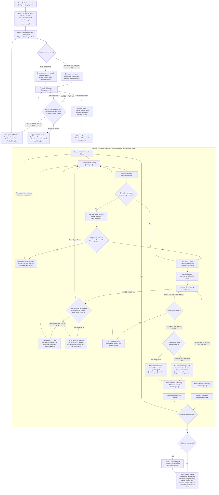

# Autonomous Agent Skill Bootstrap Specification (`<skill-name>`)

[](#)
[](#)
[](#)

A formal, generic specification and execution contract for bootstrapping production-grade, enterprise-ready autonomous agent skills from scratch. This document translates the foundational research on **Operational Personas**, **Input Gap Falsification**, and **Enterprise Verification Architectures** into an actionable, reproducible engineering methodology.

---

## Table of Contents

1. [Executive Summary & Purpose](#1-executive-summary--purpose)
2. [Universal Skill Bootstrap Prompt (`BOOTSTRAP_PROMPT`)](#2-universal-skill-bootstrap-prompt-bootstrap_prompt)
3. [User Quickstart: How to Bootstrap a Skill from Scratch](#3-user-quickstart-how-to-bootstrap-a-skill-from-scratch)
4. [The 29 Core Operational Methodologies](#4-the-29-core-operational-methodologies)
5. [Standard Skill Directory Layout](#5-standard-skill-directory-layout-skillsskill-name)
6. [Toolchain Automation Blueprint](#6-toolchain-automation-blueprint)
7. [Contract Schemas & Document Templates](#7-contract-schemas--document-templates)
8. [Tri-Model Heterogeneous Tiering Architecture](#8-tri-model-heterogeneous-tiering-architecture)
9. [End-to-End Operational Lifecycle](#9-end-to-end-operational-lifecycle)
10. [Enterprise Invariant Readiness Verification & Production Gate](#10-enterprise-invariant-readiness-verification--production-gate)
11. [Citation & Attribution](#11-citation--attribution)

---

## 1. Executive Summary & Purpose

When autonomous Large Language Model (LLM) agents are deployed without formal operational guardrails, they inherently suffer from four systemic pathologies:
1. **Single-Threaded Context Degradation**: Context windows saturate with conversational noise, causing attention drift, loss of initial constraints, and catastrophic forgetting.
2. **Persona Cosplay & Rubber-Stamping**: When prompted with loose roles (*"You are an expert engineer"*), models adopt superficial jargon while sycophantically approving critical defects, concurrency races, and security vulnerabilities.
3. **The Plausibility Trap**: Under cross-entropy loss, models fill unstated parameters and missing requirements with plausible tutorial defaults rather than actively halting for clarification.
4. **Democratic Blindness**: Consensus achieved via unweighted voting fails when two sycophantic checkers outvote a single checker identifying a catastrophic vulnerability.

This specification provides the **Universal Skill Bootstrap Contract**. Any new agent skill constructed using this bootstrap protocol is guaranteed to be:
* **Cartography-Driven**: Built upon exhaustive domain, codebase, and interface mapping prior to mutation.
* **Mathematically Validated**: Decomposed into Directed Acyclic Graphs (DAGs) verified under Bernstein Concurrency Conditions.
* **Adversarially Audited**: Governed by strict Maker $`\neq`$ Checker orthogonality, 3-agent adversarial verification panels, and Severity-Over-Majority veto authority.
* **Self-Correcting**: Equipped with active bounded verification loops ($`N \le 3`$) and on-disk negative constraint accumulation.
* **Zero-Assumption**: Structurally incapable of guessing missing parameters through rigid Input Gap Analysis (IGA) grounded in primary authoritative documentation.

---

## 2. Universal Skill Bootstrap Prompt (`BOOTSTRAP_PROMPT`)

The following verbatim specification prompt must be provided as the initial bootstrap contract to any autonomous agent, orchestration engine, or systems architect when creating a new skill from scratch. Replace `<skill-name>` with your desired skill moniker (e.g., `sqlite-migration`, `auth-engine`, `compiler-pass`).

```markdown
I need you to create a skill
Name the skill <skill-name>
The skill MUST have the following aspects:

- Skill MUST make sure skill runs in one of three autonomy modes (ask every time, only critical issues, fully autonomous), taken from the request if stated, otherwise chosen by the person as the skill's first question with no option pre-selected or recommended; the critical events are exactly: an irreversible action (one that cannot be undone), a missing fact of gap class A, B or C that cartography and sources cannot close, a work unit rejected on its third attempt, and any addition to or change of the brief (including its confirmation questions); in fully autonomous mode no question goes to a person and no irreversible action is carried out
- Skill MUST make sure that, before cartography, skill clarifies the request and rewrites it into a precise brief (goal, done criteria, out-of-scope, constraints) that is confirmed one question at a time (in fully autonomous mode, by logged, reviewed decisions), and repeats this for every mid-run human input
- Skill MUST perform thorough cartography after the initial input clarification and before any other work
- Skill MUST perform decomposition and divide work into atomic work units
- Skill MUST make sure that work units dependency graph is generated
- Skill MUST match formal methods to the kind of work in each unit at planning time (pre/post-condition contracts, property-based tests, SMT solving, model checking, and graph acyclicity plus Bernstein concurrency checks), MUST run every method the work matches, and MAY skip a required method only with a written reason that the verification panel checks.
- Skill MUST make sure skill utilizes maker != checker pattern
- Skill MUST make sure skill utilizes bounded verification and self-learning loops
- Skill MUST make sure skill has 3-agent adversarial verification panel for each maker
- Skill MUST make sure there's a written on disk formalized briefing and debriefing document for each work unit
- Skill MUST make sure to avoid any gaps in the input
- Skill MUST make sure that skill uses reputable sources for any data and/or input validation and input gap analysis
- Skill MUST make sure that skill DOES NOT fill in the blanks with assumptions, and closes every gap by evidence, by the person's answer, or (in fully autonomous mode) by a logged, reviewed decision
- Skill MUST make sure that skill DOES NOT hallucinate, goldplate, or drift
- Skill MUST make sure skill asks every question to a person through a series of Socratic dialogues with exactly one question per dialogue, the recommended option first (except the autonomy-mode question, which marks none), logged in dialogues.jsonl and checked by scripts/validate_dialogues.py
- Skill MUST make sure skill uses plain human language with all terms explained inline in every human interaction, and in critical-only mode ONLY presents human interactions when critical (the critical events of the autonomy-mode requirement)
- Skill MUST make sure skill performs a detailed internal analysis before presenting choice of or making a decision
- Skill MUST make sure that the optimum decision is presented first and marked as recommended, except in the autonomy-mode question, which marks no option as recommended
- Skill MUST make sure skill uses plain human language and explains all terms inline for any output that is intended for human consumption
- Skill MUST make sure skill uses formal language and is as concise as it can be when the input/output is intended for LLM/agent/subagent consumption
- Skill MUST make sure that all work units are executed in subagents with their independent context budget
- Skill MUST make sure that skill allows for Bounded Graph Addition
- Skill MUST make sure that in case of a major problem found by the verification panel, the severity of the problem takes precedence over majority of votes
- Skill MUST make sure that skill uses .skill_work_in_progress/<date>_<time_with_seconds>_<task-moniker> working directory for all intermediate files
- Skill MUST make sure that when skill is writing code, skill provides extensive documentation, with all parameters, pre- and post- conditions explained fully
- Skill MUST make sure that when skill is writing code, skill uses human language that implies knowledge and understanding of programming terms, and explains all terms inline
- Skill MUST make sure that skill identifies, defines, and chooses the best roles and personas for each task and DOES NOT use the same persona/role for maker/checker
- Skill MUST make sure that every persona the skill uses is a full 7-tuple <I,E,K,H,T,R,S> as defined in specs/7-tuple-persona-spec.md, stored as one JSON file per persona under resources/personas/, and validated against the persona schema resources/templates/persona.schema.json before it is used
- Skill MUST make sure that when skill is writing code, skill performs a final adversarial analysis by a panel of 3, where it makes sure that no inadvertent negative side effects take place as the result of a code change
```

---

## 3. User Quickstart: How to Bootstrap a Skill from Scratch

Any user can bootstrap a production-ready skill in a few deterministic steps:

### Option A: Autonomous Agent Invocation (Recommended)
Feed this specification directly into your autonomous agent platform (`<agent-cli>` below stands for its command-line tool):

```bash
# Invoke your agent CLI to synthesize the entire skill directory using this specification
<agent-cli> "Using the specification in specs/skill-bootstrap-spec.md, create a new skill named <skill-name>. \
Implement all 29 methodologies, the complete directory layout in skills/<skill-name>/, \
all automation scripts in scripts/, reference manuals in references/, and schemas in resources/."
```

### Option B: Scaffold & Author Step-by-Step
1. **Initialize the Skill Directory**:
   ```bash
   mkdir -p skills/<skill-name>/{scripts,references,resources/{personas,templates}}
   ```
2. **Author `SKILL.md`**: Define the operational guidelines and non-negotiable axioms.
3. **Instantiate Tooling Scripts**: Copy or adapt the automation scripts (`init_session.py`, `validate_dag.py`, `scaffold_unit.py`, `adjudicate_panel.py`).
4. **Deploy Persona Profiles**: Populate `resources/personas/` with specialized 7-tuple JSON personas.
5. **Verify Readiness**: Run the 5-Point Enterprise Invariant Readiness Scorecard audit before production cutover.

---

## 4. The 29 Core Operational Methodologies

To satisfy the 29 non-negotiable requirements of the bootstrap prompt, every generated skill must implement the following architectural methodologies.

### Methodology 1: Autonomy Modes & Fully Autonomous Behaviour
* **Principle**: The person decides how much the skill involves them. An *autonomy mode* is a run-wide setting that fixes which questions reach a person. It is set once, before any other work (here and below, only creating the session working directory, Methodology 24, comes first), and holds for the whole run (one execution of the skill on one request).
* **Open question** (term used below): any point where the skill must choose between options and neither the confirmed brief (Methodology 2), the map of the existing project (cartography, Methodology 3) nor reputable sources (Methodology 12) settle the choice. A choice those sources settle is not an open question and is put to no one. A missing value, requirement or behaviour that the confirmed brief leaves undefined is an input gap (Class A, B or C, Methodology 11), not an open question; an open question is only a choice among options that all meet the confirmed brief.
* **The three modes**:
  1. **Ask every time** (`ask-every-time`): every open question goes to the person, one question per dialogue (Methodology 15).
  2. **Only critical issues** (`critical-only`): only the critical events listed below go to the person. The skill settles every other open question itself, after the detailed internal analysis of Methodology 17, and records each such decision in the decision log `decisions.jsonl`.
  3. **Fully autonomous** (`fully-autonomous`): no question goes to a person at any point after the mode is set. Its behaviour is set out under *Fully autonomous behaviour* below.
* **Critical events** (the complete list; nothing else counts as critical):
  1. *Irreversible action*: an action whose effect the skill cannot undo afterwards, for example deleting or overwriting data that has no backup, publishing or sending something outside the session, running a database migration that drops data, rewriting shared version-control history, or spending money.
  2. *Unresolvable input gap*: a missing fact of any class, A (contract), B (environment) or C (behaviour) as defined in Input Gap Analysis (Methodology 11), that cartography and reputable primary sources cannot close.
  3. *Retry budget spent*: a work unit (one small, separately checked piece of the work) is rejected by its verification panel (three independent reviewer agents) on its third and last attempt (Methodology 8).
  4. *Brief addition or change*: every confirmation question of input clarification (Methodology 2), and any later proposal to change the confirmed brief's goal, done criteria, out-of-scope list or constraints, including dropping or weakening a constraint such as a security requirement (a *waiver*).
* **Critical events in the first two modes**: ask-every-time and critical-only modes put each critical event to the person as a one-question Socratic dialogue (Methodology 15). An irreversible action is carried out only after the person approves it in that dialogue. For a spent retry budget the options are: stop the unit and the units that depend on it (Recommended), or revise the brief through input clarification (Methodology 2); neither option starts a fourth attempt of the rejected unit (the retry limit stays 3).
* **Choosing the mode**: The request states the mode only if it names one of the three modes or an unmistakable equivalent (for example 'ask me about everything', 'only ask me about critical issues', 'run fully autonomously'), which the skill quotes verbatim; vague wording such as 'just get it done' does not count. If the request states the mode, the skill takes it from the request and records the quoted words; no mode question is then asked. Otherwise the mode question is the skill's first question, asked before input clarification and before any other work, as a one-question Socratic dialogue. It lists all three modes in the fixed order above, from most to least involvement of the person, each with a one-sentence plain explanation, worded as follows; no mode is pre-selected and none is marked recommended (the single exception to Methodology 18).
  - *Ask every time*: "The skill brings every choice it cannot settle from the brief, the project or reputable sources to the person, one question at a time."
  - *Only critical issues*: "The skill makes routine choices itself and records them, and brings to the person only actions that cannot be undone, missing facts no source can supply, a piece of work that failed its third attempt, and any addition to or change of the brief."
  - *Fully autonomous*: "The skill puts no questions at all to anyone for the whole run; it closes missing facts only by decisions that a second, independent agent reviews and that are logged (which may mean stopping some work), and it leaves every action that cannot be undone undone, listing it in the final report for a person to approve; the mode holds for the whole run."

  The mode holds for the whole run and is not changed mid-run. The mode and where it came from (the quoted request text, or the dialogue id in `dialogues.jsonl`) are written at the top of `00_intake/clarified_brief.md`.
* **Fully autonomous behaviour**:
  - No question goes to a person during the run. Each would-be question (an open question or critical event that the other modes would put to a person) is settled by a decision.
  - Before a decision is final, an independent second-opinion agent reviews it: a separate subagent that did not propose the decision, working in its own context, receives the would-be question, the options (recommended first), the evidence and the proposal, and returns agree (APPROVED) or object (REJECTED_WITH_INVARIANTS, or HALTED_INPUT_GAP when the objection is a missing fact) with reasons. If it objects and new evidence does not resolve the objection, the skill takes the option that stops the affected work and changes nothing that cannot be undone, and lists it in the final report.
  - Every decision is appended to the decision log `decisions.jsonl` in the session working directory (`.skill_work_in_progress/<YYYY-MM-DD>_<HH-MM-SS>_<task-moniker>/`, Methodology 24), one JSON record per line (JSONL), holding: decision id, time, mode, the would-be question, the options, the sources searched (file paths, URLs), the proposal, the reviewer's verdict and reasons, the final decision, and whether its effect can be undone.
  - An unresolvable input gap is closed only by such a logged, reviewed decision, and that decision cites every source searched. The decision may be to stop the work that depends on the gap; it is never a silent guess (Methodology 13).
  - Irreversible actions are never carried out in this mode. The skill prepares each one, leaves it undone, and lists it in the final report (the summary handed over when the run ends) with what it would do, why it is needed and the decision record behind it, for a person to approve after the run. Handing over the final report is not a question; approval happens outside the run.
  - Retry budget spent: the skill starts no fourth attempt; it logs a reviewed decision that stops the unit and the units that depend on it, and lists them in the final report.
  - A person may still volunteer input mid-run; it goes through input clarification (Methodology 2), confirmed by a logged, reviewed decision.

### Methodology 2: Input Clarification & Enhancement
* **Principle**: Work starts from a request the person has confirmed, not from the skill's reading of it. *Input clarification and enhancement* means turning the raw request into a precise written brief before cartography (Methodology 3, mapping the existing project and its sources) begins. It runs right after the autonomy mode is set (Methodology 1).
* **The brief** is saved as `00_intake/clarified_brief.md` in the session working directory (Methodology 24) and has four parts:
  1. *Goal*: what the work must achieve, in one or two sentences.
  2. *Done criteria*: checkable statements that are all true when the work is finished.
  3. *Out of scope*: what the work must not touch or attempt.
  4. *Constraints*: fixed limits the work must respect (for example technology, time, budget, security, compatibility).
  Each statement is tagged *quoted* (the person's own words) or *added* (the skill's rewording or addition).
* **Confirmation**: Nothing *added* is used until it is confirmed (Methodology 13). In ask-every-time and critical-only modes the person confirms each added or reworded statement one question at a time, through the one-question Socratic dialogues of Methodology 15; these confirmations are critical events (Methodology 1), so in critical-only mode they still reach the person. In fully autonomous mode each would-be confirmation question is settled by a decision that an independent second-opinion agent reviews and that is logged in `decisions.jsonl` (Methodology 1).
* **Mid-run input**: The same procedure runs every time a person gives input mid-run (after the brief is first confirmed). The skill rewrites the input into an updated `00_intake/clarified_brief.md`, keeping each earlier version in a revision history at the end of the file, confirms each changed statement the same way, and only then acts on it. Answers given inside a clarification dialogue belong to that round and do not start a new one.
* **Difference from Input Gap Analysis**: Input clarification settles *what the person wants* (the intent), before cartography. Input Gap Analysis (IGA, Methodology 11) finds *missing facts the work needs* (for example an undefined API parameter or timeout) during and after cartography, and closes them first from evidence in the project and reputable sources. A fact gap that evidence cannot close is an unresolvable input gap (a critical event, Methodology 1), not a clarification question.

### Methodology 3: Exhaustive Cartography & Reconnaissance
* **Principle**: *Cartography Before Construction*. No functional code may be authored and no state mutations may occur until the target system has been completely mapped.
* **Operational Protocol**:
  1. Traverse directory structures, module hierarchies, and package configurations.
  2. Parse Abstract Syntax Trees (ASTs) to catalog exported types, interface contracts, and call graphs.
  3. Map database schemas, migration states, and persistent invariants.
  4. Audit runtime environments, thread pools, and external service dependencies.
* **Deliverable Artifact**: Written to `.skill_work_in_progress/<session>/00_cartography/cartography_report.md`.

### Methodology 4: Atomic Work Unit (AWU) Decomposition
* **Principle**: Single Responsibility and Independent Verifiability.
* **Operational Protocol**:
  1. Break large initiatives into discrete, self-contained units (AWUs).
  2. Define rigorous Hoare-logic pre-conditions ($`\mathcal{P}`$) and post-conditions ($`\mathcal{Q}`$):

     ```math
     \lbrace \mathcal{P} \rbrace \ \mathcal{C} \ \lbrace \mathcal{Q} \rbrace
     ```

  3. Declare an explicit mathematical Modifies-Set (Frame Condition $`\mathcal{W}`$):

     ```math
     \mathcal{W} = \lbrace \text{file}_1, \text{file}_2, \dots \rbrace
     ```

     Any unauthorized write outside $`\mathcal{W}`$ triggers an immediate, unappealable Sev-1 Frame Breach Veto.

### Methodology 5: Directed Acyclic Graph (DAG) Formulation & Concurrency Algebra
* **Principle**: Acyclic execution ordering and deterministic concurrency.
* **Operational Protocol**:
  1. Define directed edges ($`u \to v`$) representing strict causal dependencies where unit $`u`$ must successfully debrief before unit $`v`$ starts.
  2. Mathematically verify graph acyclicity ($`\text{DAG}`$).
  3. Verify **Bernstein Concurrency Non-Interference** for any parallel execution candidates ($`u \parallel v`$):

     ```math
     \mathcal{R}_u \cap \mathcal{W}_v = \emptyset \quad \land \quad \mathcal{W}_u \cap \mathcal{R}_v = \emptyset \quad \land \quad \mathcal{W}_u \cap \mathcal{W}_v = \emptyset
     ```

  4. Render machine-readable manifest (`dag_manifest.json`) and visual Mermaid flowchart (`dag_graph.md`).

### Methodology 6: Formal Methods Matched to the Work
* **Principle**: Proportional rigor. A method is required exactly when the unit's work matches its row in the table below (the "When required" column is the single, authoritative definition); a required method is run, or skipped only through the written skip record of step 3. The written reason is mandatory: a required method skipped without one is never allowed, and the verification panel checks every reason.
* **Operational Protocol**:
  1. After the DAG is built and validated (item 5) and before any unit runs, the skill reads each unit's work kind and selects the methods from the table below. The unit's brief lists every required method, the property it must check, and the tool used.
  2. The Maker runs each required method and records the command and its actual output in the unit's debrief.
  3. A Maker may skip a required method only by writing a skip record: the method, the unit, the written reason, and the substitute check used instead (if any). Acceptable reasons are limited to: the work does not in fact match (with the evidence), the tool cannot run in this environment (with what was tried), or no possible result could change a decision (with the decision named).
  4. The verification panel (item 9) checks every skip record. A required method that was neither run nor skipped with a written reason, or a skip reason the panel rejects, is a Sev-2 finding and therefore blocks approval.
  5. No report may claim more than the method gives: the last column of the table is the limit of each guarantee.
* **Tool artifacts**: Tools run under this methodology write their caches and outputs (for example the Hypothesis example database `.hypothesis/`, TLC's working state files `states/`, and `__pycache__/`) into the session working directory `.skill_work_in_progress/` (Methodology 24), which the frame condition auditor (section 6) excludes, so tool artifacts are never counted as the unit's writes.

| Method | Work it fits | Example tool | When required | What it does and does not guarantee |
|---|---|---|---|---|
| Pre/post-condition contracts (Hoare triple $`\{P\}\ C\ \{Q\}`$) | Every unit and every function the skill writes or changes | Native runtime assertions in the implementation language, exercised by the property-based tests below | Always, for every unit (item 4 already requires $`P`$ and $`Q`$) | States what must hold before and after. Checking a contract at runtime detects a violation only on executions that actually happen; it is not a proof. |
| Property-based testing | Code that parses, serializes, transforms, sorts, or validates data; any function with a stated input domain and an invariant (round trip, idempotence, ordering) | Hypothesis (Python) | When the unit writes or changes such code | Generates many inputs (100 per test by default) and shrinks a failure to a minimal failing example. A passing run covers only the inputs tried; it does not prove the property for all inputs. |
| SMT solving | Arithmetic, bit-level, or logical constraints: access rules, configuration constraints, numeric bounds, and whether two rule sets can both be satisfied | Z3 (Python package `z3-solver`) | When correctness depends on such constraints | Checks satisfiability of the formulas as encoded and answers sat, unsat, or unknown. An unsatisfiable negated property is a proof only for the encoded constraints; a wrong or partial encoding proves nothing about the real code, and the solver may return no answer (unknown or timeout). |
| Model checking | Concurrency, distributed protocols, retries, locks, and state machines with interleavings | TLA+ with the TLC model checker | When the unit designs or changes such behavior | Explores the states of the configured model and checks safety and liveness properties there. The check is bounded to that finite model (the constants chosen); a pass does not prove the design for larger instances. Unbounded proof needs a proof system such as TLAPS. |
| Graph acyclicity and Bernstein concurrency checks | Every DAG manifest | `scripts/validate_dag.py` (section 6) | Always: before execution starts and after every graph amendment; Bernstein for every pair of units that may run in parallel | Decides exactly whether the declared graph has a cycle and whether $`R_u \cap W_v`$, $`W_u \cap R_v`$, and $`W_u \cap W_v`$ are empty for each parallel pair. It is only as good as the declared read and write sets; undeclared writes are caught later by the frame condition auditor, undeclared reads are not caught by either script. |

The contract form is Hoare's partial-correctness triple (written P {Q} R in Hoare 1969, with the program in braces; modern notation below):

$$
\lbrace P \rbrace \ C \ \lbrace Q \rbrace
$$

It says that if $P$ holds before $C$ runs and $C$ finishes, then $Q$ holds afterwards; it does not say that $C$ finishes.

### Methodology 7: Maker ≠ Checker Orthogonality
* **Principle**: The entity that authors an implementation is structurally prohibited from auditing or approving it.
* **Operational Protocol**:
  1. **Privilege Separation**: Maker subagents receive write access restricted to the declared modifies-set. Checker subagents are strictly read-only, except that their tools may write caches inside the excluded session working directory `.skill_work_in_progress/` (section 6), never repository files.
  2. **Isolated KV Caches**: Checkers execute in separate subagent instances with unpolluted context budgets, eliminating sycophantic confirmation bias.
  3. **Cognitive Asymmetry**: Makers operate under a constructive epistemic stance ($`\mathcal{E}_{\text{syn}}`$); Checkers operate under an adversarial falsification stance ($`\mathcal{E}_{\text{adv}}`$).

### Methodology 8: Active Bounded Self-Learning Loops (N ≤ 3)
* **Principle**: Prevent degenerative infinite retry loops while capturing negative lessons.
* **Operational Protocol**:
  1. Each AWU is allocated at most 3 attempts ($`N \in \{1, 2, 3\}`$, where $`N`$ counts the attempts made).
  2. Upon rejection by the verification panel, the adjudication engine deterministically extracts:
     - Root-cause failure mechanisms.
     - Concrete counterexamples violating invariants.
     - Negative behavioral constraints.
  3. Findings are appended to on-disk `learnings.jsonl`.
  4. Attempt $`N+1`$ (only while $`N < 3`$) re-briefs the Maker with all accumulated negative constraints injected directly into `briefing.md`.
  5. If the third attempt is also rejected (the retry budget of 3 is spent, a critical event under Methodology 1), the unit stops and the skill starts no fourth attempt: in ask-every-time and critical-only modes the skill puts the unit to the person in a one-question Socratic dialogue (Methodology 15) whose options are stop the unit and its dependents (Recommended) or revise the brief through input clarification (Methodology 2), neither of which starts a fourth attempt; in fully autonomous mode it logs a decision, reviewed by an independent second-opinion agent, in decisions.jsonl that stops the unit and its dependents, and lists them in the final report.

### Methodology 9: Mandatory 3-Agent Adversarial Verification Panel
* **Principle**: Heterogeneous, multi-perspective falsification for every single deliverable.
* **Operational Protocol**:
  Every Maker output is concurrently audited by three orthogonal Checker subagents:
  1. **Panelist 1 (Correctness & Contract Falsifier)**:
     - Validates Hoare-logic pre/post-conditions.
     - Executes Satisfiability Modulo Theories (SMT) symbolic solving (e.g., Z3) and property-based test shrinking (e.g., Hypothesis) to falsify edge cases.
  2. **Panelist 2 (Security, Invariants & Boundary Auditor)**:
     - Audits for concurrency races (TOCTOU, deadlock cycles, mutex leaks), memory safety, injection vectors, and privilege boundaries.
     - Enforces write-set containment audits.
  3. **Panelist 3 (Systemic Blast Radius Sentinel)**:
     - Cross-model architectural auditor evaluating whole-system backwards compatibility, call-site drift, and breaking contract mutations.
     - Blocks approval through the severity of its findings under Methodology 23, exactly like Panelists 1 and 2; no panelist holds a veto by identity.

### Methodology 10: On-Disk Contract Auditability
* **Principle**: Ephemeral conversational memory is untrusted; all contracts and findings must be written to disk.
* **Standard Work Unit Artifacts**:
  ```text
  units/AWU-XXX_<slug>/
  ├── briefing.json       # Structured machine-readable contract
  ├── briefing.md         # Comprehensive prompt provided to Maker
  ├── panel_verdicts.json # Structured JSON verdicts from 3 checkers
  ├── panel_verdicts.md   # Detailed human-readable falsification proofs
  ├── learnings.jsonl     # Log of failure modes and negative constraints
  └── debriefing.md       # Final output, diffs, and verification proof
  ```

### Methodology 11: Input Gap Analysis (IGA)
* **Principle**: Reject the Plausibility Trap. An agent must never hallucinate missing requirements or guess parameters.
* **3-Class Input Gap Taxonomy**:
  * **Class A (Contractual Gaps)**: Underspecified API parameters, missing schema constraints, ambiguous type definitions.
  * **Class B (Environmental Gaps)**: Unspecified concurrency thresholds, failure domains, timeout policies, memory limits.
  * **Class C (Behavioral Gaps)**: Unstated error handling requirements, fallback policies, edge-case protocols.
* **Enforcement**: If a gap is detected, execution halts with a `HALTED_INPUT_GAP` signal until grounded: first by cartography and primary sources (Methodology 12); if they cannot close it (an unresolvable input gap of any class, a critical event under Methodology 1), by the person's answer in a one-question Socratic dialogue in ask-every-time and critical-only modes, or, in fully autonomous mode, only by a logged decision reviewed by an independent second-opinion agent, the decision citing the sources searched.

### Methodology 12: Grounding in Reputable Primary Sources
* **Principle**: All external standards, protocols, and data models must be verified against authoritative primary documentation.
* **Authoritative Tiers**:
  * *Tier 1*: Official standards bodies (IETF RFCs, W3C Recommendations, IEEE/ISO standards).
  * *Tier 2*: Official vendor architectural documentation and language specifications.
  * *Tier 3*: Primary open-source implementation repositories (source code and official test suites).
* *Strict Prohibition*: Secondary blog posts, unverified forum discussions, and generic AI summaries are strictly rejected as authoritative evidence.

### Methodology 13: Zero Assumptions Rule
* **Principle**: Assumptions are treated as Sev-1 (the most severe defect level, which blocks approval; Methodology 23) system defects: not filling blanks silently is an invariant of every run, so an assumption is an invariant violation, which the Sev-1 definition covers. An *assumption* here means a blank filled silently: a value, requirement or behaviour used without evidence, without the person's answer, and (fully autonomous mode only) without a logged decision reviewed by an independent second-opinion agent, the decision citing the sources searched. A choice among options that all meet the confirmed brief (an open question, Methodology 1) is not a blank; settling it in critical-only mode with a logged decision is not an assumption.
* **Protocol**: When an input parameter, schema definition, or architectural requirement is missing:
  1. DO NOT interpolate median tutorial behavior (fill the blank with whatever typical tutorials do).
  2. Document the unverified gap explicitly in `input_gap_analysis.md`.
  3. Resolve via deterministic cartography (re-reading the project map, which gives the same answer every time) or primary source verification (checking official standards or vendor documentation, Methodology 12).
  4. If neither closes it, it is an unresolvable input gap, a critical event (Methodology 1), and execution halts with `HALTED_INPUT_GAP` (the verdict that stops work until the gap is closed; Methodology 11) until the gap is closed according to the autonomy mode:
     - ask-every-time and critical-only modes: by the person's answer in a one-question Socratic dialogue (Methodology 15);
     - fully autonomous mode: only by a decision that an independent second-opinion agent reviewed, logged in `decisions.jsonl`, citing every source searched, and listed in the final report. Such a decision is explicit, reviewed and recorded, so it is not an assumption; it may be to stop the affected work.
* Statements the skill adds during input clarification (Methodology 2) are not used until they are confirmed.

### Methodology 14: Zero Hallucination, Goldplating, or Drift
* **Principle**: Strict adherence to the declared functional envelope.
* **Protocol**:
  - Reject phantom APIs, speculative utility abstractions, or unrequested refactoring.
  - Reject cosmetic modifications of untouched sibling files.
  - Any diff outside the unit's declared scope constitutes an immediate verification rejection.

### Methodology 15: Socratic Human Dialogues, One Question per Dialogue
* **Principle**: Collaborative alignment through disciplined inquiry, one decision at a time. A *Socratic dialogue* is a short exchange in which the skill lays out the problem and the options, then asks exactly one question that lets the person reason to their own answer. A *question* here means any request for the person's input, whether phrased as a question or as an instruction (tell me, please confirm, let me know).
* **Protocol**: Every question to a person (the autonomy-mode question, input-clarification confirmations, critical events, and in ask-every-time mode every open question) is asked through a series of Socratic dialogues, exactly one question per dialogue:
  1. Present the underlying architectural dilemma or invariant tension (a conflict between two things that must always stay true).
  2. Detail the systemic tradeoffs (what each option gains and costs for the system as a whole) and potential failure modes of each alternative.
  3. Solicit architectural constraints rather than asking for code-level micro-management.
  4. Ask exactly one question, with the options in order of merit and the recommended option first, labeled `(Recommended)` (Methodology 18; the autonomy-mode question is the single exception). Steps 1-2 are statements that request nothing; step 3 is met by the step-4 question itself, which asks for an architectural constraint or choice; no other sentence requests input.
  5. Wait for the answer before opening the next dialogue. A topic that needs several answers becomes a series of dialogues, never several questions in one dialogue.
* **Dialogue log**: Before a question is shown, the skill builds its record and runs the checker on the log plus that record; only a passing record is appended and shown. The log is `dialogues.jsonl` in the session working directory (Methodology 24; JSONL means one JSON record per line), and each record holds: dialogue id, time asked, mode (the autonomy-mode record stores `unset`, because no mode exists when that question is asked), trigger (the rule that required the question; the autonomy-mode question uses trigger `autonomy-mode`), `context` (the statements of steps 1-2, exactly as shown), `question` (the single ask of step 4, exactly as shown), the options in the order shown with a recommended flag, and, once given, the answer and the time answered. A fact question with no meaningful options (for example a request for a missing value) uses the options `I will state the value` (marked recommended) and `Stop the affected work`, so recommended-first stays defined.
* **Checker**: The toolchain (the set of scripts shipped with the skill) script `scripts/validate_dialogues.py` reads `dialogues.jsonl`, plus the candidate record when one is given, and exits non-zero (fails) if any record:
  - has a `context` that contains a question mark or a request phrase from this fixed list: tell me, let me know, please confirm, please provide, please specify, please state, please choose, could you, would you;
  - has a `question` with more than one question mark, or one that joins two asks (`and which`, `and what`, `also`), so each dialogue holds exactly one question;
  - was asked before the previous dialogue was answered (two open dialogues at once);
  - has a first option not marked recommended (except the autonomy-mode question, which must have no option marked);
  - has trigger `autonomy-mode` but is not the first record, or is the second such record;
  - has mode `unset` but trigger other than `autonomy-mode` (only the first record, the mode question, may carry mode `unset`);
  - has mode `fully-autonomous` and a trigger other than `autonomy-mode` (no dialogue may be opened once fully autonomous mode is set).
* **When it runs**: The skill runs the checker on each candidate record (the stored log plus that record) BEFORE the question is shown, and appends and shows the question only on exit 0; it runs it again on the stored log before the final report. A failing candidate is rewritten (split into a series of dialogues if needed) and checked again; it is never shown. A non-zero exit on the stored log (the run before the final report) is a blocking finding, treated like a Sev-2 (Major: the second defect level, which also blocks approval) finding under Methodology 23.
* **Known limits** (residual risk): the checker sees only logged records and the candidate under check, so a question shown without a record cannot be caught mechanically, and neither can a compound question whose two asks are joined by meaning rather than by the listed words.

### Methodology 16: Critical-Only Human Interruptions with Plain Language
* **Principle**: In critical-only mode (Methodology 1), autonomous execution without user friction: the skill interrupts the person only for a critical event. In ask-every-time mode every open question reaches the person; in fully autonomous mode none does (Methodology 1).
* **Triggers for Interruption** (critical-only mode; the complete list of Methodology 1):
  - Irreversible actions (anything the skill cannot undo afterwards, such as deleting data that has no backup); the action is carried out only after the person approves it.
  - Unresolvable input gaps of any class (A contract, B environment, C behaviour; Methodology 11) that cartography and reputable sources cannot close.
  - Retry budget spent: a work unit (one separately checked piece of the work) rejected by its verification panel (the three independent reviewer agents) on its third and last attempt (Methodology 8).
  - Brief additions or changes: input-clarification confirmations (Methodology 2) and any proposal to change the confirmed brief, including waivers (dropping or weakening a constraint such as a security requirement).
* **Everything else**: the skill decides after the detailed internal analysis of Methodology 17 and records the decision in `decisions.jsonl`.
* **Language Requirement**: All human-facing dialogues must use plain, accessible language with every technical acronym and domain term explained inline.

### Methodology 17: Rigorous Internal Multi-Perspective Analysis
* **Principle**: Deliberative reasoning prior to external presentation.
* **Protocol**: Before presenting decisions, choices, or recommendations:
  - Conduct an internal multi-criteria tradeoff analysis (performance, maintainability, blast radius, security).
  - Explicitly evaluate failure modes for each viable alternative.

### Methodology 18: Optimal Choice First & Marked `(Recommended)`
* **Principle**: Cognitive ergonomics (making a choice easy for a person to understand and make) for human decision-makers.
* **Protocol**:
  - Present options in descending order of engineering merit.
  - Option 0 (the first option shown) must represent the optimal architectural path and be explicitly labeled `(Recommended)`.
  - Provide concise risk/benefit comparisons for secondary options.
* **Single exception**: the autonomy-mode question (Methodology 1). Its three options are listed in the fixed order ask every time, only critical issues, fully autonomous (most to least involvement of the person, not a ranking); none is pre-selected and none is labeled `(Recommended)`, because how much the person is involved is the person's own choice. No other question is exempt.

### Methodology 19: Plain Human Language for Human Consumers
* **Principle**: Eradicate unexplained jargon in final deliverables and reports.
* **Protocol**: Any report, debriefing summary, or prompt response intended for human reading must:
  - Define domain concepts inline (e.g., *"Directed Acyclic Graph (a workflow where steps flow strictly in one forward direction without circular loops)"*).
  - Highlight practical impacts over mathematical trivia.

### Methodology 20: Formal, Ultra-Dense Language for Agent-to-Agent Contracts
* **Principle**: Maximum token efficiency and semantic precision in machine communication.
* **Protocol**: Inter-subagent prompts, JSON contracts, and briefings must:
  - Maximize information density using mathematical and typed notation.
  - Eliminate conversational pleasantries, preamble filler, and redundant narrative summaries.
  - Enforce strict JSON schema compliance.

### Methodology 21: Dedicated Subagents with Independent Context Budgets
* **Principle**: Context window hygiene and zero cognitive contamination.
* **Protocol**:
  - Every AWU Maker and each of the 3 panel Checkers must execute in dedicated, isolated subagents.
  - Subagents start with a clean context budget containing only their specific briefing and operational persona.
  - Prevents the multi-agent failure mode where earlier debugging logs distract subsequent reasoning.

### Methodology 22: Bounded Graph Addition (BGA)
* **Principle**: Safe runtime task discovery without infinite expansion.
* **Protocol**: When execution of an AWU reveals an unforeseen prerequisite:
  1. Author a formal BGA change proposal.
  2. Maximum 3 dynamically added nodes per session.
  3. Maximum DAG depth increase $`\le 1`$.
  4. DAG must maintain strict mathematical acyclicity.
  5. Proposal must be evaluated and approved by an independent Sentinel before insertion into `dag_manifest.json`. The independent Sentinel is a checker subagent that runs in its own context with read-only access and whose persona differs from the persona of the agent that wrote the proposal (Methodologies 7 and 27); the proposer never approves its own proposal.

### Methodology 23: Severity-Over-Majority Veto Consensus
* **Principle**: Critical and major defects override democratic consensus.
* **Mathematical Definition**:
  Let $`\mathcal{A} = \{c_1, c_2, c_3\}`$ be the verdicts of the 3 panel Checkers; each verdict is `APPROVED`, `REJECTED_WITH_INVARIANTS` or `HALTED_INPUT_GAP` and carries the severities of its findings:

  ```math
  \text{Final Decision} = \begin{cases} \text{REJECTED\_WITH\_INVARIANTS}, & \exists c_i \text{ s.t. } \text{Severity}(c_i) \in \lbrace \text{Sev-1}, \text{Sev-2} \rbrace \\ \text{HALTED\_INPUT\_GAP}, & \text{otherwise, if } \exists c_i \text{ s.t. } c_i = \text{HALTED\_INPUT\_GAP} \\ \text{APPROVED}, & \sum \mathbf{1}_{\text{APPROVED}}(c_i) \ge 2 \land \forall c_i, \text{Severity}(c_i) \notin \lbrace \text{Sev-1}, \text{Sev-2} \rbrace \land \forall c_i, c_i \ne \text{HALTED\_INPUT\_GAP} \\ \text{REJECTED\_WITH\_INVARIANTS}, & \text{otherwise} \end{cases}
  ```

  The cases apply top to bottom: any single Sev-1 or Sev-2 finding blocks approval regardless of votes; a halt on an input gap (Methodology 11) is never outvoted; no Checker holds a veto by identity. An input gap reported alongside a Sev-1 or Sev-2 rejection is still closed per Methodology 11 before the next attempt.
* **Severity Definitions**:
  * **Sev-1 (Critical)**: Data loss, security breach, concurrency race, unauthorized file mutation, or invariant violation.
  * **Sev-2 (Major)**: Performance regression, contract mismatch, unhandled edge condition, or breaking interface drift.
  * **Sev-3 (Minor)**: Documentation omission, naming ambiguity, or cosmetic non-conformity.

### Methodology 24: Standardized Working Directory (`.skill_work_in_progress`)
* **Principle**: Predictable, isolated filesystem workspace.
* **Hierarchy Standard**:
  ```text
  .skill_work_in_progress/<YYYY-MM-DD>_<HH-MM-SS>_<task-moniker>/
  ├── 00_intake/
  │   └── clarified_brief.md
  ├── decisions.jsonl
  ├── dialogues.jsonl
  ├── 00_cartography/
  │   ├── cartography_report.md
  │   └── input_gap_analysis.md
  ├── 01_dag/
  │   ├── dag_manifest.json
  │   ├── dag_graph.md
  │   └── bga_proposals/
  ├── units/
  │   ├── AWU-001_<slug>/
  │   │   ├── briefing.json
  │   │   ├── briefing.md
  │   │   ├── panel_verdicts.json
  │   │   ├── panel_verdicts.md
  │   │   ├── learnings.jsonl
  │   │   └── debriefing.md
  │   └── ...
  └── 99_final_review/
      ├── adversarial_regression_audit.md
      └── session_debrief.md
  ```
* **Session-level files**: `00_intake/clarified_brief.md` (the autonomy mode and the confirmed brief, Methodologies 1 and 2), the decision log `decisions.jsonl` (Methodology 1) and the dialogue log `dialogues.jsonl` (Methodology 15) exist once per session; each work unit folder holds exactly the 6 files of Methodology 10.

### Methodology 25: Extensive Code Documentation & Contract Specifications
* **Principle**: Six-month maintainability and formal contract clarity.
* **Protocol**: All authored code must include:
  - Complete docstrings detailing functional intent and operational invariants.
  - Parameter specifications with type constraints and valid domain boundaries.
  - Explicit Hoare-logic pre-conditions (assumptions about caller state) and post-conditions (guarantees upon return).
  - Explicit exception and failure domain cataloging.

### Methodology 26: Educational, Authoritative Programming Terminology with Inline Explanations
* **Principle**: Code comments that educate while demonstrating deep systems understanding.
* **Protocol**: Inline code comments must explain *why* non-obvious patterns are chosen (e.g., explaining memory barriers, monotonic clock sources, or reentrancy locks) using clear, authoritative technical language accompanied by inline explanations.

### Methodology 27: Dynamic Persona Selection & Anti-Cosplay Gating
* **Principle**: Task-specialized personas governed by the formal 7-tuple model defined in [specs/7-tuple-persona-spec.md](7-tuple-persona-spec.md):

$$
\mathcal{P} = \langle \mathcal{I}, \mathcal{E}, \mathcal{K}, \mathcal{H}, \mathcal{T}, \mathcal{R}, \mathcal{S} \rangle
$$

* **Protocol**:
  - Dynamically allocate distinct expert personas for each task (e.g., `DistributedSystemsArchitect`, `DatabasePerformanceAuditor`, `CryptographicSecurityReviewer`).
  - Maker persona and Checker personas must never share the same identity or role definition.
  - Before execution, every selected persona is checked for 7-tuple completeness: its file in `resources/personas/` validates against `resources/templates/persona.schema.json` (item 28).
  - Before execution, every work unit is checked for maker/checker distinctness: the maker's `persona_id` differs from every checker's `persona_id`, the maker's file has `role` = `maker`, and every checker's file has `role` = `checker`.
  - A persona that fails either check is not used; the skill fixes its file or selects another persona before the work unit starts.

### Methodology 28: 7-Tuple Persona Contracts (JSON + Schema)
* **Principle**: A persona is an operational contract, not a nominal prompt. Every persona is the closed 7-tuple defined in [specs/7-tuple-persona-spec.md](7-tuple-persona-spec.md):

$$
\mathcal{P} = \langle \mathcal{I}, \mathcal{E}, \mathcal{K}, \mathcal{H}, \mathcal{T}, \mathcal{R}, \mathcal{S} \rangle
$$

* **Storage**: One JSON file per persona at `resources/personas/<persona_id>.json`. The file name equals the file's `persona_id` field. A persona defined only in prose is not a persona. Persona definitions are part of the skill package (`resources/personas/`), while the per-run artifacts that use them live in the session working directory `.skill_work_in_progress/` (Methodology 24).
* **Element mapping** (JSON keys of the persona schema `resources/templates/persona.schema.json`, §7):

| Element | JSON key | Required content |
|---|---|---|
| Identity & scope boundary | `I` | `domain`, `anti_scope` (at least one entry), `epistemic_humility_rule` |
| Epistemic stance | `E` | `stance` (`E_adv` adversarial or `E_syn` constructive), `affirmative_bias_suppression`, `asymmetric_verification` |
| Non-negotiable invariants | `K` | `K_det` (deterministic invariants, each with the `check` that verifies it) and `K_neural` (semantic invariants); at least one of each |
| Attack heuristics | `H` | `falsification_probes` (at least one), `stress_test_vectors` |
| Permitted tool matrix | `T` | `tools` (each with `name` and `access` = `read`, `write` or `execute`), `invocation` = `out-of-band` |
| Strict output schema | `R` | `format`, `output_schema` (path of the schema the persona's output validates against), `verdict_enum` = `APPROVED`, `REJECTED_WITH_INVARIANTS`, `HALTED_INPUT_GAP`, `required_fields` = `verdict`, `invariant_violations`, `input_gaps` |
| Severity scoring | `S` | `scale` = `Sev-1`, `Sev-2`, `Sev-3`; `blocking` = `Sev-1`, `Sev-2`; `invariant_violation` = `Sev-1`; one `definitions` entry per level |

* **Validation gate**: Before a persona is assigned to any role in a run, the skill validates its JSON file against `resources/templates/persona.schema.json` with a deterministic JSON Schema (draft 2020-12) validator. A file that fails validation is not used until it validates.
* **Severity and verdicts**: `S` uses only Sev-1 (Critical), Sev-2 (Major) and Sev-3 (Minor); any single Sev-1 or Sev-2 finding blocks approval regardless of votes (item 23). A violated invariant in `K` is a Sev-1 finding. `R` uses only the verdicts `APPROVED`, `REJECTED_WITH_INVARIANTS` and `HALTED_INPUT_GAP`.
* **Maker/checker separation**: Only checker verdicts count toward approval. A maker persona never approves its own work (item 7), and a persona file is used only in the `role` it declares. Every checker persona has `E.stance` = `E_adv` and no tool with `access` = `write` (checkers are strictly read-only, item 7).

### Methodology 29: Final 3-Agent Adversarial Regression & Side-Effect Panel
* **Principle**: Zero negative global side effects.
* **Protocol**: Before any initiative in which the skill writes code is finalized, a holistic 3-agent adversarial panel evaluates the cumulative repository diff:
  1. **Panelist A (Systemic Blast Radius Sentinel)**: Verifies untouched subsystems remain completely pristine, and caller contracts maintain 100% backward compatibility.
  2. **Panelist B (Performance & Concurrency Sentinel)**: Audits for latent resource leaks, contention bottlenecks, file descriptor exhaustion, or latency spikes.
  3. **Panelist C (Architectural Integrity Sentinel)**: Audits interface consistency, naming uniformity, and structural modularity.
* **Adjudication**: The final decision is the severity-over-majority rule of Methodology 23 applied to the verdicts of Panelists A, B and C: any single Sev-1 or Sev-2 finding gives `REJECTED_WITH_INVARIANTS` regardless of votes; otherwise any `HALTED_INPUT_GAP` verdict halts on that input gap (Methodology 11) and is never outvoted; otherwise at least 2 `APPROVED` verdicts give `APPROVED`; anything else is `REJECTED_WITH_INVARIANTS`. The three panelists are checkers that did not write the diff they judge (Methodology 7).
* **Deliverable Artifact**: Written to `99_final_review/adversarial_regression_audit.md`.

---

## 5. Standard Skill Directory Layout (`skills/<skill-name>/`)

When bootstrapping a skill named `<skill-name>`, the resulting skill package must be organized under the following standard directory tree:

```text
skills/<skill-name>/
├── SKILL.md                          # Primary skill definition and operational instructions
├── scripts/                          # Automated tooling and verification scripts
│   ├── init_session.py / .sh         # Initializes .skill_work_in_progress workspace hierarchy
│   ├── validate_dag.py / .sh         # DAG validator (acyclicity & Bernstein conditions)
│   ├── validate_dialogues.py         # One-question Socratic dialogue log checker
│   ├── scaffold_unit.py / .sh        # Instantiates 6 mandatory AWU on-disk files
│   ├── frame_condition_auditor.py    # Enforces write-set containment audits
│   ├── smt_contract_verifier.py      # Multi-engine contract falsification (Z3 / Hypothesis)
│   ├── adjudicate_panel.py / .sh     # Severity-over-majority adjudication engine
│   └── <skill-name>.py / .sh         # Unified CLI entry point for the skill
├── references/                       # In-depth architectural and protocol manuals
│   ├── cartography_protocol.md       # Reconnaissance checklists & IGA methods
│   ├── formal_methods_protocol.md    # Bernstein algebra, SMT solving, Hoare contracts
│   ├── maker_checker_matrix.md       # Orthogonal persona allocation rules
│   ├── adversarial_panel.md          # 3-agent panel composition & veto protocols
│   ├── bounded_verification.md       # Learning loops & negative constraint extraction
│   └── code_quality_standard.md      # Documentation & pre/post-condition spec
└── resources/                        # Schemas, templates, and persona definitions
    ├── personas/                     # Specialized 7-tuple operational personas
    │   ├── PrincipalSystemsMaker.json
    │   ├── CorrectnessContractFalsifier.json
    │   ├── SecurityInvariantsBoundaryAuditor.json
    │   └── SystemicBlastRadiusSentinel.json
    └── templates/                    # On-disk contract templates
        ├── dag_manifest.schema.json  # Schema for DAG manifests
        ├── panel_verdict.schema.json # Schema for structured checker verdicts
        ├── persona.schema.json       # Schema for 7-tuple persona files
        ├── briefing_template.md      # Template for AWU briefing contracts
        └── debriefing_template.md    # Template for AWU debriefing proofs
```

---

## 6. Toolchain Automation Blueprint

Every skill must include automated Python/Bash scripts in `scripts/` to enforce operational invariants deterministically.

### 1. Session Initializer (`scripts/init_session.py`)
Creates timestamped directory structure adhering to Methodology 24:
```python
#!/usr/bin/env python3
"""Session Initializer: Creates .skill_work_in_progress directory hierarchy."""
import os, datetime

# Session-level files (Methodology 24): clarified brief (Methodologies 1-2),
# decision log (Methodology 1) and dialogue log (Methodology 15).
SESSION_FILES = ["00_intake/clarified_brief.md", "decisions.jsonl", "dialogues.jsonl"]

def init_session(task_moniker: str, base_dir: str = ".") -> str:
    now = datetime.datetime.now().strftime("%Y-%m-%d_%H-%M-%S")
    session_dir = os.path.join(base_dir, ".skill_work_in_progress", f"{now}_{task_moniker}")
    for subdir in ["00_intake", "00_cartography", "01_dag/bga_proposals", "units", "99_final_review"]:
        os.makedirs(os.path.join(session_dir, subdir), exist_ok=True)
    for name in SESSION_FILES:
        open(os.path.join(session_dir, name), "a").close()  # create empty; never truncate
    return session_dir
```

### 2. DAG Validator (`scripts/validate_dag.py`)
Validates acyclicity via topological sorting and computes Bernstein Concurrency Non-Interference:
```python
#!/usr/bin/env python3
"""DAG Validator: checks acyclicity (Kahn) and Bernstein's three conditions."""
import json, sys
from collections import deque
from itertools import combinations
from pathlib import PurePosixPath


def _overlap(a: str, b: str) -> bool:
    """Two declared paths overlap if they are equal or one is a directory containing the other."""
    pa, pb = PurePosixPath(a), PurePosixPath(b)
    return pa == pb or pa in pb.parents or pb in pa.parents


def _meet(xs, ys) -> list:
    return sorted({f"{x} ~ {y}" for x in xs for y in ys if _overlap(x, y)})


def validate_dag(manifest_path: str) -> list:
    """Return every violation found; an empty list means the manifest is valid."""
    try:
        with open(manifest_path) as f:
            data = json.load(f)
    except (OSError, ValueError) as exc:
        return [f"cannot read manifest as JSON: {exc}"]
    raw_nodes = data.get("nodes") if isinstance(data, dict) else None
    if not isinstance(raw_nodes, list):
        return ["manifest must contain a 'nodes' list"]
    errors, nodes, sets = [], {}, {}
    for node in raw_nodes:
        if not isinstance(node, dict) or not isinstance(node.get("id"), str):
            errors.append(f"every node needs a string 'id': {node!r}")
            continue
        if node["id"] in nodes:
            errors.append(f"duplicate unit id {node['id']}")
        nodes[node["id"]] = node
        frame = node.get("frame_conditions")
        frame = frame if isinstance(frame, dict) else {}
        for key in ("reads", "modifies"):
            value = frame.get(key)
            if not isinstance(value, list) or not all(isinstance(x, str) for x in value):
                errors.append(f"{node['id']}: frame_conditions.{key} must be a list of path strings")
        sets[node["id"]] = tuple([x for x in frame.get(k) or [] if isinstance(x, str)]
                                 if isinstance(frame.get(k), list) else [] for k in ("reads", "modifies"))
    deps = {}
    for u, node in nodes.items():
        deps[u] = []
        raw_deps = node.get("dependencies", [])
        if not isinstance(raw_deps, list):
            errors.append(f"{u}: dependencies must be a list")
            raw_deps = []
        for d in raw_deps:
            if isinstance(d, str) and d in nodes:
                deps[u].append(d)
            else:
                errors.append(f"{u} depends on unknown unit {d}")

    # 1. Acyclicity: Kahn's algorithm removes units whose in-degree is 0.
    in_degree = {u: len(ds) for u, ds in deps.items()}
    children = {u: [] for u in nodes}
    for u, ds in deps.items():
        for d in ds:
            children[d].append(u)
    queue = deque(sorted(u for u, k in in_degree.items() if k == 0))
    order = []
    while queue:
        u = queue.popleft()
        order.append(u)
        for c in children[u]:
            in_degree[c] -= 1
            if in_degree[c] == 0:
                queue.append(c)
    if len(order) < len(nodes):
        done = set(order)
        errors.append(f"cycle: units on or downstream of a cycle {sorted(u for u in nodes if u not in done)}")
        return errors  # no topological order, so parallelism is undefined

    # 2. Units u and v may run in parallel iff neither is an ancestor of the other.
    ancestors = {}
    for u in order:
        ancestors[u] = set(deps[u]).union(*(ancestors[d] for d in deps[u]))

    # 3. Bernstein: R(u)∩W(v) = ∅, W(u)∩R(v) = ∅, W(u)∩W(v) = ∅ for every parallel pair.
    for u, v in combinations(order, 2):
        if u in ancestors[v] or v in ancestors[u]:
            continue
        (read_u, write_u), (read_v, write_v) = sets[u], sets[v]
        for name, hits in (("R(u)∩W(v)", _meet(read_u, write_v)),
                           ("W(u)∩R(v)", _meet(write_u, read_v)),
                           ("W(u)∩W(v)", _meet(write_u, write_v))):
            if hits:
                errors.append(f"Bernstein {name} not empty for parallel units {u}, {v}: {hits}")
    return errors


if __name__ == "__main__":
    problems = validate_dag(sys.argv[1])
    print(json.dumps({"valid": not problems, "violations": problems}, indent=2, ensure_ascii=False))
    sys.exit(1 if problems else 0)
```

### 3. Work Unit Scaffolder (`scripts/scaffold_unit.py`)
Instantiates the 6 mandatory contract files (`briefing.json`, `briefing.md`, `panel_verdicts.json`, `panel_verdicts.md`, `learnings.jsonl`, `debriefing.md`) for any given AWU ID.

### 4. Frame Condition Auditor (`scripts/frame_condition_auditor.py`)
Takes a snapshot of the unit's working copy (each file path mapped to a SHA-256 hash of its content, excluding `.git/` and the session directory `.skill_work_in_progress/`) when the unit's Maker starts, and a second snapshot when the Maker finishes. It compares the unit's own before and after snapshots, not repo-wide `git status --porcelain`, so changes made before the unit started, or by other units, are never charged to it. Every path that was added, deleted, or changed between the two snapshots and is not covered by the unit's `frame_conditions.modifies` triggers an automatic **Sev-1 Frame Breach Veto**. Units that run in parallel each run in their own isolated working copy (for example, a separate git worktree), so one unit's writes never appear in another unit's snapshots; if the environment cannot give each parallel unit its own working copy, those units run one after another instead. Each parallel working copy starts from the tree that already contains every approved change of the unit's predecessors, and after the parallel batch of units completes the approved changes of its units are applied back to the main tree; they cannot conflict, because `scripts/validate_dag.py` has already shown that the write sets of parallel units are disjoint. Tools run under Methodology 6 write their caches and outputs (for example the Hypothesis example database, TLC's working state files, and `__pycache__`) into the session directory, which both snapshots exclude, so tool artifacts are never counted as the unit's writes. An isolated working copy has no session directory of its own: its units write their unit folder and tool caches to the one session directory `.skill_work_in_progress/` in the main tree, by absolute path. Checker tools may write only caches inside that excluded session directory, never repository files, so checkers stay read-only on the repository (Methodology 7).

### 5. Panel Adjudication Engine (`scripts/adjudicate_panel.py`)
Parses `panel_verdicts.json`. If ANY reviewer flags a `Sev-1` or `Sev-2` defect, status is forced to `REJECTED_WITH_INVARIANTS`, extracting failure modes into `learnings.jsonl`. Otherwise, if ANY reviewer returns `HALTED_INPUT_GAP`, status is forced to `HALTED_INPUT_GAP` (a halt is never outvoted) and the unit waits until the gap is closed under Methodology 11. Otherwise the cases of Methodology 23 apply: `APPROVED` with at least 2 approvals, else `REJECTED_WITH_INVARIANTS`.

### 6. Dialogue Checker (`scripts/validate_dialogues.py`)
Enforces the one-question rule of Methodology 15. It reads the dialogue log `dialogues.jsonl` in the session directory, plus the candidate record when one is given, and exits non-zero if any record has a question mark or a listed request phrase in its `context`, more than one question in its `question`, was asked while another dialogue was still unanswered, has a first option not marked recommended (except the autonomy-mode question, which marks none), has trigger `autonomy-mode` but is not the first record, or was opened in fully autonomous mode for any other trigger. The skill runs it on each candidate record before the question is shown (only a passing record is appended and shown) and on the stored log before the final report; a failure there is a blocking Sev-2 finding (Methodology 23). The full rule list is in Methodology 15.

---

## 7. Contract Schemas & Document Templates

### 1. Panel Verdict Schema (`resources/templates/panel_verdict.schema.json`)
```json
{
  "$schema": "https://json-schema.org/draft/2020-12/schema",
  "title": "AdversarialPanelVerdict",
  "type": "object",
  "properties": {
    "unit_id": { "type": "string" },
    "checker_persona": { "type": "string" },
    "verdict": { "type": "string", "enum": ["APPROVED", "REJECTED_WITH_INVARIANTS", "HALTED_INPUT_GAP"] },
    "max_severity": { "type": "string", "enum": ["Sev-1", "Sev-2", "Sev-3", "NONE"] },
    "invariant_violations": {
      "type": "array",
      "items": {
        "type": "object",
        "properties": {
          "severity": { "type": "string", "enum": ["Sev-1", "Sev-2", "Sev-3"] },
          "invariant_id": { "type": "string" },
          "description": { "type": "string" },
          "counterexample": { "type": "string" },
          "suggested_negative_constraint": { "type": "string" }
        },
        "required": ["severity", "invariant_id", "description", "counterexample"]
      }
    },
    "input_gaps": {
      "type": "array",
      "items": {
        "type": "object",
        "properties": {
          "gap_id": { "type": "string" },
          "description": { "type": "string" },
          "sources_searched": { "type": "array", "items": { "type": "string" } }
        },
        "required": ["gap_id", "description"]
      }
    }
  },
  "required": ["unit_id", "checker_persona", "verdict", "max_severity", "invariant_violations", "input_gaps"]
}
```

### 2. DAG Manifest Schema (`resources/templates/dag_manifest.schema.json`)
Specifies work unit nodes, dependency prerequisites (`dependencies`), declared read sets (`frame_conditions.reads`), declared write sets (`frame_conditions.modifies`), assigned Maker personas, and Checker personas. Both `frame_conditions.reads` and `frame_conditions.modifies` are required arrays of repository-relative paths; an empty array means the unit reads (or writes) no repository file, and a directory path covers every file below it. `scripts/validate_dag.py` uses these sets to check all three Bernstein conditions for every pair of units that may run in parallel.

### 3. Persona Schema (`resources/templates/persona.schema.json`)
Every persona file `resources/personas/<persona_id>.json` (Methodology 28) must validate against this schema, which encodes the 7-tuple $P = \langle I, E, K, H, T, R, S \rangle$ of `specs/7-tuple-persona-spec.md`:
```json
{
  "$schema": "https://json-schema.org/draft/2020-12/schema",
  "title": "OperationalPersona",
  "description": "One operational persona P = <I,E,K,H,T,R,S> as defined in specs/7-tuple-persona-spec.md, stored as resources/personas/<persona_id>.json.",
  "type": "object",
  "additionalProperties": false,
  "required": ["persona_id", "role", "I", "E", "K", "H", "T", "R", "S"],
  "properties": {
    "persona_id": { "type": "string", "pattern": "^[A-Z][A-Za-z0-9]*$", "description": "Equals the file name without .json." },
    "name": { "type": "string", "minLength": 1 },
    "role": { "type": "string", "enum": ["maker", "checker"] },
    "I": {
      "type": "object",
      "additionalProperties": false,
      "required": ["domain", "anti_scope", "epistemic_humility_rule"],
      "properties": {
        "domain": { "type": "string", "minLength": 1 },
        "anti_scope": { "type": "array", "minItems": 1, "items": { "type": "string", "minLength": 1 } },
        "epistemic_humility_rule": { "type": "string", "minLength": 1 }
      }
    },
    "E": {
      "type": "object",
      "additionalProperties": false,
      "required": ["stance", "affirmative_bias_suppression", "asymmetric_verification"],
      "properties": {
        "stance": { "type": "string", "enum": ["E_adv", "E_syn"] },
        "affirmative_bias_suppression": { "type": "string", "minLength": 1 },
        "asymmetric_verification": { "type": "string", "minLength": 1 }
      }
    },
    "K": {
      "type": "object",
      "additionalProperties": false,
      "required": ["K_det", "K_neural"],
      "properties": {
        "K_det": {
          "type": "array",
          "minItems": 1,
          "items": {
            "type": "object",
            "additionalProperties": false,
            "required": ["id", "rule", "check"],
            "properties": {
              "id": { "type": "string", "pattern": "^KD[0-9]+$" },
              "rule": { "type": "string", "minLength": 1 },
              "check": { "type": "string", "minLength": 1 }
            }
          }
        },
        "K_neural": {
          "type": "array",
          "minItems": 1,
          "items": {
            "type": "object",
            "additionalProperties": false,
            "required": ["id", "rule"],
            "properties": {
              "id": { "type": "string", "pattern": "^KN[0-9]+$" },
              "rule": { "type": "string", "minLength": 1 }
            }
          }
        }
      }
    },
    "H": {
      "type": "object",
      "additionalProperties": false,
      "required": ["falsification_probes", "stress_test_vectors"],
      "properties": {
        "falsification_probes": { "type": "array", "minItems": 1, "items": { "type": "string", "minLength": 1 } },
        "stress_test_vectors": { "type": "array", "items": { "type": "string", "minLength": 1 } }
      }
    },
    "T": {
      "type": "object",
      "additionalProperties": false,
      "required": ["tools", "invocation"],
      "properties": {
        "tools": {
          "type": "array",
          "minItems": 1,
          "items": {
            "type": "object",
            "additionalProperties": false,
            "required": ["name", "access"],
            "properties": {
              "name": { "type": "string", "minLength": 1 },
              "access": { "type": "string", "enum": ["read", "write", "execute"] },
              "scope": { "type": "string", "minLength": 1 }
            }
          }
        },
        "invocation": { "type": "string", "enum": ["out-of-band"] }
      }
    },
    "R": {
      "type": "object",
      "additionalProperties": false,
      "required": ["format", "output_schema", "verdict_enum", "required_fields"],
      "properties": {
        "format": { "type": "string", "enum": ["json", "xml"] },
        "output_schema": { "type": "string", "minLength": 1 },
        "verdict_enum": { "type": "array", "items": { "type": "string", "enum": ["APPROVED", "REJECTED_WITH_INVARIANTS", "HALTED_INPUT_GAP"] }, "minItems": 3, "maxItems": 3, "uniqueItems": true },
        "required_fields": { "type": "array", "items": { "type": "string", "enum": ["verdict", "invariant_violations", "input_gaps"] }, "minItems": 3, "maxItems": 3, "uniqueItems": true }
      }
    },
    "S": {
      "type": "object",
      "additionalProperties": false,
      "required": ["scale", "blocking", "invariant_violation", "definitions"],
      "properties": {
        "scale": { "type": "array", "items": { "type": "string", "enum": ["Sev-1", "Sev-2", "Sev-3"] }, "minItems": 3, "maxItems": 3, "uniqueItems": true },
        "blocking": { "type": "array", "items": { "type": "string", "enum": ["Sev-1", "Sev-2"] }, "minItems": 2, "maxItems": 2, "uniqueItems": true },
        "invariant_violation": { "type": "string", "enum": ["Sev-1"] },
        "definitions": {
          "type": "object",
          "additionalProperties": false,
          "required": ["Sev-1", "Sev-2", "Sev-3"],
          "properties": {
            "Sev-1": { "type": "string", "minLength": 1 },
            "Sev-2": { "type": "string", "minLength": 1 },
            "Sev-3": { "type": "string", "minLength": 1 }
          }
        }
      }
    }
  }
}
```

---

## 8. Tri-Model Heterogeneous Tiering Architecture

To eradicate cognitive monoculture and eliminate model-family blind spots, every bootstrapped skill divides operational roles across three orthogonal model tiers:

```text
┌────────────────────────────────────────────────────────────────────────┐
│                   Tri-Model Heterogeneous Tiering                      │
├────────────────────────────────────────────────────────────────────────┤
│  Tier 1: Synthesis / Maker Subagents                                   │
│  Model: High-throughput code synthesis (e.g., Gemini 3.8 Flash High)   │
│  Function: Implements logic and authors code within declared frame     │
├────────────────────────────────────────────────────────────────────────┤
│  Tier 2: Deep Reasoning Algorithmic & Security Checkers                │
│  Model: Deep analytical reasoning (e.g., Gemini Pro Deep Think)        │
│  Function: SMT falsification, boundary exploits, concurrency races     │
├────────────────────────────────────────────────────────────────────────┤
│  Tier 3: Macro-Reasoning & Architectural Sentinel                      │
│  Model: Top-tier architectural reasoning (e.g., Claude Opus 5.5 xhigh) │
│  Function: Multi-file blast radius, backwards compatibility, severity  │
│  veto (Sev-1/Sev-2 blocks, as for every checker; Methodology 23)       │
└────────────────────────────────────────────────────────────────────────┘
```

---

## 9. End-to-End Operational Lifecycle

The execution lifecycle of a skill constructed via this bootstrap specification flows through the following nine phases (Phase 0 to Phase 8) in order; Phase 7 runs only when the run changed code (Methodology 29). Every point where a person would be asked branches on the active autonomy mode (Methodology 1): in ask-every-time and critical-only modes the question goes to the person in a one-question Socratic dialogue (Methodology 15); in fully autonomous mode no question goes to a person, and the skill instead logs a decision in `decisions.jsonl` after an independent second-opinion agent reviews it. Every work unit ends with a written debriefing, including a unit that stops.



---

## 10. Enterprise Invariant Readiness Verification & Production Gate

Before any newly constructed skill is certified for production deployment, it must pass the following 5-point invariant gate:

| Point | Invariant Gate | Production Standard | Enforcement Mechanism |
| :---: | :--- | :--- | :--- |
| **1** | **Structural Envelope Protocol** | Control and data planes strictly isolated via distinct delimiters (`<system_persona>` vs `<untrusted_artifact>`) | Delimiter fencing and AST sanitization |
| **2** | **Maker vs. Checker Orthogonality** | Authoring subagents and auditing subagents maintain isolated KV caches and distinct system personas | Decoupled subagent execution harnesses |
| **3** | **Active Input Gap Detection** | Skill halts on missing specifications; zero assumptions or tutorial defaults; a gap evidence cannot close is closed only by the person's one-question answer (ask-every-time, critical-only) or by a logged, second-opinion-reviewed decision citing the sources searched (fully autonomous) | Blocking `HALTED_INPUT_GAP` schema response; every closure recorded in `dialogues.jsonl` or `decisions.jsonl` |
| **4** | **Runtime CFG Logit Clamping** | Verdict schemas enforced via grammar constraints ($`z_v = -\infty`$) rather than soft attention guidance | External JSON-schema constrained decoders |
| **5** | **Severity-Over-Majority Veto** | A single verified Sev-1 or Sev-2 defect unconditionally halts approval | Multi-agent veto adjudication engine |

```text
All 5 Invariants Satisfied:  [PASS] -> Authorize Skill Production Cutover
Any Single Invariant Failed: [FAIL] -> Skill Halted (Zero Deployment)
```

---

## 11. Citation & Attribution

To cite this specification or the underlying operational architecture:

```bibtex
@misc{wtp128pro2026skill_bootstrap,
  author    = {wtp128pro},
  title     = {Autonomous Agent Skill Bootstrap Specification: Universal Architecture for Adversarial Multi-Agent Systems},
  howpublished = {GitHub repository, LLM Systems \& Foundations Research},
  year      = {2026},
  url       = {https://github.com/wtp128pro/llm-research}
}
```
